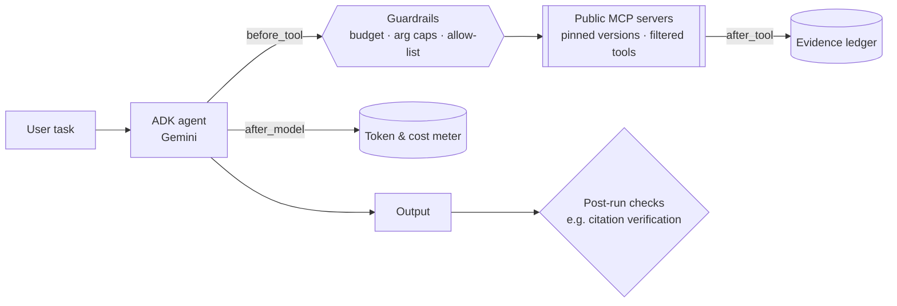
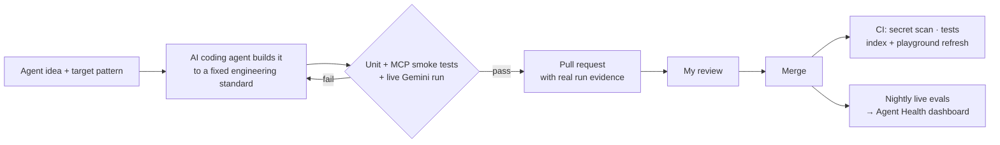

# 🤖 Agent a Day

One production-minded AI agent, built and published every day.

[](https://tallaprs15.github.io/agent-a-day/) [](https://github.com/tallaprs15/agent-a-day/actions/workflows/ci.yml)

Every agent is built with **[Google ADK](https://google.github.io/adk-docs/)** on **Gemini**, and gets its tools from **public, free MCP servers**. No custom MCP servers: the point is composing what already exists, well. Each agent folder has an engineering README covering architecture, tool selection, guardrails, cost per run, failure modes and tests.

<!-- index:start -->
**Agents built so far: 8**

| Day | Agent | What it does | Pattern | MCP servers |
|---:|---|---|---|---|
| 001 | [arXiv Scout](day-001-arxiv-scout/) | Researches a topic on arXiv and writes a cited engineering brief; rejects hallucinated citations. | Single agent + guardrail callbacks | `arxiv-mcp-server` · `mcp-server-fetch` |
| 002 | [Repo Onboarder](day-002-repo-onboarder/) | Onboarding guide for any public GitHub repo, built by a map, research, write pipeline over DeepWiki. | Sequential pipeline (SequentialAgent) | `DeepWiki MCP` · `mcp-server-fetch` |
| 003 | [Docs Copilot](day-003-docs-copilot/) | Answers library API questions from live docs; rejects unverified sources and API calls missing from the docs. | Grounded QA + answer verification | `Context7` · `Microsoft Learn MCP` |
| 004 | [Web QA Explorer](day-004-web-qa-explorer/) | Explores a web app in a real browser and files a bug report; risky clicks wait for human approval. | Browser agent + human confirmation (require_confirmation) | `Playwright MCP` |
| 005 | [HN Digest](day-005-hn-digest/) | Daily Hacker News digest that remembers covered stories in a knowledge graph and never repeats one. | Long-term memory via knowledge graph | `mcp-server-fetch` · `server-memory` |
| 006 | [Meeting Planner](day-006-meeting-planner/) | Finds meeting slots across time zones and returns a typed plan whose conversions are re-verified. | Structured output (Pydantic output_schema) | `mcp-server-time` |
| 007 | [Security Triager](day-007-security-triager/) | Runs Semgrep over a git repo via MCP and triages every finding by exploitability; verdicts are checked against the scan. | Deterministic tool + LLM triage | `semgrep` · `mcp-server-git` |
| 008 | [AWS Architect](day-008-aws-architect/) | Reviews an AWS architecture on cost, security and reliability in parallel, citing the AWS docs it actually read. | Parallel fan-out (ParallelAgent) + merge | `awslabs.aws-documentation-mcp-server` |
<!-- index:end -->

## Engineering standards (every agent)



| Standard | How |
|---|---|
| **Least privilege** | MCP `tool_filter` exposes only the tools the agent needs |
| **Reproducible** | MCP server versions pinned; `uv` lockfile per agent |
| **Bounded** | Tool-call budget and argument caps enforced in `before_tool_callback` |
| **Observable** | Token, latency and cost meter per run |
| **Verifiable** | Output checked against tool evidence, not trusted blindly |
| **Tested** | Unit tests · MCP smoke tests against the real servers · live end-to-end test |
| **No secrets in git** | `.env` is git-ignored, `.env.example` provided, gitleaks runs in CI |

## How this gets built

Shipping a well-tested agent every day is itself an engineering problem. Each agent goes through an AI-assisted pipeline I designed, built with [Claude Code](https://claude.com/claude-code), and I review every one before it merges:



The standard is the same for every agent: least-privilege MCP tools, pinned server versions, guardrail callbacks, a cost meter, a post-run verification check, tests at three levels, real sample output, and an engineering README.

## Agent health

**[Live dashboard →](https://tallaprs15.github.io/agent-a-day/)**

Every night a GitHub Action runs each agent **live** against a fixed task from its `meta.json`, using the agent's own CLI with `--metrics`. It records pass/fail, latency, tool calls, tokens and each agent's post-run checks (e.g. citations verified). Results build up on the `gh-pages` branch, so a regression from an MCP server update or a model change shows up the next morning. Code: [`scripts/run_evals.py`](scripts/run_evals.py) · [`.github/workflows/evals.yml`](.github/workflows/evals.yml) · [`dashboard/`](dashboard/).

## Playground: every agent in one UI

```bash
cp day-001-arxiv-scout/.env.example .env      # repo-root .env with your GOOGLE_API_KEY
cd playground && uv sync && uv run adk web .
```

ADK's dev UI then lists every agent (`day001_arxiv_scout`, `day002_…`) in one dropdown, with each tool call, its arguments and results, and token usage. [`scripts/sync_playground.py`](scripts/sync_playground.py) regenerates the wrappers and merged dependencies, and CI runs it after every merge.

## Run any agent

```bash
cd day-001-arxiv-scout
cp .env.example .env          # add your own GOOGLE_API_KEY (Gemini)
uv sync
uv run python -m arxiv_scout "speculative decoding"
uv run adk web                # or chat with it in ADK's dev UI
```

Requires [uv](https://docs.astral.sh/uv/). Some agents also need Node.js for `npx`-launched MCP servers; each README says so.

---

Built by [Srikant Tallapragada](https://github.com/tallaprs15) · [LinkedIn](https://www.linkedin.com/in/stallapragada/)
