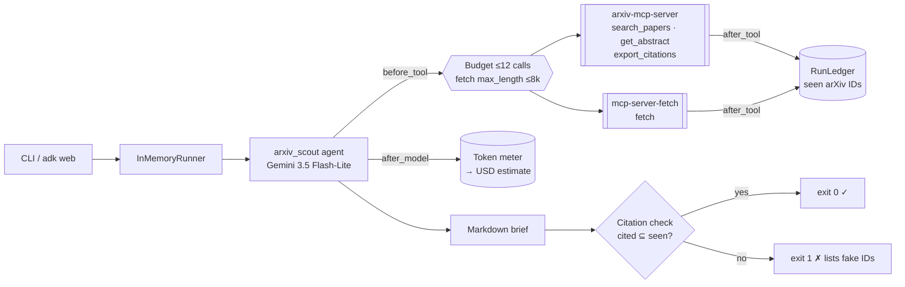
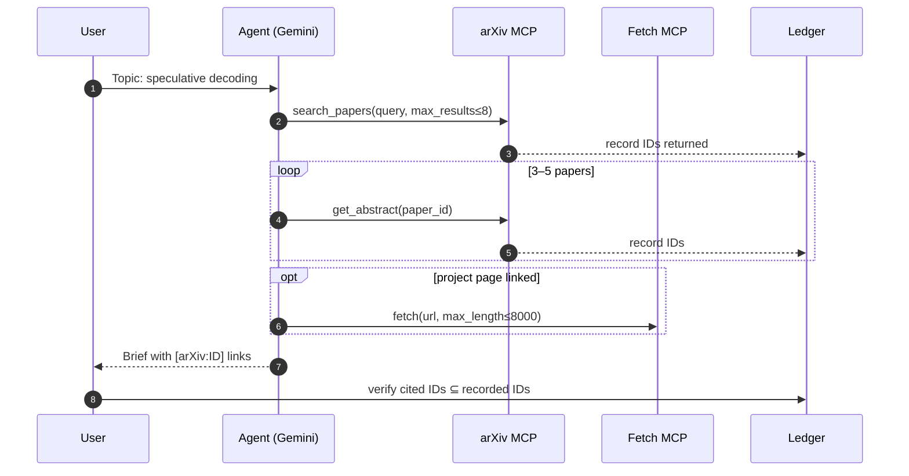

# Day 001 · arXiv Scout

> Give it a topic; it searches arXiv, reads the abstracts, and writes a cited engineering brief. Then it **verifies every citation against what the tools actually returned**, so hallucinated papers fail the run.

| | |
|---|---|
| **Pattern** | Single agent + guardrail callbacks |
| **Framework** | Google ADK 2.12 · Gemini 3.5 Flash-Lite |
| **MCP servers** | [`arxiv-mcp-server`](https://github.com/blazickjp/arxiv-mcp-server) 0.8.2 · [`mcp-server-fetch`](https://github.com/modelcontextprotocol/servers/tree/main/src/fetch) (official reference server) |
| **Needs** | Gemini API key · `uv` · no other accounts |
| **Typical run** | ≈ 15 s · 4–8 tool calls (capped at 12) · ≈ 20k tokens |

## Architecture



Both MCP servers run as **stdio subprocesses launched by `uvx`**: nothing to deploy and no ports to open. ADK's `McpToolset` starts them on first use and turns their tool schemas into Gemini function declarations.

## How a run works



## Engineering decisions

| Decision | Why |
|---|---|
| **Filter tools to 4 of ~21** | The arXiv server also exposes downloads, local indexes and topic watches. Fewer tools means a smaller prompt (cheaper, faster), fewer wrong tool choices, and no writes to disk. |
| **Pin MCP server versions** in `uvx` args | MCP servers change their tool names and schemas. Pinning keeps the agent reproducible; upgrading is a deliberate, tested change. |
| **Budget enforced in `before_tool_callback`**, not just in the prompt | Prompts are suggestions, callbacks are code. When the budget runs out, the callback returns an error dict instead of making the call, and the model is told to write the brief now. |
| **Cap `fetch.max_length` at 8k chars** | Stops one large web page from blowing up the context and the cost. |
| **Evidence ledger + post-run citation check** | LLMs invent plausible arXiv IDs. Every tool response is scanned for IDs, and the brief may only cite IDs it was actually given. This is a cheap, deterministic hallucination check. |
| **`get_abstract` over `download_paper`** | Abstracts are enough for a brief and are about 50× smaller than full text. |
| **Flash-Lite by default** | The task is retrieval and synthesis, not deep reasoning, so the cheapest tier that handles function calling reliably is the right default. Swap models with `GEMINI_MODEL`, e.g. `gemini-3.8-flash` for harder topics. |

## Cost and performance

The CLI prints a meter at the end of every run. A real run ([full output](examples/sample-output.md)):

```
  → search_papers(sort_by='relevance', categories=['cs.CL', 'cs.LG'], query='speculative decoding LLM inf...)
  → get_abstract(paper_id='2308.04623')
  → get_abstract(paper_id='2402.01528')
  → get_abstract(paper_id='2503.00491')
— 14.8s · 5 model calls · 4/12 tool calls {'search_papers': 1, 'get_abstract': 3} · 18,511 in / 1,191 out tokens
✓ All cited arXiv IDs were returned by a tool.
```

- **Input tokens dominate (94%).** Each tool result is fed back to the model on the next turn, so input grows with every call. That's why the tool filter, the `get_abstract`-over-`download_paper` choice and the fetch cap matter more than output length.
- **The run used only 4 of 12 budgeted calls.** The budget is a safety net, not the expected path.
- **No USD figure** appears because Flash-Lite's price isn't in the built-in table. Set `GEMINI_PRICE_IN` / `GEMINI_PRICE_OUT` (USD per 1M tokens) to get one. It's an estimate for budgeting, not billing.
- Run metrics are also written as JSON with `--metrics m.json`, which is what the [eval dashboard](../README.md#agent-health) consumes.

## Failure modes and mitigations

| Failure | Mitigation |
|---|---|
| Model cites a paper it never retrieved | Citation check fails the run (exit 1) and lists the IDs |
| Tool loop (repeated searches) | Hard budget of 12 calls, plus a prompt rule against repeat calls |
| Huge page fetched | `max_length` capped at 8k |
| arXiv slow or rate-limited | MCP timeout 60 s; budget bounds retries |
| Server tool names change upstream | Pinned versions, and a smoke test asserts the exact filtered tool list |
| Thin results for niche topics | Prompt tells the agent to say so rather than pad the brief |

## Tests

```bash
uv run pytest -q
```

| Test | What it proves | Needs |
|---|---|---|
| `test_ledger.py` | Budget, cost maths and citation verification logic | nothing |
| `test_before_tool_enforces_budget_and_caps_fetch` | Guardrail callback behaviour | nothing |
| `test_mcp_servers_expose_exactly_the_filtered_tools` | Starts **both real MCP servers** and checks least-privilege filtering | `uvx` |
| `test_live_brief_has_only_verified_citations` | Full end-to-end run with Gemini | `GOOGLE_API_KEY` |

## Run it

```bash
cp .env.example .env            # add GOOGLE_API_KEY
uv sync
uv run python -m arxiv_scout "speculative decoding for LLM inference" -o brief.md
uv run adk web                  # interactive dev UI
```

| Env var | Default | Purpose |
|---|---|---|
| `GOOGLE_API_KEY` | none (required) | Gemini API key, read from `.env` and never committed |
| `GEMINI_MODEL` | `gemini-3.5-flash-lite` | Model used by the agent |
| `GEMINI_PRICE_IN` / `GEMINI_PRICE_OUT` | unset | USD per 1M tokens for the cost meter; without them the meter reports tokens only |
| `MAX_TOOL_CALLS` | `12` | Tool-call budget per run |

## What I'd do next

- Add `export_citations` output as a `.bib` file next to the brief.
- Run the brief through a second, cheaper "critic" pass that checks every claim is supported by an abstract.
- Cache abstracts across runs (they never change for a given paper version).
