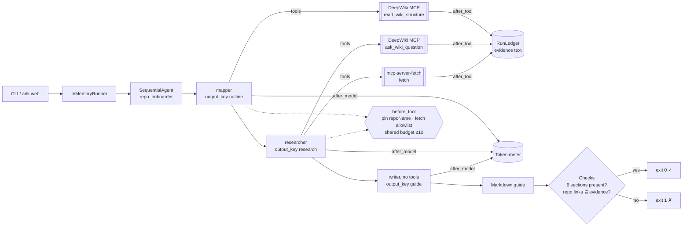
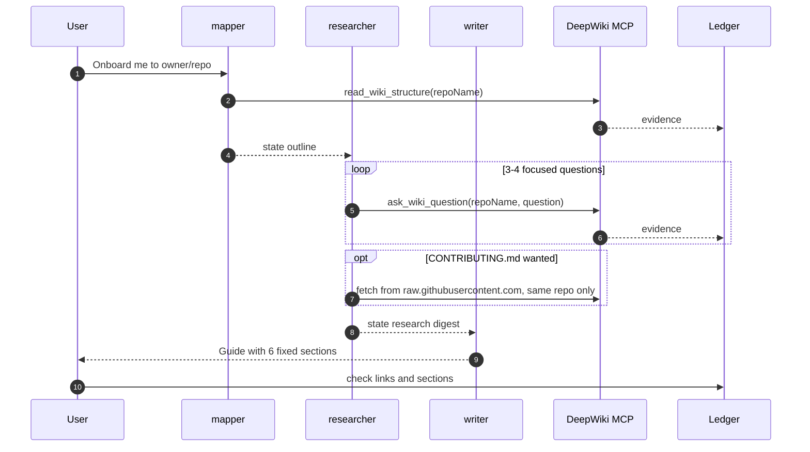

# Day 002 · Repo Onboarder

> Point it at any public GitHub repo; a three-stage **SequentialAgent** maps the wiki, interrogates it, and writes a new-contributor onboarding guide. Each stage has its own instruction and its own *least-privilege* tools, and the final guide's repo links are **checked against what the tools actually returned**.

| | |
|---|---|
| **Pattern** | Sequential pipeline (`SequentialAgent`, state handed over with `output_key`) |
| **Framework** | Google ADK 2.12 · Gemini 3.5 Flash-Lite |
| **MCP servers** | [DeepWiki](https://docs.devin.ai/work-with-devin/deepwiki-mcp) remote MCP (`https://mcp.deepwiki.com/mcp`, streamable HTTP, no auth) · [`mcp-server-fetch`](https://github.com/modelcontextprotocol/servers/tree/main/src/fetch) 2026.10.10 (official reference server) |
| **Needs** | Gemini API key · `uv` · no other accounts |
| **Typical run** | ≈ 5 tool calls · capped at 10 · about a minute |

## Architecture



DeepWiki is a **remote** server, so there is nothing to install. `mcp-server-fetch` runs as a stdio subprocess launched by `uvx`.

## How a run works



## Engineering decisions

| Decision | Why |
|---|---|
| **`SequentialAgent` with `output_key` hand-offs** | The job has a natural order, and a single agent with every tool wanders. Each stage gets a narrow prompt, so a Flash-Lite model stays on task. State keys (`outline`, `research`, `guide`) are injected into the next prompt with `{key}` templates. |
| **Writer stage has no tools** | It can only use the research digest. That is the strongest anti-hallucination lever here: it cannot go and "check" something, so anything missing is marked "not covered by the research". |
| **Per-stage tool filter: 3 DeepWiki tools, 2 exposed** | `read_wiki_contents` dumps the whole wiki into context, which is slow and expensive. The mapper gets only `read_wiki_structure`; the researcher only `ask_wiki_question` and `fetch`. |
| **Target repo comes from each message, held in session state** | A `before_agent_callback` on the pipeline extracts `owner/name` or a GitHub URL from the user's message and stores it as `state["repo_name"]`. ADK fills `{repo_name}` into every stage's instruction at run time. Nothing is bound at import time, so one `adk web` session can onboard several repos in a row, and a message with no repo gets a clarifying question without spending a model call. |
| **Pin the `repoName` argument in `before_tool`** | The model may omit or change it. The callback overwrites it with the session's repo, so the pipeline cannot drift to another repo. |
| **Short-circuit when DeepWiki has no wiki** | Private or unindexed repos return "Repository not found". `after_tool` records that in state, and the researcher and writer `before_agent_callback`s skip their model calls. The user gets an explanation and the indexing link, the CLI exits 1, and the run costs about 800 tokens instead of about 40k. |
| **`fetch` allowlist** | Only `raw.githubusercontent.com` / `github.com` URLs whose path contains the target `owner/repo`, capped at 6k chars. Rejected calls do not spend budget. |
| **One shared budget of 10 tool calls** | The ledger is shared by all stages, so total cost is bounded however the stages behave. Enforced in code, not in the prompt. |
| **Link verification after the run** | Every `github.com/<repo>/blob/…` link must have its path appear somewhere in tool output. The first live run of this agent failed this check: it linked paths the tools never returned. See the sample output for a passing run. |
| **DeepWiki URL cannot be version-pinned** | It is a hosted service. The smoke test asserts its exact tool list, so a change upstream fails CI loudly. `mcp-server-fetch` is pinned with `uvx`. |
| **Flash-Lite for all stages** | Mapping, Q&A relay and templated writing are not deep reasoning; the heavy lifting is done by DeepWiki. Override with `GEMINI_MODEL`. |
| **`SequentialAgent` over `Workflow`** | ADK 2.12 marks `SequentialAgent` deprecated in favour of `Workflow`, which cannot yet be an `LlmAgent` sub-agent. The warning is filtered in pytest; migrating is a follow-up. |

## Cost and performance

Real meter line from the live run in `examples/sample-output.md` (`modelcontextprotocol/python-sdk`):

```
— 59.8s · 8 model calls · 5/10 tool calls {'read_wiki_structure': 1, 'ask_wiki_question': 4} · 43,469 in / 2,414 out tokens
✓ All sections present and every repo link was returned by a tool.
```

No USD figure is printed because there is no built-in price for `gemini-3.5-flash-lite`; set `GEMINI_PRICE_IN` / `GEMINI_PRICE_OUT` (USD per 1M tokens) to see an estimate. Input tokens dominate: each DeepWiki answer is long and is re-sent to the model on the following turns. Most of the wall-clock time is DeepWiki answering questions, not Gemini.

## Failure modes and mitigations

| Failure | Mitigation |
|---|---|
| Writer invents file paths | Link check fails the run (exit 1) and lists the links |
| Writer skips a section | Section check fails the run |
| Model asks about a different repo | `repoName` is overwritten in `before_tool` |
| Model fetches an arbitrary URL | Host and repo-path allowlist; call is rejected without spending budget |
| Tool loop | Shared hard budget of 10 calls, plus a prompt rule against repeats |
| Private, tiny or un-indexed repo | DeepWiki returns "Repository not found"; later stages are skipped by callback, the user gets the reason and indexing link, and the CLI exits 1 |
| User's message names no repo, or a different one from last time | The repo is extracted from each message into session state; if there is none, the agent asks for one |
| DeepWiki changes tools or is down | Smoke test asserts the exact filtered tool list; MCP timeout 60 s |
| Cold `uvx` cache on first run | Fetch server start has a 60 s timeout; the first run downloads it |

## Tests

```bash
uv run pytest -q
```

| Test | What it proves | Needs |
|---|---|---|
| `test_ledger.py` | Budget, cost maths, repo parsing, link verification and section checks | nothing |
| `test_before_tool_*`, `test_fetch_*` | Budget, `repoName` pinning, fetch allowlist and cap | nothing |
| `test_pipeline_is_sequential_with_state_handoff` | Stage order, `output_key` chain, writer has no tools | nothing |
| `test_deepwiki_exposes_exactly_the_filtered_tools` | Calls the **real remote DeepWiki server** and checks each stage's tool filter | network |
| `test_fetch_server_exposes_exactly_the_filtered_tools` | Starts the **real** fetch server and checks its filtered tools | `uvx` |
| `test_live_guide_has_sections_and_verified_links` | Full end-to-end run with Gemini | `GOOGLE_API_KEY` |

## Run it

```bash
cp .env.example .env            # add GOOGLE_API_KEY
uv sync
uv run python -m repo_onboarder modelcontextprotocol/python-sdk -o guide.md
uv run python -m repo_onboarder https://github.com/pallets/flask
uv run adk web                                  # then type e.g. "onboard me to pallets/flask"
```

| Env var | Default | Purpose |
|---|---|---|
| `GOOGLE_API_KEY` | none (required) | Gemini API key, read from `.env` and never committed |
| `GEMINI_MODEL` | `gemini-3.5-flash-lite` | Model used by every stage |
| `GEMINI_PRICE_IN` / `GEMINI_PRICE_OUT` | unset | USD per 1M tokens for the cost meter |
| `MAX_TOOL_CALLS` | `10` | Shared tool-call budget per run |

## What I'd do next

- Run the three questions in a `ParallelAgent` (day 8 covers fan-out) to cut latency by roughly half.
- Verify file *existence*, not just that a path was mentioned, by checking paths against the repo tree.
- Migrate to ADK's `Workflow` once it can nest inside agents.
