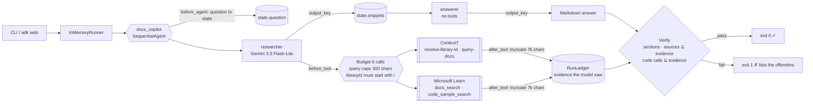
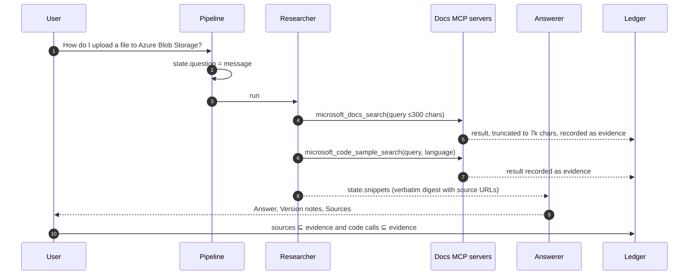

# Day 003 · Docs Copilot

> Ask how to use a library API; it pulls the current docs through MCP, answers **only from what it retrieved**, then **verifies the answer**: every cited source must have been returned by a tool, and every function called in the code must appear in the retrieved docs. Invented APIs fail the run.

| | |
|---|---|
| **Pattern** | Grounded QA + answer verification |
| **Framework** | Google ADK 2.12 · Gemini 3.5 Flash-Lite |
| **MCP servers** | [`@upstash/context7-mcp`](https://github.com/upstash/context7) 4.4.4 (stdio via `npx`) · [Microsoft Learn MCP](https://learn.microsoft.com/en-us/training/support/mcp) (remote, no auth) |
| **Needs** | Gemini API key · `uv` · Node 18+ (`npx`) · optional free Context7 key (see below) |
| **Typical run** | ≈ 10 s · 2–4 tool calls (capped at 6) · ≈ 20k tokens |

## Architecture



Context7 runs as a **stdio subprocess started by `npx`**; Microsoft Learn is a **remote streamable-HTTP** server. `McpToolset` turns both tool lists into Gemini function declarations.

## How a run works



## Engineering decisions

| Decision | Why |
|---|---|
| **Two stages: researcher (tools) then answerer (no tools)** | The answerer physically cannot call a tool or "remember" an API from outside the digest: its only context is `{snippets}`. Splitting retrieval from writing also lets each stage have a short, single-purpose prompt. |
| **Question taken from the chat message, not import time** | `root_agent` hard-codes no subject. A `before_agent_callback` stores each message in `state["question"]`, so two different questions in one `adk web` session rebind the pipeline. A greeting gets a clarifying question and costs no model call. |
| **Filter to 4 tools** | Context7 needs both of its tools (resolve a library id, then query it). From Microsoft Learn we take search and code samples but not the page fetcher, whose pages are large and unbounded. |
| **Pin Context7 to 4.4.4** | MCP servers change tool names and schemas. Learn is remote and cannot be pinned, so a smoke test asserts its exact filtered tool list. |
| **Evidence = what the model saw** | Tool results are truncated to 7k chars per part *before* they are recorded. A source that only appears in text the model never read cannot satisfy the check. |
| **Two deterministic verifiers** | `sources_verified`: each URL or Context7 id in `## Sources` appears in a tool result (anchors are ignored). `code_grounded`: each function or method called in a code block appears in the retrieved text, ignoring builtins and names the snippet defines itself. This catches the usual docs-QA failure, a plausible API from training data that the docs don't contain. |
| **Declining is a failure of the run, not of the answer** | If the docs don't cover the question the answerer says so and the CLI exits 1 (`answered_from_docs: false`), so a docs server outage can't look like a healthy run on the dashboard. |
| **Argument guards before the budget** | Queries are capped at 300 chars; `query-docs` with a malformed `libraryId` is rejected without spending budget. When the budget runs out the callback returns an error instead of calling the server. |
| **Flash-Lite by default** | Retrieval plus quoting from supplied context is not deep reasoning. Override with `GEMINI_MODEL`. |

## Cost and performance

A real run ([full output](examples/sample-output.md)):

```
  → [researcher] microsoft_docs_search(query='upload local file azure blob storage python sdk')
  → [researcher] microsoft_code_sample_search(query='upload_blob upload local file azure storage blob python', language='python')
— 9.0s · 4 model calls · 2/6 tool calls {'microsoft_docs_search': 1, 'microsoft_code_sample_search': 1} · 20,535 in / 701 out tokens
✓ Sections present, every source was returned by a tool, and every API call appears in the docs.
```

- **Input tokens dominate (97%).** The researcher's tool results are read by the researcher, copied into the digest, and read again by the answerer. The per-result truncation and the 6-call budget bound this.
- **No USD figure** appears because Flash-Lite's price isn't in the built-in table. Set `GEMINI_PRICE_IN` / `GEMINI_PRICE_OUT` (USD per 1M tokens) to get one. It is an estimate for budgeting, not billing.
- `--metrics m.json` writes the same numbers as JSON for the [eval dashboard](../README.md#agent-health).

## Context7 free quota

Context7 works without a key but applies a shared monthly quota to keyless use. When it is used up, the server returns `Monthly quota exceeded`. Get a **free** key at <https://context7.com/dashboard> and put `CONTEXT7_API_KEY=...` in `.env`; the agent passes it to the server process. Without a key, Microsoft and Azure questions still work through Microsoft Learn (the default eval question is one), and for other libraries the run reports the Context7 error and exits 1 instead of guessing. During development the keyless quota was already exhausted, so **the sample run exercises Microsoft Learn only; the Context7 server was verified only as far as starting it and listing its tools (its calls returned the quota error), so no end-to-end answer from it is included here.**

## Failure modes and mitigations

| Failure | Mitigation |
|---|---|
| Model cites a URL or library id it never retrieved | `sources_verified` fails the run (exit 1) and lists them |
| Model uses an API call that is not in the docs | `code_grounded` fails the run and lists the names |
| Docs don't cover the question, or a server errors | Answerer says so; `answered_from_docs` fails the run |
| Context7 quota used up | Error text surfaces in the answer; use `CONTEXT7_API_KEY` or ask a Microsoft/Azure question |
| Huge docs dump | Each result part truncated to 7k chars; budget of 6 calls |
| Upstream tool names change | Pinned Context7 version; smoke tests assert the exact filtered tool lists |
| Vague input ("hi") | Clarifying question, no model or tool call |

## Tests

```bash
uv run pytest -q
```

| Test | What it proves | Needs |
|---|---|---|
| `test_ledger.py` | Budget, cost maths, question parsing, source verification, call extraction and grounding | nothing |
| `test_before_tool_*`, `test_after_tool_*` | Budget, query caps, `libraryId` guard, truncation and what counts as evidence | nothing |
| `test_question_comes_from_the_message_not_import_time` | Two questions in one session rebind the pipeline | nothing |
| `test_pipeline_is_sequential_with_state_handoff` | Stage order, `output_key` hand-off, answerer has no tools | nothing |
| `test_context7_exposes_exactly_the_filtered_tools` | Starts the **real** Context7 server and checks least-privilege filtering | `npx` |
| `test_microsoft_learn_exposes_exactly_the_filtered_tools` | Same for the remote Microsoft Learn server | network |
| `test_live_answer_has_verified_sources_and_grounded_code` | Full end-to-end run with Gemini | `GOOGLE_API_KEY` |

## Run it

```bash
cp .env.example .env            # add GOOGLE_API_KEY
uv sync
uv run python -m docs_copilot "How do I upload a local file to Azure Blob Storage using the Python SDK?" -o answer.md
uv run adk web                  # interactive dev UI: ask several questions in one chat
```

| Env var | Default | Purpose |
|---|---|---|
| `GOOGLE_API_KEY` | none (required) | Gemini API key, read from `.env` and never committed |
| `CONTEXT7_API_KEY` | unset | Optional free Context7 key; lifts the keyless quota |
| `GEMINI_MODEL` | `gemini-3.5-flash-lite` | Model used by both stages |
| `GEMINI_PRICE_IN` / `GEMINI_PRICE_OUT` | unset | USD per 1M tokens for the cost meter |
| `MAX_TOOL_CALLS` | `6` | Tool-call budget per run |

## What I'd do next

- Add an LLM judge that checks each *claim* (not just each call) against the snippets, and compare its verdicts with the deterministic checks.
- Cache `resolve-library-id` results across runs; library ids rarely change.
- Check parameter names and keyword arguments in the code, not only the called function names.
