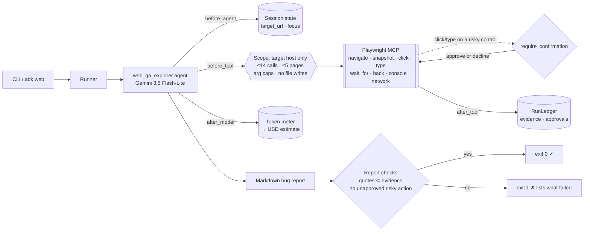
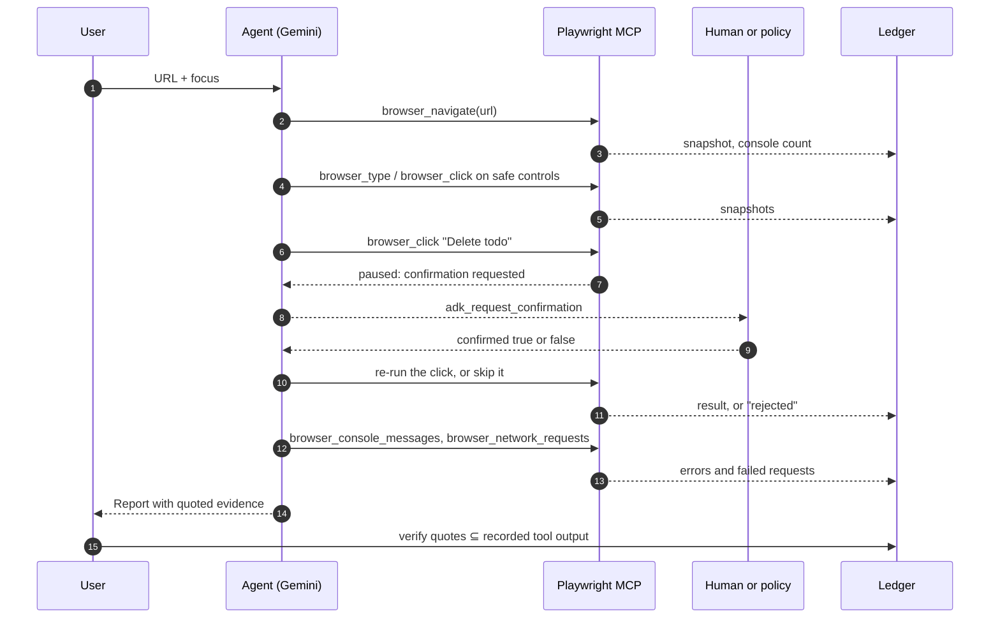

# Day 004 · Web QA Explorer

> Give it a URL; it drives a real browser through Playwright MCP, exercises the app and files a bug report. **Risky clicks (delete, pay, clear, log out) pause for human approval** using ADK's `require_confirmation`, and every quote in the report is **checked against what the browser tools actually returned**, so invented bugs fail the run.

| | |
|---|---|
| **Pattern** | Browser agent + human confirmation (`require_confirmation`) |
| **Framework** | Google ADK 2.12 · Gemini 3.5 Flash-Lite |
| **MCP servers** | [`@playwright/mcp`](https://github.com/microsoft/playwright-mcp) 0.0.83 (stdio via `npx`) |
| **Needs** | Gemini API key · `uv` · Node 18+ (`npx`) · a Chromium/Chrome browser (Playwright downloads one on first use, or set `PLAYWRIGHT_MCP_EXECUTABLE_PATH`) |
| **Typical run** | ≈ 20 s · ≈ 12 tool calls (capped at 14) · ≈ 60k tokens |

## Architecture



Playwright MCP runs as a **stdio subprocess launched by `npx`**. It reads pages as accessibility snapshots (text with element refs), so the model needs no vision and the page is small enough to reason about.

## How a run works



## Engineering decisions

| Decision | Why |
|---|---|
| **Filter tools to 8 of ~30** | The server also exposes `browser_evaluate` and `browser_run_code_unsafe` (arbitrary JavaScript), file upload and downloads. A QA pass needs to look, click, type and read the console and network log. Fewer tools also means a smaller prompt. |
| **Pin `@playwright/mcp@0.0.83`** | Tool names and schemas change between releases. Upgrading is a deliberate, tested change; the smoke test asserts the exact filtered tool list. |
| **`require_confirmation` takes a function, not `True`** | Asking before every click makes the agent useless; asking never makes it dangerous. The function sees each call's arguments and asks only when the control's label matches a state-changing word (delete, clear, pay, order, log out...) or the field is sensitive (password, card...). Quoted page content is ignored, so toggling a todo called `'Buy milk'` does not trigger it. |
| **One toolset, one browser** | `require_confirmation` is set per toolset and the callable cannot see the tool name. Splitting click/type into a second toolset would start a second server and a second browser with no shared page. So the rule works from arguments alone. |
| **Approval policy lives in the CLI, not the agent** | `--risky ask` prompts on a terminal, `deny` (the default when not on a terminal) refuses, `approve` allows. `adk web` shows ADK's own confirmation prompt. The agent is told a rejection is final and must report the action as not exercised. |
| **Scope check in `before_tool`** | Navigation is limited to http(s) on the target's host and subdomains. That also keeps the browser off `localhost` and cloud metadata addresses unless the target itself is local. A blocked call is free: it costs no budget. |
| **Budgets: 14 tool calls and 5 pages** | Prompts are suggestions; callbacks are code. A paused (not yet approved) call costs nothing; only calls that run are counted. |
| **Argument caps** | Typed text ≤ 200 chars, waits ≤ 5 s, URLs ≤ 500 chars, `filename` stripped so tools return text instead of writing files. |
| **Evidence ledger + post-run checks** | Each finding needs a backticked quote that appears verbatim in a tool result (whitespace-insensitive). Pages on the target host that the report cites must also have been returned by a tool. Evidence is recorded after truncation, so text the model never saw cannot satisfy the check. |
| **Approval log written by code** | The report ends with an `## Approval log` appended by the CLI from the ledger, so what was asked and decided never depends on the model's memory. |
| **Resume-safe run state** | ADK re-runs the agent callback with the original message when it resumes after an approval. The ledger keys its reset on the invocation id, otherwise every approval would wipe the budget, evidence and approvals gathered so far. |
| **Flash-Lite by default** | The task is tool use and short synthesis. Swap with `GEMINI_MODEL` if a complex app needs more reasoning. |

## Cost and performance

The CLI prints a meter at the end of every run. A real run ([full output](examples/sample-output.md)) against the public TodoMVC demo, with no human approving risky actions:

```
— 19.4s · 15 model calls · 12/14 tool calls {'browser_navigate': 1, 'browser_console_messages': 2, 'browser_network_requests': 2, 'browser_snapshot': 3, 'browser_type': 3, 'browser_click': 1} · 60,316 in / 631 out tokens
✓ Sections present, every quote came from a tool result, and no risky action ran unapproved.
```

- **Input tokens dominate (99%).** Every click returns a fresh page snapshot, and each tool result is replayed to the model on the next turn. Snapshot size is the cost driver, which is why results are capped at 6,000 characters each and the page budget is small.
- **Output is tiny.** The report is a few hundred tokens; the meter shows 631.
- **No USD figure** appears because Flash-Lite's price isn't in the built-in table. Set `GEMINI_PRICE_IN` / `GEMINI_PRICE_OUT` (USD per 1M tokens) to get one.
- Run metrics are also written as JSON with `--metrics m.json` for the eval dashboard.

## Failure modes and mitigations

| Failure | Mitigation |
|---|---|
| Model reports a bug no tool showed | Evidence check fails the run (exit 1) and lists the quotes it could not find |
| Model wanders off to another site | `before_tool` scope check rejects the navigation; the attempt is recorded in the metrics |
| Destructive click (delete, pay, log out) | Paused for approval; with no approver it is declined and the report must list it as not exercised |
| Model mislabels a risky control as harmless | Classification uses the model's `element` description. Mitigation is partial: use a throwaway account or test environment, and keep `--risky deny`. See next steps |
| Same click retried under a new description | Each attempt asks again and is logged; the budget bounds it |
| Huge page snapshot | Tool results truncated at 6,000 characters |
| Tool loop | 14-call budget plus a prompt rule against repeats |
| Server tool names change upstream | Pinned version, and a smoke test asserts the exact filtered tool list |
| Site needs a login | Not handled; sensitive-field typing is always gated, and credentials are never read from the environment |

## Tests

```bash
uv run pytest -q
```

| Test | What it proves | Needs |
|---|---|---|
| `test_ledger.py` | Budgets, cost maths, per-run reset, evidence and page verification, approval log | nothing |
| `test_risk.py` | Which labels need approval (and that page content such as `'Buy milk'` does not), and the scope rules | nothing |
| `test_agent.py` guardrail tests | Scope blocking, page and tool budgets, argument caps, no file writes, approval accounting, run state across an approval resume, target taken from the message (two targets in one session) | nothing |
| `test_playwright_exposes_exactly_the_filtered_tools` | Starts the **real Playwright MCP server** and checks least-privilege filtering | `npx` + browser |
| `test_real_browser_surfaces_fixture_defects_...` | Real browser on a local page with a known console error and a failing request; the real tool output passes the evidence check, an invented quote fails it | `npx` + browser |
| `test_live_report_has_verified_evidence_and_gated_actions` | Full Gemini + browser run on the TodoMVC demo with approvals denied | `GOOGLE_API_KEY`, `npx` + browser, internet |

## Run it

```bash
cp .env.example .env            # add GOOGLE_API_KEY
uv sync
uv run python -m web_qa_explorer https://demo.playwright.dev/todomvc/ \
  --focus "add two todos, complete one, delete one" --risky ask -o report.md
uv run adk web                  # interactive dev UI: send a URL and what to test
```

| Env var | Default | Purpose |
|---|---|---|
| `GOOGLE_API_KEY` | none (required) | Gemini API key, read from `.env` and never committed |
| `GEMINI_MODEL` | `gemini-3.5-flash-lite` | Model used by the agent |
| `MAX_TOOL_CALLS` | `14` | Tool-call budget per run |
| `MAX_PAGES` | `5` | Distinct URLs the agent may navigate to |
| `PLAYWRIGHT_MCP_EXECUTABLE_PATH` | unset | Use an installed Chrome/Chromium instead of Playwright's own |
| `GEMINI_PRICE_IN` / `GEMINI_PRICE_OUT` | unset | USD per 1M tokens for the cost meter |

| CLI flag | Purpose |
|---|---|
| `--focus "..."` | What to exercise; defaults to the main flow on the page |
| `--risky ask\|approve\|deny` | Policy for state-changing actions. Default: `ask` on a terminal, `deny` otherwise |
| `-o`, `--metrics` | Write the report, and run metrics as JSON |

Only test sites you own or are allowed to test. The browser runs headless with an in-memory profile (`--isolated`); as root (containers, CI) the browser sandbox is disabled because Chromium cannot start it.

## What I'd do next

- Classify risk from the page itself (the element's role and accessible name from the snapshot) instead of the model's description, so a mislabelled click cannot slip through.
- Add a replay step: save the steps that reproduce each bug and re-run them to confirm the bug is deterministic before reporting it.
- Add an accessibility pass using the snapshot's roles and names, scored against a fixed rubric.
