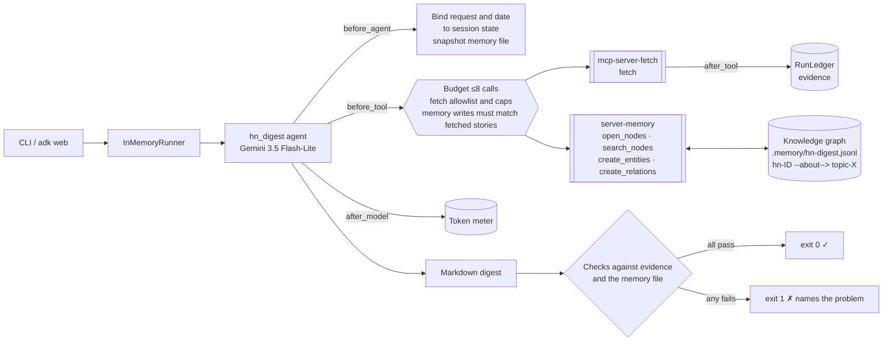
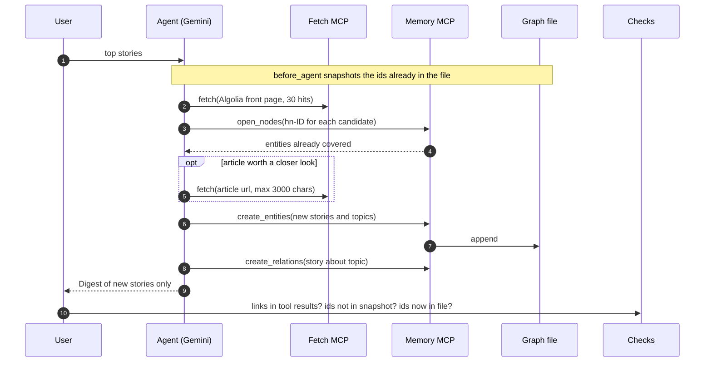

# Day 005 · HN Digest

> A Hacker News digest that **remembers what it already told you**. Covered stories are written to a knowledge graph (story → topic) through a memory MCP server, and the next run opens that graph first and skips them. The CLI then checks the digest against the memory *file*, not against what the model says it did.

| | |
|---|---|
| **Pattern** | Long-term memory via knowledge graph |
| **Framework** | Google ADK 2.12 · Gemini 3.5 Flash-Lite |
| **MCP servers** | [`mcp-server-fetch`](https://github.com/modelcontextprotocol/servers/tree/main/src/fetch) 2026.10.19 · [`@modelcontextprotocol/server-memory`](https://github.com/modelcontextprotocol/servers/tree/main/src/memory) 2.0.0 (both official reference servers) |
| **Needs** | Gemini API key · `uv` · Node (`npx`) · no other accounts. Stories come from the free [HN Algolia API](https://hn.algolia.com/api) |
| **Typical run** | ≈ 11 s · 4–5 tool calls (capped at 8) · ≈ 30–40k tokens |

## Architecture



Both servers run as **stdio subprocesses** (`uvx` and `npx`): nothing to deploy and no ports to open. The graph is a plain JSONL file you can read, diff or delete.

## How a run works



## Engineering decisions

| Decision | Why |
|---|---|
| **A knowledge graph, not a "seen" list** | Entities (`hn-ID`, `topic-x`) and `about` relations make the memory queryable later: "what did I read about security?" is a `search_nodes` call, not a re-fetch. |
| **Story id is the entity name** (`hn-50180873`) | Lookup is one exact `open_nodes` call with all 30 candidate names. No fuzzy matching, no title comparison, and ids never change. |
| **Filter memory tools to 4 of 9** | `read_graph` dumps the whole graph into the prompt (cost grows every day), and the delete tools and `add_observations` let a confused model damage the memory. The digest needs none of them. |
| **Pin both servers** | `uvx mcp-server-fetch==…` and `npx @modelcontextprotocol/server-memory@2.0.0`. The memory server's package changed its versioning scheme recently, a good reminder of why unpinned tools are risky. |
| **Trim the Algolia response in `before_tool`** | The default payload is ~23k chars (mostly highlight metadata); with `attributesToRetrieve` and `attributesToHighlight=none` it is ~6k, so 30 candidates fit in one 8k-capped fetch. The callback enforces this even if the model forgets. |
| **Fetch allowlist** | Only HN hosts, plus at most 2 article URLs that a story result actually returned (3k chars each). No free browsing, and story pages are untrusted text. |
| **Memory writes must match fetched stories** | `create_entities` is rejected if a `hn-ID` never appeared in a tool result, and names must start with `hn-` or `topic-`. A prompt-injected title cannot make the agent write arbitrary data into the graph. |
| **Checks read the memory *file*** | "No repeats" compares the digest with a snapshot of the JSONL taken before the run; "saved" compares it with the file after. The model cannot pass these by claiming it checked. |
| **Request bound in `before_agent_callback`** | `root_agent` never hard-codes a subject. Each message sets `{request}` and `{today}` in state and resets the ledger; a bare greeting gets a question back without spending a model call. |
| **Flash-Lite by default** | Selecting, summarising and calling four tools is within Flash-Lite's reach. Set `GEMINI_MODEL` for harder requests. |

## Cost and performance

Two real consecutive runs against the same graph file ([full output](examples/sample-output.md)):

```
# run 1, empty memory
— 10.8s · 5 model calls · 4/8 tool calls {'fetch': 1, 'open_nodes': 1, 'create_entities': 1, 'create_relations': 1} · 29,645 in / 1,816 out tokens
✓ 5 new stories, all links returned by a tool, none repeated (memory held 0 before), all saved.

# run 2, memory holds run 1's five stories
— 12.3s · 6 model calls · 5/8 tool calls {'fetch': 1, 'open_nodes': 2, 'create_entities': 1, 'create_relations': 1} · 41,781 in / 1,804 out tokens
✓ 5 new stories, all links returned by a tool, none repeated (memory held 5 before), all saved.
```

- **Input tokens dominate (~95%).** The 30-story page is re-read on every model turn, which is why trimming the Algolia payload matters more than output length.
- **Run 2 used ~40% more input than run 1.** Its first `open_nodes` batch (the first candidates on the page) matched the five stories run 1 saved, so the agent made a second `open_nodes` call on later candidates to find five new ones. As the graph grows, more of the front page is already covered and runs need more lookups; the budget bounds them.
- **No USD figure** because Flash-Lite's price isn't in the built-in table. Set `GEMINI_PRICE_IN` / `GEMINI_PRICE_OUT` for one.
- `--metrics m.json` writes the same keys as the other days for the eval dashboard; its checks also record how many stories memory held before the run.

## Failure modes and mitigations

| Failure | Mitigation |
|---|---|
| Digest repeats a story | `no_repeats` check against the pre-run snapshot of the memory file (exit 1) |
| Model skips memory and just writes a digest | `memory_consulted` check requires an `open_nodes` or `search_nodes` call |
| Model invents a story or link | `links_verified` requires each URL or item id to appear in a tool result |
| Covered story not saved, so it repeats tomorrow | `memory_saved` check reads the file after the run |
| Prompt injection via a title or article | Fetch allowlist, memory write validation, and no tools that can delete or read the whole graph |
| Every candidate already covered | Prompt says "Nothing new" and saves nothing; the check accepts that |
| Memory file grows without bound | Entities are small and lookups are by exact name; `read_graph` is filtered out so size never reaches the prompt |
| Algolia or a server is down | Timeouts on both servers; the budget bounds retries and the run fails the checks instead of fabricating a digest |

## Tests

```bash
uv run pytest -q
```

| Test | What it proves | Needs |
|---|---|---|
| `test_ledger.py` | Budget and cost maths, memory-file parsing, repeat/unsaved/forged-link detection | nothing |
| `test_algolia_requests_are_trimmed_and_capped` and `test_fetch_is_not_free_browsing` | Fetch argument guardrails | nothing |
| `test_article_fetch_only_for_returned_urls_and_limited`, `test_memory_writes_must_be_about_returned_stories`, `test_budget_is_enforced` | Memory-write validation, article limits, budget | nothing |
| `test_request_comes_from_the_conversation_not_import_time` | Two different requests on one agent rebind state and reset the run | nothing |
| `test_fetch_server_exposes_exactly_the_filtered_tools`, `test_memory_server_exposes_exactly_the_filtered_tools` | Starts **both real MCP servers** and asserts the exact filtered tool lists | `uvx`, `npx` |
| `test_memory_survives_a_server_restart` | Entities written by one server process are found by the next one | `npx` |
| `test_live_digest_skips_a_story_memory_already_holds` | Seeds memory with today's top story and checks the live digest leaves it out | `GOOGLE_API_KEY` |

## Run it

```bash
cp .env.example .env            # add GOOGLE_API_KEY
uv sync
uv run python -m hn_digest "top stories" -o digest.md
uv run python -m hn_digest "5 stories about databases"   # same graph, so no repeats
uv run python -m hn_digest "top stories" --fresh           # throwaway memory
uv run adk web                  # interactive dev UI
```

| Env var | Default | Purpose |
|---|---|---|
| `GOOGLE_API_KEY` | none (required) | Gemini API key, read from `.env` and never committed |
| `GEMINI_MODEL` | `gemini-3.5-flash-lite` | Model used by the agent |
| `HN_MEMORY_FILE` | `.memory/hn-digest.jsonl` | Knowledge-graph file (also `--memory-file`) |
| `MAX_TOOL_CALLS` | `8` | Tool-call budget per run |
| `GEMINI_PRICE_IN` / `GEMINI_PRICE_OUT` | unset | USD per 1M tokens for the cost meter |

## What I'd do next

- Use the topic relations: weight candidates toward topics the reader keeps opening, with a `search_nodes` call at the start.
- Add a time-to-live to covered stories so a story that stays on the front page for days can resurface with new comments.
- Look up all 30 candidates in one `open_nodes` call by default, so a mostly-covered front page costs one lookup, not two.
