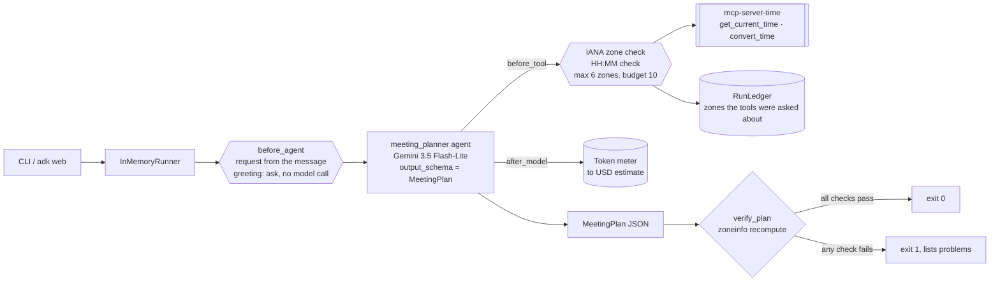
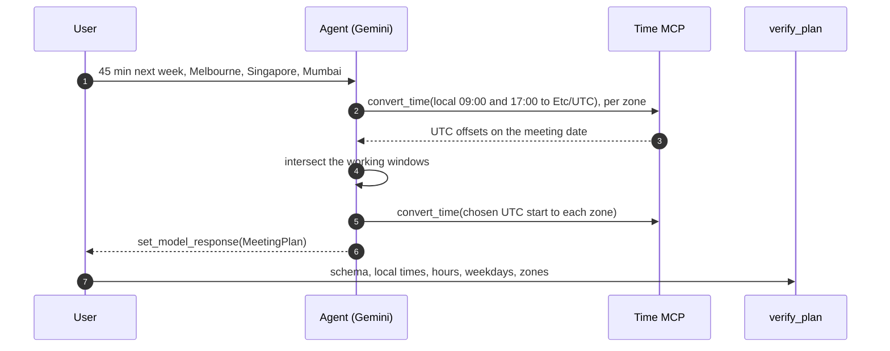

# Day 006 · Meeting Planner

> Give it who is meeting and roughly when; it asks a time-zone server for the offsets and returns a **typed `MeetingPlan`** (Pydantic, enforced by `output_schema`). Then it **recomputes every local time itself** with the tz database, so a wrong conversion, a slot outside working hours or a weekend meeting fails the run.

| | |
|---|---|
| **Pattern** | Structured output (Pydantic `output_schema`) |
| **Framework** | Google ADK 2.12 · Gemini 3.5 Flash-Lite |
| **MCP servers** | [`mcp-server-time`](https://github.com/modelcontextprotocol/servers/tree/main/src/time) 2026.10.19 (official reference server) |
| **Needs** | Gemini API key · `uv` · no other accounts |
| **Typical run** | ≈ 15 s · 8-10 tool calls (capped at 10) · ≈ 50k tokens |

## Architecture



The server runs as a **stdio subprocess launched by `uvx`**: nothing to deploy and no ports to open.

## How a run works



## Engineering decisions

| Decision | Why |
|---|---|
| **`output_schema=MeetingPlan`** | The caller gets an object, not prose to parse. ADK validates it against the Pydantic model, and every field has a description that the model sees. |
| **A `needs_clarification` field in the schema** | With `output_schema` the agent can't reply in free text, so asking a question has to be part of the type. A missing city or date produces a typed question instead of an invented plan. |
| **Recompute everything in `verify_plan`** | A schema guarantees shape, not truth. Local times, durations, weekdays and working hours are re-derived from `zoneinfo`, so the verifier does not trust the model or the server. Daylight saving is covered by a test. |
| **Check that the plan's zones were queried through the tool** | Catches a plan that guessed offsets from memory instead of consulting the server. |
| **Pin `mcp-server-time`** | MCP servers change tool names and schemas. Pinning keeps runs reproducible. |
| **Both server tools kept, nothing else exists to filter** | `tool_filter` is still set, so a future server release that adds tools doesn't silently widen the agent's reach. |
| **Argument guardrails in `before_tool_callback`** | Unknown IANA names and malformed times are rejected *before* the call, and rejected calls cost no budget. At most 6 distinct zones per plan. ADK's own `set_model_response` tool is exempt, so the budget can never block the final answer. |
| **Request read from the message** | The agent never hard-codes cities or dates. `before_agent_callback` stores the request in session state, `{request}` is templated into the instruction, and a bare greeting gets a question without a model call. |
| **Flash-Lite** | Tool use plus structured output needs reliable function calling, not deep reasoning. Swap with `GEMINI_MODEL`. |

## Cost and performance

A real run ([full output](examples/sample-output.md)):

```
  → convert_time(target_timezone='Etc/UTC', time='09:00', source_timezone='Australia/Melbourne')
  → convert_time(time='17:00', target_timezone='Etc/UTC', source_timezone='Australia/Melbourne')
  ... (8 more convert_time calls)
  → set_model_response(title='45-minute sync between Melbourne, Singapore and Mumbai', slots=[{'local_times': ...)
— 14.3s · 12 model calls · 10/10 tool calls {'convert_time': 10} · 51,539 in / 1,315 out tokens
✓ Valid MeetingPlan; 3 slot(s) re-computed from the tz database and inside working hours.
```

- **Input tokens dominate (97%).** Every tool result is fed back on the next model call, and one `convert_time` call per question adds up.
- **This run used its whole budget of 10.** That's the main cost lever: the model converts one value per call. The prompt asks for one call per zone; a first attempt without that hint used 10 calls and ran out of budget before the final answer, which is why the final answer is exempt from the budget. Raise `MAX_TOOL_CALLS` for 5-6 participants.
- **No USD figure** appears because Flash-Lite's price isn't in the built-in table. Set `GEMINI_PRICE_IN` / `GEMINI_PRICE_OUT` (USD per 1M tokens) to get one.
- Run metrics are also written as JSON with `--metrics m.json`, which is what the [eval dashboard](../README.md#agent-health) consumes.

## Failure modes and mitigations

| Failure | Mitigation |
|---|---|
| Wrong offset (forgot a half-hour zone or daylight saving) | `verify_plan` recomputes and fails the run, naming the person and the right time |
| Slot outside someone's working hours, or on a weekend | Same verifier, per participant |
| Model invents a time zone name | `before_tool` rejects it with a hint; `verify_plan` rejects it in the plan |
| Plan uses zones the server was never asked about | `zones_checked_by_tool` check fails |
| Ambiguous city ("Georgia", "Cambridge") | The prompt maps places to zones and the plan lists the zone it chose, so a human sees the assumption |
| No overlap exists | The plan carries `no_overlap_reason` instead of bending the hours |
| Request names no one or no date | `needs_clarification` question; the CLI exits non-zero |
| Server tool names change upstream | Pinned version, and a smoke test asserts the exact filtered tool list |

## Tests

```bash
uv run pytest -q
```

| Test | What it proves | Needs |
|---|---|---|
| `test_plan.py` | Verifier accepts a correct plan; catches wrong offsets, hours, weekends, daylight saving, bad zones, durations and past dates | nothing |
| `test_ledger.py` | Budget, cost maths, counter reset and request parsing | nothing |
| `test_before_tool_*` | Argument guardrails, budget, zone cap, no budget spent on rejected calls | nothing |
| `test_request_comes_from_the_message_not_the_code` | Two different requests in one session bind to two different states; a greeting asks instead | nothing |
| `test_time_server_exposes_exactly_the_filtered_tools` | Starts the **real MCP server** and checks least-privilege filtering | `uvx` |
| `test_live_plan_is_valid_and_verified` | Full end-to-end run with Gemini, including the verifier | `GOOGLE_API_KEY` |

## Run it

```bash
cp .env.example .env            # add GOOGLE_API_KEY
uv sync
uv run python -m meeting_planner "A 45-minute sync next week between Melbourne, Singapore and Mumbai, working hours 09:00-17:00" -o plan.md
uv run adk web                  # interactive dev UI
```

| Env var | Default | Purpose |
|---|---|---|
| `GOOGLE_API_KEY` | none (required) | Gemini API key, read from `.env` and never committed |
| `GEMINI_MODEL` | `gemini-3.5-flash-lite` | Model used by the agent |
| `GEMINI_PRICE_IN` / `GEMINI_PRICE_OUT` | unset | USD per 1M tokens for the cost meter; without them the meter reports tokens only |
| `MAX_TOOL_CALLS` | `10` | Tool-call budget per run |

## What I'd do next

- Take real availability as input (busy intervals per person) and make the verifier check the slots against it.
- Let the verifier feed its problems back to the model for one repair round, instead of failing the run.
- Emit an `.ics` invite from the validated plan.
