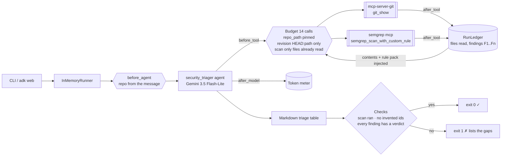
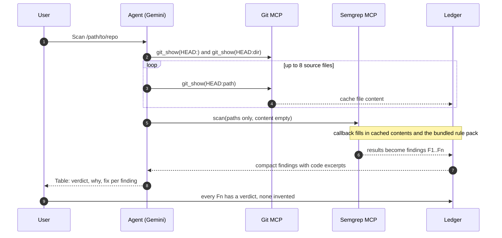

# Day 007 · Security Triager

> Point it at a git repository; Semgrep finds the candidates, and the agent reads the surrounding code to decide which ones an attacker can actually reach. The scan is **deterministic**: the callbacks inject the rule pack and the file contents, so the model never writes rules or retypes code. Then every finding must come back with a verdict, and a made-up finding fails the run.

| | |
|---|---|
| **Pattern** | Deterministic tool + LLM triage |
| **Framework** | Google ADK 2.12 · Gemini 3.5 Flash-Lite |
| **MCP servers** | [`semgrep mcp`](https://github.com/semgrep/semgrep) (built into the `semgrep` CLI) 1.182.1 · [`mcp-server-git`](https://github.com/modelcontextprotocol/servers/tree/main/src/git) 2026.10.19 (official reference server) |
| **Needs** | Gemini API key · `uv` · no other accounts |
| **Typical run** | ≈ 12 s · 7–8 tool calls (capped at 14) · ≈ 17k tokens |

## Architecture



Both servers run as **stdio subprocesses launched by `uvx`**: nothing to deploy and no ports to open. The Semgrep server runs with its telemetry switched off, and the scan itself is offline.

## How a run works



## Engineering decisions

| Decision | Why |
|---|---|
| **Scanner deterministic, model only triages** | A scanner is good at finding every call to `os.popen`; it can't tell whether the argument is attacker-controlled. The model is good at that second question and bad at being exhaustive. Each does only its half. |
| **Inject `rule` and `content` in `before_tool_callback`** | The model passes paths only. Retyping source into a tool call costs output tokens, risks silent edits, and would let the model scan code it never saw. Injecting from the ledger makes the scan reproducible and the findings trustworthy. |
| **Bundled rule pack instead of the `auto` config** | Semgrep's hosted `auto` config refuses to run with metrics off. A 13-rule pack in `rules.py` is reviewable, offline and stable, and a smoke test proves each rule fires. The trade-off is coverage: it is a starter pack, not a replacement for a full ruleset. |
| **Filter tools to 1 of 12 (git) and 1 of 7 (Semgrep)** | The git server can commit, reset and check out; the Semgrep server can call the platform API and run supply-chain scans. A read-only triager needs `git_show` and one scan tool. |
| **Pin `repo_path`, accept only `HEAD:<path>` revisions** | The model can't point the git server at another directory or at another ref, or smuggle a flag in as a revision. Rejected calls cost no budget. |
| **`semgrep mcp` instead of the `semgrep-mcp` package** | The standalone package is deprecated: version 0.9.0 exposes a single deprecation-notice tool and also fails to start against current dependencies. The maintained server ships inside the `semgrep` CLI. |
| **Stable finding ids (F1..Fn) assigned by the ledger** | Gives the report something checkable to cite. The post-run check compares ids in the table with ids the scanner returned. |
| **Counts computed from the table** | The first live run's prose summary miscounted its own table. Totals are now derived from the verdict column, not trusted from the model. |
| **Flash-Lite by default** | Reading short files and judging reachability is retrieval plus light reasoning. Swap with `GEMINI_MODEL` (for example `gemini-3.8-flash`) for large, subtle codebases. |

## Cost and performance

The CLI prints a meter at the end of every run. A real run on the bundled demo app ([full output](examples/sample-output.md)):

```
  → git_show(revision='HEAD:')
  → git_show(revision='HEAD:app/')
  → git_show(revision='HEAD:app')
  → git_show(revision='HEAD:app/views.py')
  → git_show(revision='HEAD:app/client.py')
  → git_show(revision='HEAD:app/cache.py')
  → semgrep_scan_with_custom_rule(code_files=[{'content': '', 'path': 'app/views.py'}, {'content': '', 'path': 'app/clien...)
— 12.2s · 8 model calls · 7/14 tool calls {'git_show': 6, 'semgrep_scan_with_custom_rule': 1} · 16,619 in / 924 out tokens
✓ All 7 scanner findings triaged; none invented.
```

- **Input tokens dominate (95%).** Every file read is fed back to the model on each later turn. The 12k-character cap per file and the compact scan result (id, rule, location, five lines of code; none of Semgrep's bookkeeping) keep that in check.
- **The scan itself is nearly free.** It is one local call; the cost is reading files and judging them.
- **Verdicts vary a little between runs** on borderline cases (the pickle finding was "exploitable" in one run and "likely" in another). The checks guard coverage and honesty, not agreement with a human reviewer.
- **No USD figure** appears because Flash-Lite's price isn't in the built-in table. Set `GEMINI_PRICE_IN` / `GEMINI_PRICE_OUT` (USD per 1M tokens) to get one. It's an estimate for budgeting, not billing.
- Run metrics are also written as JSON with `--metrics m.json`, which is what the [eval dashboard](../README.md#agent-health) consumes.

## Failure modes and mitigations

| Failure | Mitigation |
|---|---|
| Model reports a finding the scanner never returned | Check fails the run (exit 1) and lists the ids |
| Model skips a finding | Same check lists the untriaged ids |
| Model asks to scan a file it never read | Rejected with an instruction to read it first |
| Model targets another directory or ref | `repo_path` overwritten; revisions must match `HEAD:<path>` |
| Huge file floods the context | Files are cut at 12k characters and the model is told |
| Tool loop | Hard budget of 14 calls, plus a prompt rule against repeats |
| Semgrep server tool names change upstream | Pinned versions, and a smoke test asserts the exact filtered tool list |
| Rule pack silently stops matching | Smoke test scans samples for all 13 rules through the real server |
| Code in the repo tries to instruct the model | The prompt marks repository content as data; the model has no write tools to misuse |

## Tests

```bash
uv run pytest -q
```

| Test | What it proves | Needs |
|---|---|---|
| `test_ledger.py` | Budget, cost maths, finding ids, excerpts, report checks, verdict counting | nothing |
| `test_git_show_is_pinned...` · `test_scan_gets_cached_content...` · `test_scan_rejects_unread...` · `test_budget_is_enforced` | Argument guardrails and injection in the callbacks | nothing |
| `test_after_tool_*` | File caching, truncation and compact scan results | nothing |
| `test_repo_comes_from_the_message_not_the_code` | Two repositories in one session bind separately; greetings and bad paths ask instead | nothing |
| `test_mcp_servers_expose_exactly_the_filtered_tools` | Starts **both real MCP servers** and checks least-privilege filtering | `uvx` |
| `test_bundled_rule_pack_fires_every_rule...` | The real Semgrep server matches all 13 rules on sample code | `uvx` |
| `test_live_demo_triage_covers_every_finding` | Full end-to-end run with Gemini on the demo app | `GOOGLE_API_KEY` |

## Run it

```bash
cp .env.example .env            # add GOOGLE_API_KEY
uv sync
uv run python -m security_triager --demo -o triage.md          # bundled, deliberately flawed app
uv run python -m security_triager /path/to/your/repo -o triage.md
uv run adk web                  # interactive dev UI: send "Scan /path/to/repo"
```

| Env var | Default | Purpose |
|---|---|---|
| `GOOGLE_API_KEY` | none (required) | Gemini API key, read from `.env` and never committed |
| `GEMINI_MODEL` | `gemini-3.5-flash-lite` | Model used by the agent |
| `GEMINI_PRICE_IN` / `GEMINI_PRICE_OUT` | unset | USD per 1M tokens for the cost meter; without them the meter reports tokens only |
| `MAX_TOOL_CALLS` | `14` | Tool-call budget per run |

The target must be the root of a local git checkout, and the path must not contain spaces. Only files committed at `HEAD` are read.

## What I'd do next

- Add a second pass that re-reads each "exploitable" finding and tries to name the entry point that reaches it, so the verdict carries a concrete call path.
- Accept `--ruleset` to load a user-supplied rule file instead of the bundled pack, and report which rules never ran.
- Compare verdicts against a labelled set of known-vulnerable apps to measure how often Flash-Lite and Flash agree with a human.
