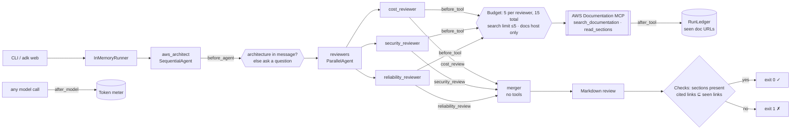
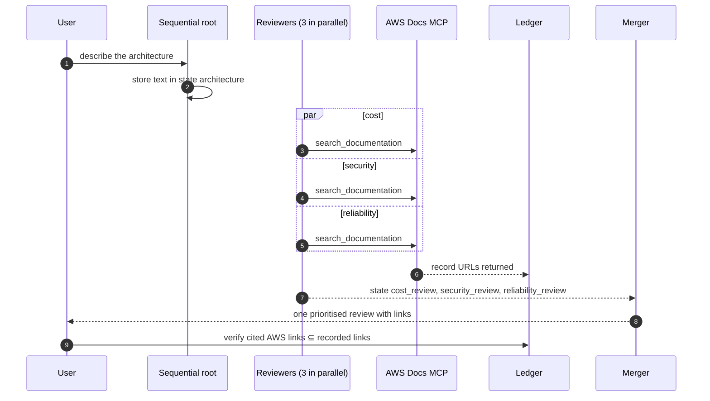

# Day 008 · AWS Architect

> Describe an architecture in a few sentences; three reviewers (cost, security, reliability) research the **AWS documentation in parallel** and a merge stage produces one prioritised review. Every `docs.aws.amazon.com` link in the report is checked against what the documentation tool actually returned, so invented sources fail the run.

| | |
|---|---|
| **Pattern** | Parallel fan-out (`ParallelAgent`) + merge |
| **Framework** | Google ADK 2.12 · Gemini 3.5 Flash-Lite |
| **MCP servers** | [`awslabs.aws-documentation-mcp-server`](https://github.com/awslabs/mcp/tree/main/src/aws-documentation-mcp-server) 1.2.3 (official AWS Labs server, free, no AWS account) |
| **Needs** | Gemini API key · `uv` · no AWS credentials |
| **Typical run** | ≈ 15 s · 6 to 12 tool calls (capped at 15) · ≈ 90k tokens |

## Architecture



The documentation server runs as a **stdio subprocess launched by `uvx`**: nothing to deploy. Each reviewer gets its own `McpToolset`, hence its own server process, so the three branches never queue behind one connection.

## How a run works



## Engineering decisions

| Decision | Why |
|---|---|
| **`ParallelAgent` for the three pillars** | The reviews are independent, so they can run concurrently: wall-clock time is the slowest reviewer, not the sum. Each writes to its own `output_key`, so parallel branches never overwrite each other. |
| **Separate merge stage with no tools** | The merger can only combine what the reviewers found. It cannot go and fetch a convenient link, which keeps the citation check meaningful. |
| **Filter tools to 2 of 5** | `search_documentation` finds pages and `read_sections` reads named sections. `read_documentation` returns whole paginated pages (expensive), and `recommend` / `search_table` are not needed for a review. |
| **Pin the server version** | `awslabs.aws-documentation-mcp-server==1.2.3`. Tool names and schemas change between releases; upgrading is a deliberate, tested change. |
| **Per-reviewer budget (5) plus a total (15)** | With a single shared counter one eager branch could starve the others. Budgets are enforced in `before_tool_callback`, not just the prompt. |
| **Argument guards before the budget** | Search phrase ≤ 200 chars, `limit` ≤ 5, at most 3 section titles, and `read_sections` only on `docs.aws.amazon.com`. A rejected call costs nothing. |
| **Architecture comes from the chat message** | `before_agent_callback` stores it in session state and instructions use `{architecture}`. If the message is too short the agent asks a question without spending a model call. Nothing about the subject is hard-coded. |
| **Forward proxy and CA variables to the stdio server** | The MCP stdio launcher passes only a minimal environment, so on a network with a TLS-inspecting proxy the server's HTTPS calls fail. `SSL_CERT_FILE`, `REQUESTS_CA_BUNDLE` and proxy variables are passed explicitly when set. |
| **Flash-Lite by default** | Each reviewer does search and summarise, not deep reasoning. Swap with `GEMINI_MODEL`. |

## Cost and performance

The CLI prints a meter at the end of every run. A real run ([full output](examples/sample-output.md)):

```
  → [reliability_reviewer] search_documentation(search_intent='Multi-AZ failover and scaling for Amazon RDS PostgreSQL and ECS Fargate'...)
  → [cost_reviewer] search_documentation(search_phrase='ECS Fargate cost optimization right sizing', ...)
  → [security_reviewer] search_documentation(search_phrase='CloudFront ALB ECS RDS S3 security best practices', ...)
  → ... (3 more searches)
— 14.5s · 10 model calls · 6/15 tool calls {'search_documentation': 6} · 91,764 in / 2,778 out tokens
✓ All sections present and every AWS doc link was returned by a tool.
```

- **Input tokens dominate (97%).** Search results are verbose and each is fed back to the model on the next turn, three times over (one per reviewer). The tool filter and the search `limit` cap are the main levers.
- **Parallelism shortens the run, not the bill.** Three branches cost about what three sequential reviews cost; the gain is latency.
- **No USD figure** appears because Flash-Lite's price isn't in the built-in table. Set `GEMINI_PRICE_IN` / `GEMINI_PRICE_OUT` (USD per 1M tokens) for an estimate.
- Metrics are also written as JSON with `--metrics m.json`, which the [eval dashboard](../README.md#agent-health) consumes.

## Failure modes and mitigations

| Failure | Mitigation |
|---|---|
| A reviewer cites a page it never retrieved | Citation check fails the run (exit 1) and lists the links |
| A real link that doesn't support the claim | **Not caught.** The check proves a link was returned, not that it is relevant (the sample has a couple of loosely related sources). A claim-level critic is the next step |
| One branch loops on searches | 5-call budget per reviewer; the others keep theirs |
| A branch returns nothing | The merger is told to say so under that pillar instead of padding |
| Missing or vague input | Clarifying question, no model call spent |
| Documentation search unreachable (TLS, proxy, outage) | The tool returns an error entry with no URL; the reviewer has no sources, so its findings are dropped by the merger |
| Server tool names change upstream | Pinned version, and a smoke test asserts the exact filtered tool list |

## Tests

```bash
uv run pytest -q
```

| Test | What it proves | Needs |
|---|---|---|
| `test_ledger.py` | Total and per-reviewer budgets, cost maths, link verification, section check | nothing |
| `test_before_tool_*` | Per-reviewer budget, argument caps, docs-host restriction, free rejections | nothing |
| `test_architecture_comes_from_each_message_not_import_time` | Two different inputs in one session bind correctly | nothing |
| `test_pipeline_shape_is_parallel_fan_out_then_merge` | Parallel reviewers with distinct output keys, tool-less merger | nothing |
| `test_mcp_server_exposes_exactly_the_filtered_tools` | Starts the **real MCP server** and checks least-privilege filtering | `uvx` |
| `test_live_review_has_all_sections_and_verified_links` | Full end-to-end run with Gemini and the live docs | `GOOGLE_API_KEY` |

## Run it

```bash
cp .env.example .env            # add GOOGLE_API_KEY
uv sync
uv run python -m aws_architect "A public web app: CloudFront in front of an ALB, ECS Fargate tasks in two AZs, an RDS PostgreSQL instance, and an S3 bucket for user uploads." -o review.md
uv run adk web                  # interactive dev UI: paste any architecture in chat
```

| Env var | Default | Purpose |
|---|---|---|
| `GOOGLE_API_KEY` | none (required) | Gemini API key, read from `.env` and never committed |
| `GEMINI_MODEL` | `gemini-3.5-flash-lite` | Model used by every stage |
| `MAX_TOOL_CALLS` | `15` | Total tool-call budget per run |
| `MAX_CALLS_PER_REVIEWER` | `5` | Budget per reviewer |
| `GEMINI_PRICE_IN` / `GEMINI_PRICE_OUT` | unset | USD per 1M tokens for the cost meter |

## What I'd do next

- Add a critic pass that checks each finding is actually supported by the section it cites, closing the relevance gap.
- Add a fourth reviewer for operational excellence and let the merger weigh pillars by stated requirements.
- Use `read_sections` more: the sample used search results only, so findings rest on page summaries rather than full sections.
