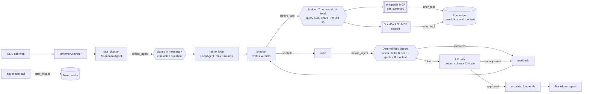
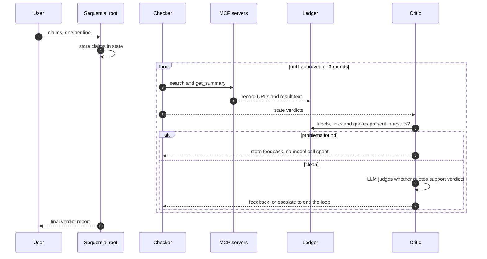

# Day 009 · Fact Checker

> Send one or more factual claims; a **checker** searches the web and Wikipedia and writes a verdict per claim with a quoted passage, and a **critic** sends it back until the evidence really supports each verdict. Format, links and quotes are checked deterministically against what the tools returned, so a made-up source or a paraphrased "quote" is rejected before any model is asked for its opinion.

| | |
|---|---|
| **Pattern** | Generator–critic loop (`LoopAgent`) |
| **Framework** | Google ADK 2.12 · Gemini 3.5 Flash-Lite |
| **MCP servers** | [`wikipedia-mcp`](https://github.com/rudra-ravi/wikipedia-mcp) 2.0.1 (free, no key) · [`duckduckgo-mcp-server`](https://github.com/nickclyde/duckduckgo-mcp-server) 0.7.0 (free, no key) |
| **Needs** | Gemini API key · `uv` · no other accounts |
| **Typical run** | ≈ 30 s · 1 to 3 rounds · 6 to 14 tool calls (capped at 14) · ≈ 60k tokens for three claims |

## Architecture



Both documentation servers run as **stdio subprocesses launched by `uvx`**: nothing to deploy. Only the checker holds tools; the critic can reject but cannot go looking for a convenient source.

## How a run works



## Engineering decisions

| Decision | Why |
|---|---|
| **`LoopAgent` with a checker and a critic** | One pass from a small model often produces a plausible verdict on weak evidence. A second role whose only job is to reject gives the checker a concrete reason to search again. The loop ends by `escalate` on approval or after `max_iterations`. |
| **Deterministic critic first, LLM critic second** | Missing verdict labels, wrong claim count, a verdict with no source, links no tool returned and quotes not in any tool result are all checkable with code. Those rejections cost no model call and cannot be argued with. The LLM only judges what code can't: does the quote support the verdict as the claim is worded? |
| **Quoted evidence must appear in the tool results** | A link proves a page was returned; a quote that appears in the tool text proves the verdict rests on something the checker read. Quotes are compared by letters and digits only, so spacing, punctuation and brackets don't cause false rejections but changed words do. |
| **Feedback through session state** | The critic writes `feedback`; the checker's instruction reads `{feedback}`. The checker is told to fix the named issues and keep the rest, so round 2 is usually one or two extra tool calls. |
| **Tools: 2 of 20+** | DuckDuckGo `search` finds sources, including Wikipedia titles; Wikipedia `get_summary` reads one article. Wikipedia's own search is left out because its public API rate-limits shared IPs (HTTP 429), and the fetch, sections, links and coordinates tools aren't needed. |
| **Pin both servers** | `wikipedia-mcp==2.0.1`, `duckduckgo-mcp-server==0.7.0`. Tool names and schemas change between releases; upgrading is a deliberate, tested change. A smoke test asserts the exact filtered tool list. |
| **Budget per round (7) plus a total (14)** | Counted in `before_tool_callback`, not just the prompt. The per-round allowance resets on each checker pass, the total never does, so revisions can't run away. |
| **Argument guards before the budget** | Query ≤ 200 chars, `max_results` ≤ 5, article title ≤ 200 chars. A rejected call costs nothing. |
| **Claims come from the chat message** | `before_agent_callback` stores them in session state and instructions use `{claims}`. A too-short message gets a clarifying question without a model call. Nothing about the subject is hard-coded. |
| **Flash-Lite for both roles** | Search-and-summarise and rubric-style review don't need deep reasoning, and the deterministic checks backstop the cheap model. Swap with `GEMINI_MODEL`. |

## Cost and performance

The CLI prints a meter at the end of every run. A real run on three claims ([full output](examples/sample-output.md)):

```
  → [checker] search(query='Great Wall of China visible from space naked eye')
  → [checker] get_summary(title='Artificial_structures_visible_from_space')
  → ... (5 more searches and article reads)
  ◦ round 1: checker wrote verdicts
  ◦ round 1: critic reviewed
  → [checker] get_summary(title='Canberra')
  ◦ round 2: checker wrote verdicts
  ◦ round 2: critic approved
— 32.3s · 2 rounds · 11 model calls · 8/14 tool calls {'search': 4, 'get_summary': 4} · 63,591 in / 1,546 out tokens
✓ Critic approved after 2 round(s); every verdict, link and quote checked against tool results.
```

- **Input tokens dominate (98%).** Search results are fed back to the model on each turn, and the checker re-reads the whole conversation every round. The result-count cap and the tool filter are the main levers.
- **A rejection round is cheap.** Round 2 above was one `get_summary` call and one rewrite; the deterministic rejection itself spent no tokens.
- **No USD figure** appears because Flash-Lite's price isn't in the built-in table. Set `GEMINI_PRICE_IN` / `GEMINI_PRICE_OUT` (USD per 1M tokens) for an estimate.
- Metrics are also written as JSON with `--metrics m.json`, which the [eval dashboard](../README.md#agent-health) consumes.

## Failure modes and mitigations

| Failure | Mitigation |
|---|---|
| A verdict cites a page no tool returned | Rejected by the critic's deterministic pass; the checker is told which links to remove or replace |
| A "quote" is paraphrased or invented | Same: compared against the text of every tool result |
| A real quote that doesn't support the verdict | Caught only by the LLM critic, which can be wrong. The quote check proves the text exists, not that it proves the claim |
| Checker and critic never agree | `max_iterations` (3) ends the loop; the CLI exits 1 and prints the unresolved problems |
| Search returns thin or SEO-farm results | The checker may mark a claim Unverifiable rather than guess; sources aren't ranked by reliability beyond the prompt |
| Search backend rate-limits or blocks | The tool returns an error with no URLs, so the checker has no evidence; claims end up Unverifiable or the run fails its checks |
| Claim with several facts in one line | Counted as one claim; the prompt asks for a Mixed verdict that says which part fails |
| Missing or vague input | Clarifying question, no model call spent |
| Server tool names change upstream | Pinned versions, and a smoke test asserts the exact filtered tool list |

## Tests

```bash
uv run pytest -q
```

| Test | What it proves | Needs |
|---|---|---|
| `test_ledger.py` | Round and total budgets, cost maths, URL handling, quote normalisation, every deterministic report check | nothing |
| `test_before_tool_*` / `test_after_tool_*` | Budgets, argument caps, URL and Wikipedia-page evidence recording (errors don't count) | nothing |
| `test_claims_come_from_each_message_not_import_time` | Two different inputs in one session bind correctly | nothing |
| `test_critic_*` | Malformed reports are rejected with no model call; the loop escalates only when checks pass and the LLM approves | nothing |
| `test_pipeline_shape_is_a_checker_critic_loop` | `LoopAgent` with a round cap, tool-less critic with a typed schema | nothing |
| `test_mcp_servers_expose_exactly_the_filtered_tools` | Starts the **real MCP servers** and checks least-privilege filtering | `uvx` |
| `test_live_check_is_approved_and_cites_tool_results` | Full end-to-end run with Gemini and live search | `GOOGLE_API_KEY` |

## Run it

```bash
cp .env.example .env            # add GOOGLE_API_KEY
uv sync
uv run python -m fact_checker "Sydney is the capital of Australia." "Mount Everest is the tallest mountain on Earth measured from base to peak." -o report.md
uv run adk web                  # interactive dev UI: paste claims in chat, one per line
```

| Env var | Default | Purpose |
|---|---|---|
| `GOOGLE_API_KEY` | none (required) | Gemini API key, read from `.env` and never committed |
| `GEMINI_MODEL` | `gemini-3.5-flash-lite` | Model used by both roles |
| `MAX_TOOL_CALLS` | `14` | Total tool-call budget per run |
| `MAX_CALLS_PER_ROUND` | `7` | Tool-call budget per checker pass |
| `MAX_ROUNDS` | `3` | Maximum checker/critic rounds |
| `GEMINI_PRICE_IN` / `GEMINI_PRICE_OUT` | unset | USD per 1M tokens for the cost meter |

## What I'd do next

- Rank sources by type (primary, encyclopedia, news, blog) and have the critic require at least one reputable source for a Supported or Refuted verdict.
- Add `fetch_content` for the top result so a quote can come from the full page rather than a search snippet or summary, with a size cap.
- Give the critic a different, stronger model than the checker and measure whether it catches more unsupported verdicts than it falsely rejects.
