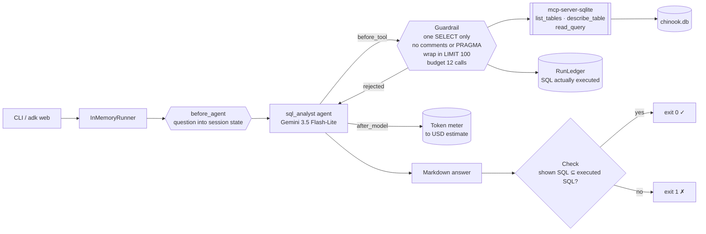
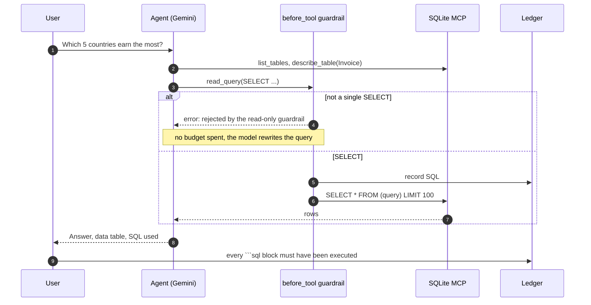

# Day 010 · SQL Analyst

> Ask a question in plain English; it explores a SQLite database, runs SELECTs, and answers with the figures and the exact SQL it ran. **Writes are blocked in code, not in the prompt**: the write tools are filtered out, every query is checked in `before_tool_callback`, and a post-run check fails the run if the answer shows SQL the database never executed.

| | |
|---|---|
| **Pattern** | Argument guardrails (block writes in `before_tool`) |
| **Framework** | Google ADK 2.12 · Gemini 3.5 Flash-Lite |
| **MCP servers** | [`mcp-server-sqlite`](https://github.com/modelcontextprotocol/servers-archived/tree/main/src/sqlite) 2025.4.25 (official reference server) |
| **Needs** | Gemini API key · `uv` · no other accounts. Bundled sample: the [Chinook](https://github.com/lerocha/chinook-database) music-store database |
| **Typical run** | ≈ 6 s · 4–8 tool calls (capped at 12) · ≈ 8k tokens |

## Architecture



The server runs as a **stdio subprocess launched by `uvx`**: nothing to deploy and no ports to open. Of its six tools, the agent is only given three.

## How a run works



## Engineering decisions

| Decision | Why |
|---|---|
| **Filter tools to 3 of 6** | `write_query`, `create_table` and `append_insight` are never shown to the model. The cheapest write protection is a tool that does not exist for the agent. |
| **Still validate `read_query` arguments** | The server's `read_query` is only *documented* to take SELECTs. `guard.py` is code we control: one statement, must start with `SELECT`/`WITH`, no comments, and a deny-list of whole words (`DELETE`, `PRAGMA`, `ATTACH`, `load_extension`, ...) that also catches `WITH ... DELETE`. String literals are stripped first, so searching for `'Delete me'` still works. |
| **Rejections cost no budget** | A rejected call returns an error dict to the model and does not count as a tool call, so a model that tries a write once can correct itself without losing a step. |
| **Wrap every query in `SELECT * FROM (...) LIMIT 100`** | A row cap the model cannot forget, applied to the arguments in the callback. One careless `SELECT * FROM Track` cannot flood the context. |
| **Question from the message, not import time** | `before_agent_callback` stores the question in session state and the instruction uses `{question}`. A greeting gets a clarifying question without a model call. The test runs two different questions in one session. |
| **Post-run check: shown SQL ⊆ executed SQL** | Models sometimes show tidied-up SQL they never ran. The ledger records every executed statement, and the CLI fails the run if an answer's ```sql block is not among them (whitespace, case and `;` ignored). |
| **Pin the server and its two dependencies** | The server declares unpinned `mcp` and `pydantic`, and crashes at start-up on current releases (`'Server' object has no attribute 'list_resources'`). `uvx --with mcp==1.12.4 --with pydantic==2.11.7` is the combination verified to start it. |
| **Flash-Lite by default** | Writing a few SELECTs from a schema is a task the cheapest function-calling tier handles. Swap with `GEMINI_MODEL` for harder analytics. |

## Cost and performance

The CLI prints a meter at the end of every run. A real run ([full output](examples/sample-output.md)):

```
  → list_tables()
  → describe_table(table_name='Customer')
  → describe_table(table_name='Invoice')
  → read_query(query='SELECT BillingCountry AS Country, SUM(Total) AS TotalRevenue FROM Invoice GROUP ...)
  → read_query(query="SELECT c.CustomerId, c.FirstName, c.LastName, SUM(i.Total) AS CustomerRevenue FR...)
— 5.7s · 5 model calls · 5/12 tool calls {'list_tables': 1, 'describe_table': 2, 'read_query': 2} · 7,793 in / 580 out tokens
✓ The answer's SQL is exactly what the database ran, and every query was a guarded SELECT.
```

- **Input tokens dominate (93%).** Each tool result is fed back on the next turn. Schema discovery is the main fixed cost; the row cap bounds the variable part.
- **Used 5 of 12 budgeted calls.** The budget is a safety net, not the expected path.
- **No USD figure** appears because Flash-Lite's price isn't in the built-in table. Set `GEMINI_PRICE_IN` / `GEMINI_PRICE_OUT` (USD per 1M tokens) to get one.
- The figures in the sample answer were cross-checked by hand against the database (USA 523.06, Canada 303.96, France 195.10, Brazil 190.10, Germany 156.48; top USA customer Richard Cunningham, 47.62).
- Run metrics are also written as JSON with `--metrics m.json`, which is what the [eval dashboard](../README.md#agent-health) consumes.

## Failure modes and mitigations

| Failure | Mitigation |
|---|---|
| User (or text in the data) asks the agent to modify the database | Write tools are filtered out; `read_query` rejects non-SELECT SQL; the prompt also says to refuse. In one live test the model declined on its own before any tool call, so the guardrail is covered by unit tests and the real-server smoke test rather than by a live rejection. |
| `WITH ... DELETE`, stacked statements, `PRAGMA`, `ATTACH`, `load_extension` | Deny-list and single-statement check in `guard.py`, with a test case for each |
| Huge result set | Every query is wrapped in `LIMIT 100`; the answer's Notes section mentions the cap |
| Model shows SQL it did not run | Post-run check fails the run (exit 1) |
| Invented column names | Prompt requires `describe_table` first; SQL errors from the server are returned to the model for one fix |
| Tool loop | Hard budget of 12 calls |
| Server crashes on new `mcp`/`pydantic` | Versions pinned, and a smoke test starts the real server |

**Known limits.** The deny-list is deliberately conservative (a column literally named `update` would need quoting tricks) and the guardrail is not a SQL parser. For untrusted deployments also open the database file read-only at the OS level or hand the server a copy.

## Tests

```bash
uv run pytest -q
```

| Test | What it proves | Needs |
|---|---|---|
| `test_guard.py` | 5 SELECT shapes pass; 13 write, stacking, comment, PRAGMA, ATTACH and extension attempts are rejected; row cap wrapper | nothing |
| `test_ledger.py` | Budget, cost maths, shown-vs-executed SQL comparison, reset between questions | nothing |
| `test_before_tool_*` | Rejections cost no budget; accepted SQL is capped and recorded; budget enforced | nothing |
| `test_question_comes_from_the_message_not_the_code` | Two questions in one session bind to two states; a greeting asks instead | nothing |
| `test_sqlite_server_exposes_exactly_the_filtered_tools` | Starts the **real MCP server** and checks least-privilege filtering | `uvx` |
| `test_guarded_query_runs_through_the_real_server_and_is_row_capped` | The wrapped query is accepted by the real server and returns exactly 100 of 3,503 rows | `uvx` |
| `test_live_answer_is_grounded_and_database_untouched` | End-to-end with Gemini: Chinook ground truth (Rock = 1,297 tracks), SQL check passes, database row count unchanged | `GOOGLE_API_KEY` |

## Run it

```bash
cp .env.example .env            # add GOOGLE_API_KEY
uv sync
uv run python -m sql_analyst "Which 5 genres have the most tracks?" -o answer.md
uv run adk web                  # interactive dev UI: ask anything about the data
```

| Env var | Default | Purpose |
|---|---|---|
| `GOOGLE_API_KEY` | none (required) | Gemini API key, read from `.env` and never committed |
| `GEMINI_MODEL` | `gemini-3.5-flash-lite` | Model used by the agent |
| `SQL_DB_PATH` | `data/chinook.db` | Any SQLite file to analyse |
| `GEMINI_PRICE_IN` / `GEMINI_PRICE_OUT` | unset | USD per 1M tokens for the cost meter |
| `MAX_TOOL_CALLS` | `12` | Tool-call budget per run |

`data/chinook.db` was built from the upstream `Chinook_Sqlite.sql` script ([lerocha/chinook-database](https://github.com/lerocha/chinook-database), see its license).

## What I'd do next

- Open the database with SQLite's read-only URI mode in a thin wrapper server, so the guarantee also holds at the engine level.
- Replace the deny-list with a real SQL parser (for example `sqlglot`) that walks the AST and allows only `Select` nodes.
- Add a self-check step that re-runs the final query with `EXPLAIN` and flags full-table scans on large tables.
