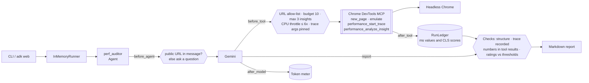
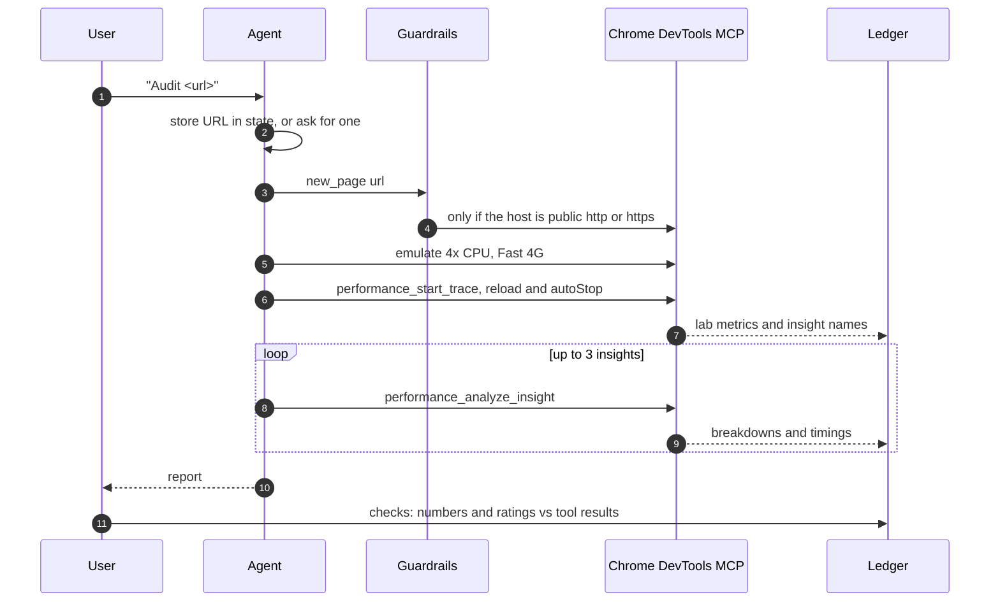

# Day 011 · Perf Auditor

> Give it a URL; it opens the page in headless Chrome, records a performance trace through the **Chrome DevTools MCP server**, drills into the DevTools insights and writes a ranked diagnosis. Special: the report is checked by code, not trust. Every metric value and every millisecond figure must appear in a tool result, and each Good / Needs improvement / Poor rating must match Google's published thresholds.

| | |
|---|---|
| **Pattern** | Tool-heavy diagnostics (one agent, four tools, deterministic report checks) |
| **Framework** | Google ADK 2.12 · Gemini 3.5 Flash-Lite |
| **MCP servers** | [`chrome-devtools-mcp`](https://github.com/ChromeDevTools/chrome-devtools-mcp) 1.12.0 (free, no key; needs Node and a Chrome or Chromium) |
| **Needs** | Gemini API key · `uv` · Node 20+ (`npx`) · Chrome or Chromium |
| **Typical run** | ≈ 30 s · 5 to 8 tool calls (capped at 10) · ≈ 35k tokens |

## Architecture



The server runs as a **stdio subprocess launched by `npx`**: nothing to deploy. It exposes about 35 tools; the agent sees four.

## How a run works



## Engineering decisions

| Decision | Why |
|---|---|
| **One agent, heavy tools** | The work is a fixed diagnostic sequence (open, trace, drill in), not a debate. Complexity goes into tool arguments and verification, not extra agents. |
| **Tools: 4 of ~35** | `new_page`, `emulate`, `performance_start_trace`, `performance_analyze_insight` are read-only for the audited page. Click, type, `evaluate_script`, `upload_file`, heap snapshots, screenshots, file-writing and Lighthouse tools are left out. |
| **Pin the server** | `chrome-devtools-mcp@1.12.0`. Tool names and trace output change between releases; upgrading is deliberate. A smoke test starts the real server and asserts the exact filtered tool list. |
| **URL allow-list in `before_tool`** | A browser tool is an SSRF risk: a prompt-injected page could ask the agent to open `http://169.254.169.254/` or `file://`. Only http(s) to public hosts passes; localhost, `.local`/`.internal` names, private, loopback and link-local addresses and embedded credentials are refused before the budget is spent. The same check runs on the user's message. |
| **Trace arguments are pinned** | `reload` and `autoStop` are forced true and `filePath` is dropped, so a model-chosen path is never written. `emulate` keeps only CPU and network throttling (CPU capped at 6x); user agent, geolocation and headers are stripped. |
| **Budget of 10 calls, 3 insights** | Counted in code. A normal run uses 5 to 8. Insight analysis returns the largest payloads, so it has its own cap. |
| **Numbers are verified** | The ledger keeps every millisecond value and CLS score a tool returned. A table value or any other `N ms` in the report must match one (within rounding) or be a threshold figure; otherwise the run fails. |
| **Ratings are computed, not judged** | LCP 2500/4000 ms, INP 200/500 ms, CLS 0.1/0.25, FCP 1800/3000 ms, TTFB 800/1800 ms. A mislabelled row fails the check. |
| **Page comes from the chat message** | `before_agent_callback` stores the URL in session state and the instruction uses `{target_url}`. No URL, or an unsafe one, gets a question with no model call spent. |
| **CrUX lookups off** | `--no-performance-crux` keeps trace URLs from being sent to Google's CrUX API, and stops noisy 403s in locked-down networks. Reports use lab data. |
| **Flash-Lite** | Reading a structured trace and writing a table doesn't need deep reasoning; the checks backstop the cheap model. Swap with `GEMINI_MODEL`. |

## Cost and performance

The CLI prints a meter at the end of every run. A real run against web.dev ([full output](examples/sample-output.md)):

```
  → new_page(url='https://web.dev')
  → emulate(cpuThrottlingRate=4, networkConditions='Fast 4G', pageId=2)
  → performance_start_trace(pageId=2)
  → performance_analyze_insight(pageId=2, insightName='LCPBreakdown', insightSetId='NAVIGATION_0')
  → performance_analyze_insight(insightSetId='NAVIGATION_0', pageId=2, insightName='CLSCulprits')
  → performance_analyze_insight(pageId=2, insightName='RenderBlocking', insightSetId='NAVIGATION_0')

— 29.7s · 7 model calls · 6/10 tool calls {'new_page': 1, 'emulate': 1, 'performance_start_trace': 1, 'performance_analyze_insight': 3} · 36,384 in / 1,010 out tokens
✓ Trace recorded; every metric value and rating checked against tool results.
```

- **Input tokens dominate (97%).** The trace summary and each insight payload are re-read on every model turn. The insight cap and the tool filter are the main levers.
- **Most wall time is Chrome**, not the model: page load, throttled trace and insight analysis.
- **No USD figure** appears because Flash-Lite's price isn't in the built-in table. Set `GEMINI_PRICE_IN` / `GEMINI_PRICE_OUT` (USD per 1M tokens) for an estimate.
- Metrics are also written as JSON with `--metrics m.json`, which the [eval dashboard](../README.md#agent-health) consumes.

## Failure modes and mitigations

| Failure | Mitigation |
|---|---|
| Model invents or mis-copies a metric | Run fails `numbers_verified`; the CLI exits 1 and lists the offending figures |
| Rating contradicts the thresholds | Run fails `ratings_correct` |
| Model converts units (`1.3 s`) or does arithmetic | Instructions require milliseconds as returned; derived `N ms` figures not in any tool result fail the check, which can reject honest arithmetic. Strict on purpose |
| Page is blocked, offline or times out | The tool returns an error; no trace means `trace_recorded` fails instead of a made-up report |
| INP is `not measured` | Expected: a load trace has no interaction. The report must say so rather than guess |
| Lab numbers vary run to run | Chrome, network and machine load all move them. Eval checks are structural, not value thresholds |
| Prompt injection from the audited page | The agent only sees page-derived strings such as the title and resource URLs in tool results; the tool filter has no click, type or script tools, so an injected instruction has nothing to act with beyond opening another public URL |
| Public hostname that resolves to a private IP | Not caught: only literal hosts are checked. Run it in a network without internal reach, or add a DNS check |
| Chrome can't start (no sandbox in containers) | Set `CHROME_NO_SANDBOX=1` and `CHROME_PATH` |
| Server tool names change upstream | Pinned version and a smoke test of the exact filtered tool list |

## Tests

```bash
uv run pytest -q
```

| Test | What it proves | Needs |
|---|---|---|
| `test_ledger.py` | Budget, cost maths, threshold boundaries, number extraction, URL allow-list, every report check (invented value, wrong rating, invented prose figure, missing sections, no trace) | nothing |
| `test_before_tool_*` | Unsafe URLs refused for free; emulate and trace arguments constrained; total and insight budgets | nothing |
| `test_after_tool_*` | Tool text feeds the ledger; token meter | nothing |
| `test_page_comes_from_each_message_not_import_time` | Two different URLs in one session bind correctly; missing or unsafe input asks a question | nothing |
| `test_agent_is_one_agent_with_the_page_templated_in` | Subject is templated from state, not hard-coded | nothing |
| `test_mcp_server_exposes_exactly_the_filtered_tools` | Starts the **real MCP server** and checks least-privilege filtering | `npx` |
| `test_live_audit_passes_all_checks` | Full end-to-end run with Gemini and headless Chrome | `GOOGLE_API_KEY`, Chrome |

## Run it

```bash
cp .env.example .env            # add GOOGLE_API_KEY
uv sync
uv run python -m perf_auditor https://web.dev -o report.md
uv run adk web                  # interactive dev UI: send a URL in chat
```

| Env var | Default | Purpose |
|---|---|---|
| `GOOGLE_API_KEY` | none (required) | Gemini API key, read from `.env` and never committed |
| `GEMINI_MODEL` | `gemini-3.5-flash-lite` | Model used by the agent |
| `MAX_TOOL_CALLS` | `10` | Total tool-call budget per run |
| `CHROME_PATH` | auto-detected | Chrome or Chromium binary for DevTools MCP |
| `CHROME_NO_SANDBOX` | unset | `1` runs Chrome without its sandbox (containers, CI) |
| `GEMINI_PRICE_IN` / `GEMINI_PRICE_OUT` | unset | USD per 1M tokens for the cost meter |

## What I'd do next

- Audit mobile and desktop profiles in one run and report the difference, with the viewport and throttling recorded in the table.
- Run the trace three times and report the median, so the verification also covers run-to-run variance.
- Resolve the hostname and refuse private resolutions, closing the DNS gap in the allow-list.
