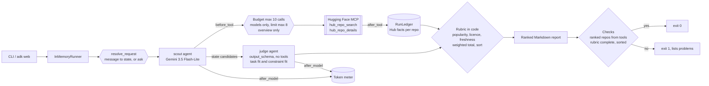
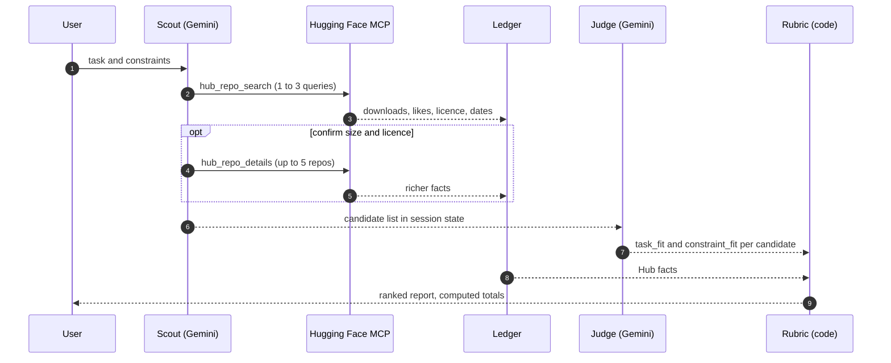

# Day 012 · Model Picker

> Describe a task and your constraints; it searches the Hugging Face Hub and returns a ranked shortlist. The ranking is an **explicit rubric in code**: the model only judges task fit and constraint fit, while popularity, licence and freshness come from Hub data and the weighted total and the sort order are computed, never generated.

| | |
|---|---|
| **Pattern** | Ranking with explicit scoring rubric (SequentialAgent: scout → judge → code scoring) |
| **Framework** | Google ADK 2.12 · Gemini 3.5 Flash-Lite |
| **MCP servers** | [Hugging Face MCP](https://huggingface.co/mcp) (remote, streamable HTTP, server version 0.4.31 when verified; [docs](https://huggingface.co/docs/hub/en/hf-mcp-server)) |
| **Needs** | Gemini API key · `uv` · no Hugging Face account (an optional free `HF_TOKEN` only raises rate limits) |
| **Typical run** | ≈ 10 s · 4–6 tool calls (capped at 10) · ≈ 30k tokens |

## Architecture



The Hugging Face server is **remote**: nothing to install or deploy. ADK's `McpToolset` connects over streamable HTTP and turns the two allowed tool schemas into Gemini function declarations.

## How a run works



## The rubric

| Criterion | Weight | Scored by | How |
|---|---:|---|---|
| Task fit | 35% | Model | 0-5: task, language and domain match |
| Constraint fit | 25% | Model | 0-5: size, speed, hardware and other stated limits |
| Popularity | 15% | Code | log-scaled downloads: 0 at 100 or fewer, 5 at 1M or more |
| Licence | 15% | Code | 5 permissive (MIT, Apache-2.0, BSD, CC-BY-4.0 ...), 2 other declared, 0 undeclared |
| Freshness | 10% | Code | 5 within 6 months, then 4, 3, 2, 1 at 1, 2, 3 years and older |

Total = weighted sum on a 0-100 scale. A candidate the judge marks `disqualified` (a hard constraint is clearly broken) is listed under "Ruled out" instead of ranked.

## Engineering decisions

| Decision | Why |
|---|---|
| **Split judgement from arithmetic** | LLMs are inconsistent at adding weighted scores and at keeping a sort stable. Code computes the totals and the order, so the same scores always give the same ranking and the table can be audited. |
| **Score what the Hub states in code** | Downloads, licence and dates are facts. Computing them from tool results removes a place where the model could flatter a model it likes, and makes those columns reproducible. |
| **`output_schema` on the judge** | Scores are validated integers in 0-5, so a malformed judgement fails at the schema, not in a table. The judge has no tools, so it can only reason about what the scout found. |
| **Filter tools to 2 of 4** | The server also exposes `hf_whoami` and a filesystem-style `hf_fs`. Search plus read-only details is all a recommendation needs. |
| **Argument guards in `before_tool_callback`** | `repo_types` is forced to `model`, search `limit` is capped at 8, details is capped at 5 repos and `overview` only (no dataset previews). Rejected arguments are fixed before the budget is spent. |
| **Budget of 10 tool calls in code** | A prompt is a suggestion; the callback returns an error dict that tells the model to write its list now. |
| **Ranked repos must come from a tool** | The ledger remembers every repo id a tool returned. An id outside that set is reported as a problem and the run exits non-zero. |
| **Request comes from the message** | `resolve_request` stores the user's text in session state each turn (and asks a question if it is too short), so `adk web` works for any task and nothing is hard-coded at import time. |
| **Flash-Lite by default** | Both steps are extraction and light judgement over short facts. Switch with `GEMINI_MODEL` if you want deeper reasoning about trade-offs. |
| **Unpinned remote server** | A hosted server has no package version to pin. The smoke test asserts the exact filtered tool list, which catches renamed tools. |

## Cost and performance

The CLI prints a tool-call trace and a meter at the end of every run. A real run ([full output](examples/sample-output.md)):

```
  → [scout] hub_repo_search(filters=['feature-extraction'], repo_types=['model'], query='multilingual sentence embe...)
  → [scout] hub_repo_search(sort='downloads', limit=10, repo_types=['model'], query='multilingual embeddings')
  → [scout] hub_repo_search(query='sentence-transformers multilingual', repo_types=['model'], limit=10, sort='downl...)
  → [scout] hub_repo_details(repo_ids=['sentence-transformers/paraphrase-multilingual-MiniLM-L12-v2', 'sentence-tran...)
— 9.1s · 6 model calls · 4/10 tool calls {'hub_repo_search': 3, 'hub_repo_details': 1} · 28,043 in / 989 out tokens
✓ 4 models ranked; every one came from a tool result and was scored on the full rubric.
```

- **Input tokens dominate (97%).** Search results carry long tag lists and every result is fed back on the next model call. Capping `limit` at 8 and details to `overview` is what keeps this at about 30k.
- **The judge is cheap.** It has no tools, one call, and a few hundred output tokens.
- **No USD figure** appears because Flash-Lite's price isn't in the built-in table. Set `GEMINI_PRICE_IN` / `GEMINI_PRICE_OUT` (USD per 1M tokens) to get one. It is an estimate for budgeting, not billing.

## Failure modes and mitigations

| Failure | Mitigation |
|---|---|
| Judge ranks a model it never saw | Not ranked; reported as a problem and the run exits 1 |
| Model flatters its favourite | It cannot: only task and constraint fit are model-scored, and the rest is computed |
| Search tags are truncated, so the licence looks missing | The scout is told to confirm with `hub_repo_details`; an undeclared licence scores 0 and shows as "licence not declared" rather than being guessed |
| Tie in totals | Stable order by repo id, so output is deterministic |
| Tool loop | Hard budget of 10 calls |
| Hub rate limits for anonymous callers | Optional free `HF_TOKEN` is sent as a bearer header |
| Server renames or removes a tool | Smoke test asserts the exact filtered tool list |
| Vague request | Asks what the task and constraints are instead of searching |

## Tests

```bash
uv run pytest -q
```

| Test | What it proves | Needs |
|---|---|---|
| `test_ledger.py` | Fact parsing (search and details formats, JSON-escaped text), each computed criterion, weight sum, ranking and sort by code, disqualification, unknown repos, duplicates, out-of-range scores | nothing |
| `test_before_tool_*` | Budget, argument caps, models-only and overview-only guards | nothing |
| `test_request_comes_from_each_message_not_import_time` | Two different requests in one session each bind to state | nothing |
| `test_render_ranks_with_code_and_replaces_the_judges_json` | An invented repo is dropped from the report and reported as a problem | nothing |
| `test_mcp_server_exposes_exactly_the_filtered_tools` | Connects to the **real remote server** and checks least-privilege filtering | network |
| `test_live_shortlist_is_ranked_from_tool_results` | Full end-to-end run with Gemini | `GOOGLE_API_KEY` |

## Run it

```bash
cp .env.example .env            # add GOOGLE_API_KEY
uv sync
uv run python -m model_picker "Multilingual sentence embeddings for semantic search, permissive licence, small enough for a laptop CPU" -o shortlist.md
uv run adk web                  # interactive dev UI
```

| Env var | Default | Purpose |
|---|---|---|
| `GOOGLE_API_KEY` | none (required) | Gemini API key, read from `.env` and never committed |
| `GEMINI_MODEL` | `gemini-3.5-flash-lite` | Model used by both agents |
| `MAX_TOOL_CALLS` | `10` | Tool-call budget per run |
| `HF_TOKEN` | unset | Optional free Hugging Face token to raise rate limits |
| `GEMINI_PRICE_IN` / `GEMINI_PRICE_OUT` | unset | USD per 1M tokens for the cost meter |

## What I'd do next

- Let the user set the rubric weights per request ("latency matters most"), validated to sum to 1.
- Add a computed size criterion from model parameter counts, so hardware fit is not left to the judge.
- Compare against a benchmark leaderboard for the task, with the source linked per score.
