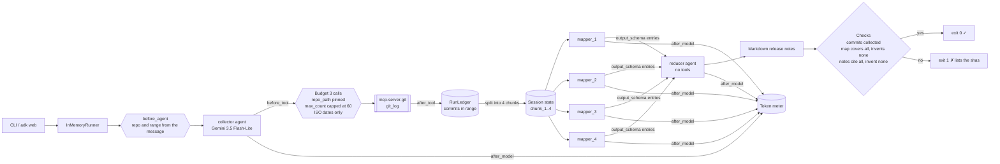
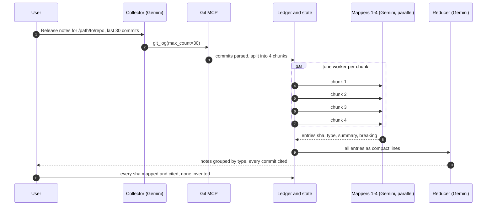

# Day 013 · Release Notes

> Point it at a git repository and a range; parallel workers each classify a slice of the commits, and a reducer merges their entries into release notes grouped by change type. No model call ever sees the whole history, and the run fails if any commit is dropped or invented.

| | |
|---|---|
| **Pattern** | Map-reduce summarisation |
| **Framework** | Google ADK 2.12 · Gemini 3.5 Flash-Lite |
| **MCP servers** | [`mcp-server-git`](https://github.com/modelcontextprotocol/servers/tree/main/src/git) 2026.10.28 (official reference server) |
| **Needs** | Gemini API key · `uv` · no other accounts |
| **Typical run** | Not measured yet: see [Cost and performance](#cost-and-performance) |

## Architecture



The server runs as a **stdio subprocess launched by `uvx`**: nothing to deploy and no ports to open.

## How a run works



## Engineering decisions

| Decision | Why |
|---|---|
| **Map-reduce instead of one long prompt** | Each worker reads about a quarter of the history, and the reducer reads one line per commit instead of full messages and bodies. Context per call stays small as the range grows, and the workers run concurrently. |
| **`ParallelAgent` with a fixed fan-out of 4** | ADK builds its agent tree up front, so the worker count is fixed. Chunks are contiguous and near-equal; workers whose chunk is empty are skipped by a `before_agent_callback` and cost no model call. |
| **`output_schema` on the map step** | Workers return `{sha, type, summary, breaking}` entries, not prose. The reducer and the checks can rely on the shape, and type is a closed set (`breaking`, `feature`, `fix`, `performance`, `docs`, `internal`). |
| **Chunking, parsing and coverage are plain code** | Splitting commits and verifying citations is exact work. The model only does what needs language: classifying messages and writing sentences. |
| **Reducer instruction built from state** | The reducer's instruction is a function that renders the workers' entries as `sha \| type \| breaking \| summary` lines, so raw commit text never reaches it. |
| **Filter the git server to `git_log`** | The server exposes 12 tools (commit, add, reset, checkout, create_branch...). Release notes need read-only history, so the agent gets exactly one. |
| **Range is a count or a date window** | `git_log` in the server accepts `max_count` and timestamps, not revision ranges such as `v1.0..v1.1`. The collector maps "last N commits" and "since DATE" onto those arguments. |
| **Pin the server, pin `repo_path`, cap `max_count` at 60, ISO dates only** | A run today behaves like a run next month; the model cannot point the server at another directory or smuggle a flag in as a timestamp. Rejected calls cost no budget. |
| **Flash-Lite by default** | Classifying short commit messages is light work. Swap with `GEMINI_MODEL` for repositories whose messages need more interpretation. |

## Cost and performance

**No live run is recorded for this day yet.** When the code was built, the Gemini API project behind the key available at the time returned `429 RESOURCE_EXHAUSTED` (monthly spending cap reached) on the first model call, so there is no meter line and no `examples/sample-output.md`. Nothing here is estimated. Once a run succeeds, the CLI prints a meter line like this on stderr:

```
— <seconds> · <n> model calls · <n>/3 tool calls {'git_log': 1} · <in> in / <out> out tokens
```

What should drive cost, from the design: one collector call and one reducer call, plus up to four mapper calls, one per non-empty chunk. Input tokens dominate, because each worker reads its commit messages and the reducer reads every entry. No USD figure is printed unless `GEMINI_PRICE_IN` / `GEMINI_PRICE_OUT` (USD per 1M tokens) are set. Run metrics are also written as JSON with `--metrics m.json`, which is what the [eval dashboard](../README.md#agent-health) consumes.

## Failure modes and mitigations

| Failure | Mitigation |
|---|---|
| A worker skips a commit | Check fails the run (exit 1) and lists the unmapped shas |
| Notes drop a commit | Same, listing the uncited shas |
| A worker or the reducer cites a sha that was not in the range | Check fails the run and lists the invented shas |
| Model asks `git_log` for another directory or an odd timestamp | `repo_path` overwritten; timestamps must be ISO dates; rejected calls are free |
| Huge range | `max_count` capped at 60; bodies clipped to 300 characters per commit |
| Empty range | The tool callback returns an error and the collector reports it; empty chunks are skipped |
| Tool loop | Hard budget of 3 calls and a prompt rule to call `git_log` once |
| Server tool names change upstream | Pinned version, and a smoke test asserts the exact filtered tool list |
| Commit messages try to instruct the model | Prompts mark commit text as data; the agent has no write tools to misuse |
| Model quota or spending cap reached | The run stops with the API error; nothing partial is written as output |

## Tests

```bash
uv run pytest -q
```

| Test | What it proves | Needs |
|---|---|---|
| `test_ledger.py` | Log parsing, chunking, budget and cost maths, map and reduce checks, demo history | `git` |
| `test_git_log_is_pinned...` · `test_git_log_rejects_bad_arguments...` · `test_budget_is_enforced` | Argument guardrails in the callbacks | nothing |
| `test_after_tool_records_commits...` · `test_empty_chunks_skip...` | Commits become chunks in state; empty workers are skipped | nothing |
| `test_request_comes_from_the_message_not_the_code` | Two repositories in one session bind separately; greetings and bad paths ask instead | nothing |
| `test_reducer_instruction_lists_every_mapped_commit` | The reduce step sees compact entries only | nothing |
| `test_mcp_server_exposes_exactly_the_filtered_tools` | Starts the **real MCP server** and checks least-privilege filtering | `uvx` |
| `test_real_git_log_output_parses...` | The real `git_log` output on the demo repo parses into the right commits | `uvx` |
| `test_live_demo_notes_cover_every_commit` | Full end-to-end run with Gemini on the demo history | `GOOGLE_API_KEY` with quota |

## Run it

```bash
cp .env.example .env            # add GOOGLE_API_KEY
uv sync
uv run python -m release_notes --demo -o notes.md                       # invented 22-commit history
uv run python -m release_notes /path/to/repo --last 40 -o notes.md
uv run python -m release_notes /path/to/repo --since 2026-10-01 -o notes.md
uv run adk web                  # interactive dev UI: send "Release notes for /path/to/repo, last 20 commits"
```

| Env var | Default | Purpose |
|---|---|---|
| `GOOGLE_API_KEY` | none (required) | Gemini API key, read from `.env` and never committed |
| `GEMINI_MODEL` | `gemini-3.5-flash-lite` | Model used by every stage |
| `GEMINI_PRICE_IN` / `GEMINI_PRICE_OUT` | unset | USD per 1M tokens for the cost meter; without them the meter reports tokens only |
| `MAX_TOOL_CALLS` | `3` | Tool-call budget per run |

The target must be the root of a local git checkout, and the path must not contain spaces. Only committed history is read.

## What I'd do next

- Resolve tag ranges (`v1.0..v1.1`) by looking up each tag's commit date, so the range matches how releases are cut.
- Make the fan-out adaptive with a dynamic workflow instead of four fixed workers, so very long ranges get more, smaller chunks.
- Add a second reduce level that merges near-duplicate bullets across chunks, such as a feature and its follow-up fix.
