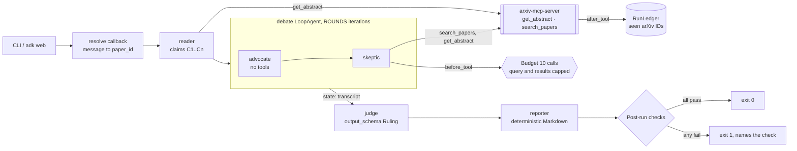
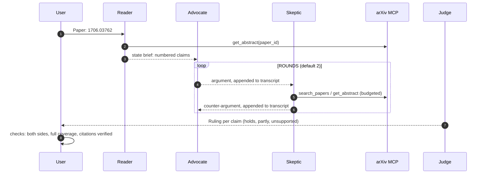

# Day 014 · Paper Debate

> Give it an arXiv paper. An **Advocate** argues its claims hold, a **Skeptic** attacks them (and may search arXiv for outside evidence), and a **Judge** rules on every claim with a typed `Ruling`. Afterwards, plain code checks that both sides spoke, every claim got a ruling, and **every cited arXiv ID was really returned by a tool**.

| | |
|---|---|
| **Pattern** | Multi-agent debate (`SequentialAgent` → `LoopAgent` of two debaters → judge with `output_schema`) |
| **Framework** | Google ADK 2.12 · Gemini 3.5 Flash-Lite |
| **MCP servers** | [`arxiv-mcp-server`](https://github.com/blazickjp/arxiv-mcp-server) 0.8.2 (latest on PyPI at build time) |
| **Needs** | Gemini API key · `uv` · no other accounts |
| **Typical run** | Not measured yet, see [Cost and performance](#cost-and-performance) |

## Architecture



The server runs as a **stdio subprocess launched by `uvx`**. The reader and the skeptic each get their own `McpToolset`, filtered to different tool lists.

## How a run works



## Engineering decisions

| Decision | Why |
|---|---|
| **Debaters talk through `state["transcript"]`**, written by `after_agent_callback`s | Each turn is saved once, in order, and the judge reads one string. No hidden dependence on chat history. |
| **Only the skeptic can search** | A debate needs an asymmetry to be informative: the advocate defends what the paper says, the skeptic is the one allowed to bring outside evidence. It also halves the tool surface and cost. |
| **Tool filter per agent**: reader `get_abstract`; skeptic `search_papers`, `get_abstract` | The server exposes about 20 tools (downloads, watches, local indexes). Least privilege means a smaller prompt and no disk writes. |
| **Pinned server version** | MCP servers change tool names and schemas; upgrading should be a deliberate, tested change. |
| **Judge uses `output_schema=Ruling`** | A typed verdict per claim can be checked by code (coverage, enum values) and rendered consistently. Agents with an output schema can't call tools, which is what we want from a judge. |
| **Reporter is a `BaseAgent` with no model** | The final Markdown is deterministic, so it costs nothing and can't drift from the typed ruling. |
| **Guardrails in callbacks, not prompts** | `before_tool_callback` caps the budget (10 calls), query length and `max_results`; a refused call returns an error dict and the model argues with what it has. |
| **Citation check across transcript and ruling** | Models invent plausible arXiv IDs. Every ID in the output must have been returned by a tool this run. |
| **Debaters limited to 120 words per turn** | Keeps the transcript, and so the judge's input, small. Cost grows with rounds × transcript length. |
| **Flash-Lite for all four roles** | The work is argument over short abstracts, not deep reasoning. `GEMINI_MODEL` overrides it, e.g. a stronger judge. |
| **Judgements rest on abstracts only** | By design (cheap, fast). The ruling's `confidence` field and the README say so; it is a triage tool, not a peer review. |

## Cost and performance

**No live run is recorded for this day yet.** When the PR was prepared, the Gemini API rejected every request with `429 RESOURCE_EXHAUSTED` (the project's monthly spending cap was reached), so `examples/sample-output.md` is deliberately absent and no meter line is claimed. The scripted-model test (below) exercises the full graph, but it says nothing about real latency, tokens or answer quality.

Expected cost drivers, from the design (not measured):

- Model calls: reader 2, each round 2 to 4 (advocate 1, skeptic 1 plus a call per tool round trip), judge 1.
- Input tokens dominate: every call re-sends the brief and the growing transcript.
- Cost scales with `ROUNDS`; the tool budget (`MAX_TOOL_CALLS`, default 10) bounds the skeptic's searching.

The CLI prints a meter line at the end of every run (time · rounds · model calls · tool calls · tokens · optional USD), and `--metrics m.json` writes the same numbers as JSON.

## Failure modes and mitigations

| Failure | Mitigation |
|---|---|
| A debater cites a paper it never retrieved | `citations_verified` fails the run (exit 1) |
| Judge skips or invents a claim | `ruling_covers_every_claim` compares the ruling's labels to the reader's |
| Reader returns no or too many claims | `claims_extracted` requires 2 to 5 |
| A side doesn't speak (error mid-loop) | `both_sides_heard` requires one Advocate and one Skeptic turn per round |
| Skeptic search loop | Hard budget of 10 calls and capped arguments |
| Instructions hidden in abstracts | Prompts treat tool output as data; tool surface is read-only |
| No arXiv ID in the message | Callback asks for one without spending a model call |
| Gemini quota or rate limits | The error surfaces as a failed run; nothing is written as if it succeeded |

## Tests

```bash
uv run pytest -q
```

| Test | What it proves | Needs |
|---|---|---|
| `test_ledger.py` | Budget, cost maths, citation verification and every post-run check, including failure cases | nothing |
| `test_agent.py` (callbacks) | Argument caps and budget; the paper is rebound on each message (two inputs in one session); transcript order; instructions contain no hard-coded paper; report rendering | nothing |
| `test_mcp_server_exposes_exactly_the_filtered_tools` | Starts the **real MCP server** twice and checks each agent's filtered tool list | `uvx` |
| `test_pipeline_scripted.py` | The whole graph (state templating, 2-round loop, `output_schema`, reporter, checks) with a **scripted stand-in for Gemini** and the real MCP server. Wiring only, not model quality | `uvx` |
| `test_live_debate_passes_all_checks` | Full end-to-end run with Gemini | `GOOGLE_API_KEY` with quota |

## Run it

```bash
cp .env.example .env            # add GOOGLE_API_KEY
uv sync
uv run python -m paper_debate 1706.03762 -o report.md
uv run adk web                  # interactive dev UI: send an arXiv ID or link
```

| Env var | Default | Purpose |
|---|---|---|
| `GOOGLE_API_KEY` | none (required) | Gemini API key, read from `.env` and never committed |
| `GEMINI_MODEL` | `gemini-3.5-flash-lite` | Model used by all four roles |
| `ROUNDS` | `2` | Debate rounds (`--rounds` on the CLI) |
| `MAX_TOOL_CALLS` | `10` | Tool-call budget per run |
| `GEMINI_PRICE_IN` / `GEMINI_PRICE_OUT` | unset | USD per 1M tokens for the cost meter |

Behind a TLS-intercepting proxy, set `UV_SYSTEM_CERTS=1`, `SSL_CERT_FILE` and `REQUESTS_CA_BUNDLE`; they are forwarded to the server subprocess.

## What I'd do next

- Let the judge stop the loop early when the Skeptic has nothing new to say.
- Read full text for the one or two claims the abstract can't settle (adds `download_paper`, at a real cost).
- Score the judge against papers with known errata or retractions.
