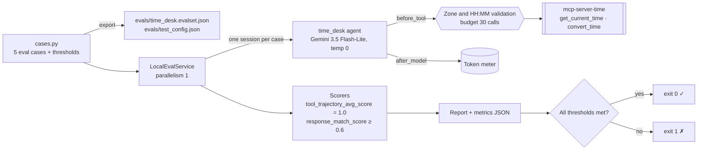
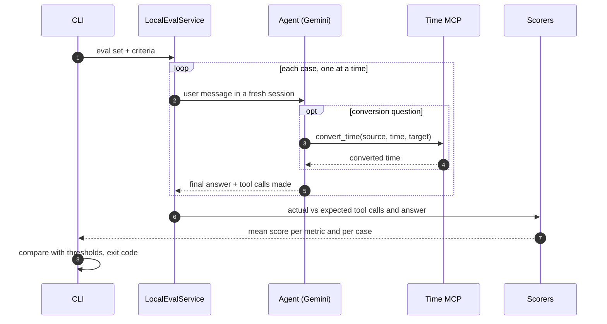

# Day 015 · Agent Evals

> A small time-zone agent and, around it, an **eval set defined as code**: five cases scored on *which tools were called* (trajectory) and *what was said* (response match) with ADK's evaluation framework. The suite is a regression gate: it exits non-zero when a score drops below its threshold.

| | |
|---|---|
| **Pattern** | Evals as code (trajectory + response scoring) |
| **Framework** | Google ADK 2.13 (`google-adk[eval]`) · Gemini 3.5 Flash-Lite |
| **MCP servers** | [`mcp-server-time`](https://github.com/modelcontextprotocol/servers/tree/main/src/time) 2026.10.28 (official reference server) |
| **Needs** | Gemini API key · `uv` · no other accounts |
| **Typical run** | ≈ 10 s · 3 tool calls (capped at 30) · ≈ 11k tokens for the whole suite |

## Architecture



The exported JSON uses ADK's standard eval-set and config schema, so `adk eval agent_evals evals/time_desk.evalset.json --config_file_path evals/test_config.json` can consume it too (not exercised here; `adk eval` runs cases concurrently, see the parallelism note below). The code is the source of truth.

## How a run works



## Engineering decisions

| Decision | Why |
|---|---|
| **Eval set built in Python, exported to JSON** | One reviewable source. A unit test fails if the checked-in JSON drifts from the code, and another recomputes every reference answer with `zoneinfo` so a typo in an expectation cannot pass. |
| **Cases use zones without daylight saving** | The time server converts relative to today's date; Tokyo, Kolkata, Singapore, Kathmandu, Dubai and Karachi give the same answer all year, so the suite does not rot in spring. |
| **Two metrics with different jobs** | Trajectory (exact tool name and arguments) is deterministic and catches wrong or missing tool use. Response match (ROUGE-1 vs a reference sentence) tolerates rewording. No LLM judge, so scoring itself costs nothing and cannot flake. |
| **No-tool cases are first-class** | "Off topic" and "missing source zone" expect an *empty* trajectory. The first version of the agent failed the second one by assuming UTC; the eval caught it and the instruction was tightened. |
| **Temperature 0** | A score change should mean the agent changed, not the dice. It did not remove all variance on its own (see failure modes), which is why the eval has to be rerun, not trusted once. |
| **`LocalEvalService` with parallelism 1** | `AgentEvaluator` runs 4 cases concurrently by default. Cases here share one stdio MCP session, and concurrent use closed it mid-run (`Connection closed`) and made scores flaky. Sequential cases are slower by seconds and make the token meter exact. |
| **Guardrails in callbacks** | Invalid IANA zones and non-`HH:MM` times are rejected in `before_tool` without spending budget; the tool budget (30 per suite run) is enforced in code. |
| **Pinned server, filtered tools** | `mcp-server-time==2026.10.28`, only its two tools exposed; a smoke test asserts the exact list. |
| **Flash-Lite** | Tool selection for two simple tools needs no stronger model. Override with `GEMINI_MODEL`. |

## Cost and performance

A real run ([full output](examples/sample-output.md)):

```
— 9.5s · 8 model calls · 3/30 tool calls {'convert_time': 3} · 10,636 in / 205 out tokens
✓ tool_trajectory_avg_score = 1.00 (threshold 1.0)
✓ response_match_score = 0.87 (threshold 0.6)
```

- **Input tokens dominate (98%)**: every model call resends the instruction and tool schemas. A suite of N cases costs roughly N times a single question.
- **Scoring is free.** Both metrics are computed locally; only inference calls the model.
- **No USD figure** appears because Flash-Lite's price isn't in the built-in table. Set `GEMINI_PRICE_IN` / `GEMINI_PRICE_OUT` (USD per 1M tokens) to get one.
- `--runs N` repeats every case N times and averages, useful for measuring flakiness before tightening a threshold.

## Failure modes and mitigations

| Failure | Mitigation |
|---|---|
| Agent assumes a missing zone (seen in development: it guessed `Etc/UTC`, then also asked) | Prompt rule with a worked example, temperature 0, and an eval case that expects *no* tool call |
| Residual model nondeterminism | `--runs N` averaging; thresholds set from observed results rather than hopes |
| ROUGE rewards wording, not meaning | Reference answers are fixed-format one-liners; the clarification case has a deliberately low observed score (0.43) and the threshold applies to the mean, not per case |
| Concurrent cases break the shared MCP session | Parallelism 1 |
| Eval set and config drift | Sync test against the generated JSON |
| Server changes tool names upstream | Pinned version plus exact-tool-list smoke test |

## Tests

```bash
uv run pytest -q
```

| Test | What it proves | Needs |
|---|---|---|
| `test_cases.py` | JSON in sync with code, unique ids, tool and no-tool coverage, every reference conversion verified with `zoneinfo` | nothing |
| `test_suite.py` | Score aggregation (per metric, per case, repeated runs, failures) and threshold checks | nothing |
| `test_agent.py` guardrails | Zone and time validation, free rejections, budget, token accumulation, no hard-coded task | nothing |
| `test_time_server_exposes_exactly_the_filtered_tools` | Starts the **real MCP server** and checks least-privilege filtering | `uvx` |
| `test_live_eval_suite_meets_thresholds` | Whole suite end to end against Gemini through the CLI | `GOOGLE_API_KEY` |

## Run it

```bash
cp .env.example .env            # add GOOGLE_API_KEY
uv sync
uv run python -m agent_evals -o report.md --metrics m.json
uv run python -m agent_evals.cases   # regenerate evals/*.json after editing cases.py
uv run adk web                  # chat with the agent under test
```

| Env var | Default | Purpose |
|---|---|---|
| `GOOGLE_API_KEY` | none (required) | Gemini API key, read from `.env` and never committed |
| `GEMINI_MODEL` | `gemini-3.5-flash-lite` | Model used by the agent |
| `GEMINI_PRICE_IN` / `GEMINI_PRICE_OUT` | unset | USD per 1M tokens for the cost meter |
| `MAX_TOOL_CALLS` | `30` | Tool-call budget for the whole suite run |

## What I'd do next

- Add an LLM-judged rubric metric (`rubric_based_final_response_quality_v1`) for open-ended agents where reference sentences do not exist.
- Store results per commit and fail CI on a *drop* versus main, not only on an absolute threshold.
- Apply the same harness to the other agents in this repo, one eval set each, starting with those that have deterministic tools.
