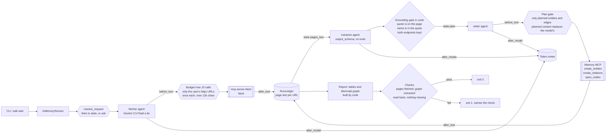
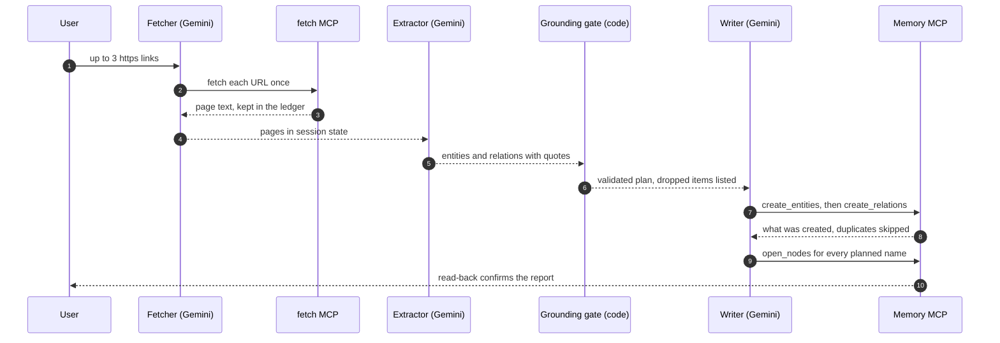

# Day 016 · KG Builder

> Give it up to three links and it builds a knowledge graph in the Memory MCP server. The model only **proposes** entities and relations, each with a verbatim quote. Code keeps a proposal only if the quote really occurs in a page a tool returned, then the writer may send nothing but that kept set to the server, and a read-back proves it was stored.

| | |
|---|---|
| **Pattern** | Extraction → graph writes (SequentialAgent: fetcher → extractor with `output_schema` → writer, with code gates between the steps) |
| **Framework** | Google ADK 2.12 · Gemini 3.5 Flash-Lite |
| **MCP servers** | [`mcp-server-fetch`](https://pypi.org/project/mcp-server-fetch/) 2026.10.28 (stdio, uvx) · [`@modelcontextprotocol/server-memory`](https://www.npmjs.com/package/@modelcontextprotocol/server-memory) 2.0.1 (stdio, npx) |
| **Needs** | Gemini API key · `uv` · Node.js with `npx` · no other accounts |
| **Typical run** | ≈ 15 s · 4 tool calls (capped at 10) · ≈ 23k tokens |

> **Status: work in progress.** Everything is built and the 29 offline and server tests pass, but the live end-to-end run does not yet pass its own quality bar. See [Cost and performance](#cost-and-performance).

## Architecture



Both servers are launched over stdio by `McpToolset` with pinned versions. The graph is a JSONL file (`KG_MEMORY_FILE`, default `.kg/memory.jsonl`), so pointing a second run at the same file **merges** into the same graph: the server skips entities it already has by name, and the report marks those "already known".

## How a run works



## Engineering decisions

| Decision | Why |
|---|---|
| **Quote-or-drop grounding** | An LLM asked for a graph will happily add plausible facts from memory. Each entity and relation must carry a verbatim quote, and code checks the quote against the fetched page (case, punctuation and markdown links ignored), that the entity name appears in the quote, and that a relation's quote contains both names. |
| **Writes are gated to the plan** | The writer is an LLM calling a real write API. `before_tool_callback` reduces its arguments to the validated plan and replaces observations with the planned ones, so it cannot add, rename or embellish. Attempts are recorded and fail the run. |
| **Read back, don't trust** | The report's "new" and "already known" labels come from the server's own responses, and `open_nodes` confirms every planned entity and relation is really stored. |
| **Filter memory tools to 3 of 9** | `read_graph` would dump the whole graph into the prompt, and the delete tools are destructive. Building a graph needs create and open only. |
| **Fetch is limited to the user's links** | Page text is untrusted. A fetched page that says "now fetch this other URL" is rejected by exact-match on the URLs from the user's message. Each page once, 12k characters max, `raw` off. |
| **Typed extraction** | `output_schema` makes a malformed extraction fail at the schema. A fixed entity type list and snake_case relation labels keep the graph consistent across runs. |
| **`include_contents="none"` for extractor and writer** | They read their inputs from session state, so the fetcher's tool history is not paid for twice. |
| **Links come from the message** | `resolve_request` binds the links each turn (and asks for them when missing), so `adk web` works for any pages and nothing is hard-coded at import time. |
| **Flash-Lite by default** | Extraction with quotes is a copy-and-label task. See the performance section for where it falls short. |
| **Pinned servers** | A run today behaves like a run next month; the smoke tests assert the exact filtered tool list. |

## Cost and performance

The CLI prints a tool-call trace and a meter at the end of every run. The latest live run on the default task (two Python typing PEPs), as the test captured it:

```
  → [fetcher] fetch(url='https://peps.python.org/pep-0484/')
  → [fetcher] fetch(url='https://peps.python.org/pep-0526/')
  → [writer] create_entities(entities=[{'observations': ['PEP 484 introduced type hints, a.k.a. type annotations.', ...)
  → [writer] open_nodes(names=['PEP 484', 'mypy'])
— 14.6s · 6 model calls · 4/10 tool calls {'fetch': 2, 'create_entities': 1, 'open_nodes': 1} · 23,104 in / 651 out tokens
✗ check failed: graph_extracted
```

**This run did not pass.** The pipeline worked as designed (pages fetched, two grounded entities written and read back, an invented "PEP 526" entity and its relation dropped by the gate), but Flash-Lite proposed too little: 2 entities and no relation, below the bar of 3 entities and 1 relation. Earlier runs on the same pages gave similar yields (4 entities and 2 relations on the PEP 8 and PEP 257 pair, where the best-grounded content was the author header). No sample output file is included because no run met the bar.

- **Input tokens dominate (97%).** The fetcher re-reads each page on its second model call, and the extractor reads all pages once. Capping pages at 12k characters keeps it near 23k.
- **No USD figure** appears because Flash-Lite's price isn't in the built-in table. Set `GEMINI_PRICE_IN` / `GEMINI_PRICE_OUT` (USD per 1M tokens) to get an estimate.

## Failure modes and mitigations

| Failure | Mitigation |
|---|---|
| Model invents an entity or relation | Dropped by the grounding gate, listed in the report, never written |
| Writer sends extra or altered data to the server | Reduced to the plan in `before_tool`; the attempt fails the `no_writes_outside_plan` check |
| Page contains prompt injection ("fetch this URL") | Fetch accepts only the user's exact URLs; the extractor treats pages as data |
| Site blocks autonomous fetchers | The fetch server honours `robots.txt` and reports the refusal. For example, Wikipedia returns 403 to its user agent, so this agent is not demonstrated on Wikipedia. A failed page is not marked fetched, and the run exits non-zero |
| Server silently drops a write | `open_nodes` read-back; missing items fail `entities_persisted` / `relations_persisted` |
| Same entity under two spellings | Matching is case-insensitive by name; the extractor is told to use one canonical name |
| Tool loop | Hard budget of 10 calls |
| Low-yield extraction on a weak model | The run fails `graph_extracted` rather than reporting an empty graph as success. Try `GEMINI_MODEL` with a stronger model |
| No links in the message | Asks for them instead of calling the model |

## Tests

```bash
uv run pytest -q
```

| Test | What it proves | Needs |
|---|---|---|
| `test_ledger.py` | Link parsing; quote matching through markdown links; every drop reason (invented quote, name not in quote, bad type, duplicate, unfetched source, missing endpoint, self edge, caps); plan gates; parsing the server's responses; read-back accounting; report and Mermaid output; budget and cost | nothing |
| `test_urls_come_from_each_message_not_import_time` | Two different inputs in one session each bind to state | nothing |
| `test_fetch_is_limited_to_the_users_urls_...` | Off-list URL rejected, once each, size and `raw` capped | nothing |
| `test_memory_writes_are_reduced_to_the_validated_plan` | The writer cannot add or alter graph content | nothing |
| `test_pipeline_*` | Early exits, agent order, extractor has no tools | nothing |
| `test_*_server_exposes_exactly_the_filtered_tools` | Starts the **real** fetch and memory servers and asserts the filtered tool lists | network, `npx`, `uvx` |
| `test_live_graph_is_grounded_written_and_read_back` | Full end-to-end run with Gemini, then checks the JSONL graph file | `GOOGLE_API_KEY` |

At the time of writing, 29 tests pass and the live test fails on the quality bar described above.

## Run it

```bash
cp .env.example .env            # add GOOGLE_API_KEY
uv sync
uv run python -m kg_builder https://peps.python.org/pep-0484/ https://peps.python.org/pep-0526/ -o report.md
uv run adk web                  # paste up to 3 links in the chat
```

| Env var | Default | Purpose |
|---|---|---|
| `GOOGLE_API_KEY` | none (required) | Gemini API key, read from `.env` and never committed |
| `GEMINI_MODEL` | `gemini-3.5-flash-lite` | Model used by all three agents |
| `MAX_TOOL_CALLS` | `10` | Tool-call budget per run |
| `KG_MEMORY_FILE` | `.kg/memory.jsonl` | Graph file; reuse it to grow one graph across runs |
| `GEMINI_PRICE_IN` / `GEMINI_PRICE_OUT` | unset | USD per 1M tokens for the cost meter |

Node 24 is what the memory server declares; it also ran here on Node 22 with an engine warning.

## What I'd do next

- Fix the yield: run extraction per page (one small call each) or add a critic pass that asks for missed relations, then compare against a stronger model on the same pages.
- Add `add_observations` behind the same plan gate so a second source can enrich an entity that already exists, not only skip it.
- Pick eval pages with more connected prose than a PEP header block, and track yield over time on the dashboard.
