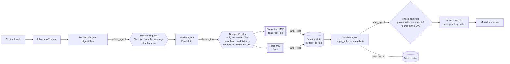
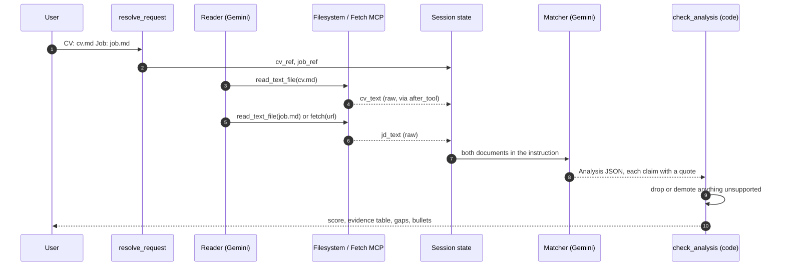

# Day 017 · JD Matcher

> Give it a CV and a job description; it returns a weighted fit score, requirement-by-requirement evidence, gaps and tailored bullets. Every claim must carry a **verbatim quote**, and code checks each quote against the text the tools actually returned, so invented experience is demoted or dropped before you see it.

| | |
|---|---|
| **Pattern** | Structured comparison (typed `output_schema` + deterministic verification) |
| **Framework** | Google ADK 2.12 · Gemini 3.5 Flash-Lite |
| **MCP servers** | [`@modelcontextprotocol/server-filesystem`](https://github.com/modelcontextprotocol/servers/tree/main/src/filesystem) 2.1.0 (sandboxed folder, needs Node 24+) · [`mcp-server-fetch`](https://github.com/modelcontextprotocol/servers/tree/main/src/fetch) 2026.10.28 |
| **Needs** | Gemini API key · `uv` · Node 24+ (`npx`) · no other accounts |
| **Typical run** | ≈ 75 s in the measured run · 2 tool calls (capped at 6) · ≈ 6k tokens |

## Architecture



The Filesystem server runs as an **stdio subprocess started by `npx`** and can only see the sample folder (`JD_SANDBOX`); the Fetch server runs under `uvx`. Neither needs an account.

## How a run works



## Engineering decisions

| Decision | Why |
|---|---|
| **Filter the filesystem server to `read_text_file`** (1 of 14 tools) | The server can also write, edit and move files. Reading two documents needs one read-only tool. |
| **Sandboxed folder plus an argument guard** | `before_tool_callback` resolves every path, rejects anything outside the sandbox or not `.md`/`.txt`, and allows only the two files the user named. A prompt-injected CV cannot make the agent read other files. The server enforces the same directory as a second layer. |
| **`fetch` limited to the exact job URL, 12k chars** | A job page may contain instructions aimed at the model. The agent cannot follow links it was not given, and the page size is bounded. |
| **Raw documents go to state in `after_tool`, never through the model** | An LLM that retypes a CV subtly rewrites it. Storing the tool result verbatim means quote checks run against the real text. |
| **Reader and matcher are separate agents** | The reader needs tools and no judgement; the matcher needs judgement and no tools (it cannot go fetch extra "evidence"). Each gets a short, focused prompt. |
| **Typed output (`output_schema` with Pydantic)** | `importance`, `status` and the quote fields are enforced by schema, so the report is built from fields rather than parsed from prose. |
| **Quote-or-it-didn't-happen verification** | A "met" without a CV quote that exists in the CV becomes a gap; a requirement whose job quote is not in the job text is dropped; a tailored bullet must cite its source line and may not contain figures absent from the CV. Matching ignores case, Markdown decoration and line wrapping only. |
| **Score and verdict computed in code** | Must-haves weigh 2, nice-to-haves 1; met = 1, partial = 0.5, gap = 0. Models are inconsistent at arithmetic and at calibrating a 0-100 number; the formula is the same every run and visible in the report. |
| **Flash-Lite by default** | Reading comparison with quoted evidence is within the cheapest tier, and the verifier catches its mistakes. Use `GEMINI_MODEL` for a stronger model on long CVs. |

## Cost and performance

A real run ([full output](examples/sample-output.md)) on the bundled sample CV and job:

```
  → [reader] read_text_file(path='cv.md')
  → [reader] read_text_file(path='job.md')
— 76.2s · 3 model calls · 2/6 tool calls {'read_text_file': 2} · 5,191 in / 982 out tokens
✓ 8 requirements scored; every quote was found in the CV or job text.
```

- **Wall time was not profiled.** The two file reads are local; the run includes starting the Filesystem server through `npx` and three model calls, so expect it to vary with network and cache state.
- **Input tokens dominate (~84%)**: the matcher receives both documents in full. Long CVs and postings are the cost lever; document text is capped at 20k characters each.
- **No USD figure** appears because Flash-Lite's price is not in the built-in table. Set `GEMINI_PRICE_IN` / `GEMINI_PRICE_OUT` (USD per 1M tokens) to get one. It is an estimate for budgeting, not billing.
- Run metrics are written as JSON with `--metrics m.json`, which is what the [eval dashboard](../README.md#agent-health) consumes.

## Failure modes and mitigations

| Failure | Mitigation |
|---|---|
| Model claims a skill the CV lacks | Evidence quote must exist in the CV or the requirement becomes a gap; the run exits 1 and lists it under Integrity notes |
| Model invents a requirement | The job quote must exist in the job text, otherwise the item is dropped |
| Tailored bullet adds a metric or tool | Figures must appear in the CV; the bullet needs a real source line |
| Quote exists but does not really support the claim | **Not caught.** The sample run cites a general "6 years" line for Python and a Snowflake line for SQL. The check proves the quote is real, not that it is relevant. See next steps |
| Prompt injection inside a CV or job page | Matcher has no tools; reader can only read the two named documents; output is schema-typed |
| Path traversal or reading other files | Sandbox folder plus extension and allow-list guard, tested |
| Job page is empty or blocked | Fewer than 3 verified requirements fails the run instead of printing a thin score |
| Server tool names change upstream | Pinned versions, and a smoke test asserts the exact filtered tool list |

## Tests

```bash
uv run pytest -q
```

| Test | What it proves | Needs |
|---|---|---|
| `test_ledger.py` | Request parsing, sandbox resolution, quote matching, invented-figure detection, demote/drop logic, scoring, verdict, report | nothing |
| `test_before_tool_*` | Budget, named-files-only, sandbox escape attempts rejected, fetch limited to the job URL and capped | nothing |
| `test_after_tool_stores_documents_in_state...` | Raw tool text lands in state, CV and job kept apart | nothing |
| `test_inputs_come_from_each_message_not_import_time` | Two different jobs in one session rebind state; stale text is cleared | nothing |
| `test_missing_or_unsafe_inputs_trigger_a_clarifying_question` | The agent asks instead of guessing | nothing |
| `test_render_verifies_quotes_...` | Fabricated evidence is demoted and the score reflects it | nothing |
| `test_mcp_servers_expose_exactly_the_filtered_tools` | Starts **both real MCP servers** and checks least-privilege filtering | `uvx`, `npx` (Node 24+ recommended) |
| `test_live_report_has_only_verified_quotes` | Full end-to-end run with Gemini | `GOOGLE_API_KEY` |

## Run it

```bash
cp .env.example .env            # add GOOGLE_API_KEY
uv sync
uv run python -m jd_matcher "CV: cv.md  Job: job.md" -o report.md
uv run python -m jd_matcher "CV: cv.md  Job: https://example.com/jobs/123"   # job from a URL
uv run adk web                  # interactive dev UI; type the same message
```

Put your own CV in the sandbox folder (`samples/` by default, or set `JD_SANDBOX`) as `.md` or `.txt`. CVs never leave your machine except as prompt text sent to Gemini.

| Env var | Default | Purpose |
|---|---|---|
| `GOOGLE_API_KEY` | none (required) | Gemini API key, read from `.env` and never committed |
| `GEMINI_MODEL` | `gemini-3.5-flash-lite` | Model used by both agents |
| `JD_SANDBOX` | `./samples` | The only folder the agent can read |
| `MAX_TOOL_CALLS` | `6` | Tool-call budget per run |
| `GEMINI_PRICE_IN` / `GEMINI_PRICE_OUT` | unset | USD per 1M tokens for the cost meter |

## What I'd do next

- Add a relevance check: a second cheap pass that asks, for each quote, "does this line actually show the requirement?", to catch real-but-irrelevant evidence.
- Accept PDF and DOCX CVs by converting them to text before they reach the sandbox.
- Run several postings against one CV and rank them.
