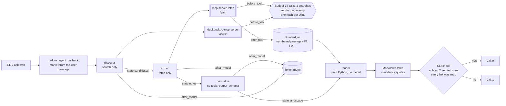
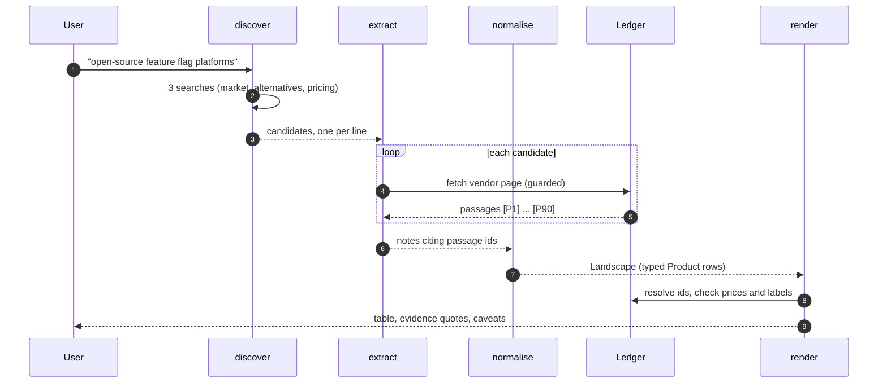

# Day 018 · Competitor Scan

> Describe a market in a sentence; it searches, reads each vendor's own page, and returns a normalised comparison table. The model never types evidence: it **cites numbered page passages by id**, and plain Python copies the quote, pins the URL to the page that passage came from, and deletes any row or price the page does not back.

| | |
|---|---|
| **Pattern** | Search → extract → normalise (`SequentialAgent`, one job per stage, typed hand-offs) |
| **Framework** | Google ADK 2.13 · Gemini 3.5 Flash-Lite |
| **MCP servers** | [`duckduckgo-mcp-server`](https://github.com/nickclyde/duckduckgo-mcp-server) 0.7.0 (`search` only) · [`mcp-server-fetch`](https://github.com/modelcontextprotocol/servers/tree/main/src/fetch) 2026.10.28 (`fetch` only) |
| **Needs** | Gemini API key · `uv` · no other accounts |
| **Typical run** | ≈ 25 s · 6–8 tool calls (capped at 14) · ≈ 80k tokens in, ≈ 1k out |

## Architecture



Both servers run as **stdio subprocesses launched by `uvx`**: nothing to deploy and no ports. Only the discovery stage can search and only the extraction stage can fetch, so each stage has the least privilege it needs.

## How a run works



## Engineering decisions

| Decision | Why |
|---|---|
| **Cite passage ids, never retype quotes** | The first version asked the model to copy quotes verbatim and then string-matched them. Flash-Lite kept paraphrasing, so most rows failed the check. Passage ids move the copying into code: a quote in the output is guaranteed verbatim. |
| **Row URL comes from the passage, not the model** | The model wrote `https://vendor.com` while having read `/pricing`. The URL is now looked up from the cited passage's page, so a row can only point at a page that was actually read. |
| **Unsupported pricing becomes `Unknown`, the row stays** | A real product with a bad price citation is still useful. Any price must appear in the cited passage and a `Free` / `Open source` label needs that word there. Otherwise the fields reset and a caveat says so. A missing price is honest; an unsupported one is not. |
| **Four stages, three typed hand-offs** | Each stage has one job and a small prompt. Notes are text, but the last model stage fills a Pydantic `Landscape`, so the table has a fixed vocabulary (`Free`, `Freemium`, `Paid`, `Open source`, `Contact sales`, `Unknown`) and rows compare. |
| **Rendering is not a model call** | `render` is a `BaseAgent` that yields the table. Dropping, de-duplicating and escaping `|` in cells are deterministic and unit-tested. |
| **Tool filtering: `search` and `fetch` only** | DuckDuckGo's server also offers `fetch_content` and `expand_link`; the official fetch server does the reading, so one tool each. Smaller prompts, no overlapping tools. |
| **Pinned server versions** | `duckduckgo-mcp-server==0.7.0`, `mcp-server-fetch==2026.10.28`. A run next month behaves like today's. |
| **Guardrails in `before_tool`** | Budget of 14 calls and 3 searches (enforced in code after the model kept running extra searches), query ≤ 200 chars, `max_results` ≤ 10, `fetch` ≤ 6,000 chars, no paging (`start_index` forced to 0), no refetching a URL, only hosts a search returned, and no blog, comparison, GitHub or forum pages. Rejected calls are free. |
| **Model: `gemini-3.5-flash-lite`** | Cheapest model with function calling. A single try with `gemini-3.8-flash` was not better on this task (its search errored and it returned nothing), so the default stays. Override with `GEMINI_MODEL`. |
| **`SequentialAgent`** | Stages are strictly ordered and share state, which is what it is for. ADK 2.13 marks it deprecated in favour of `Workflow`, which cannot yet be used as a sub-agent, so a deprecation warning shows in test output. |
| **Input from the conversation** | `root_agent` has no hard-coded market. A `before_agent_callback` reads it from the user's message, resets the ledger, and asks a question if the message is too short. |

## Cost and performance

A real run from this repo, the sample in [`examples/sample-output.md`](examples/sample-output.md):

```
— 26.0s · 11 model calls · 7/14 tool calls {'search': 3, 'fetch': 4} · 83,736 in / 1,053 out tokens
```

No USD figure is printed because this model has no entry in the price table. Set `GEMINI_PRICE_IN` / `GEMINI_PRICE_OUT` (USD per 1M tokens) to get one.

What drives cost: the **input tokens**. Every `fetch` result (up to 90 numbered passages) is re-sent with each later model call in that stage, so input is roughly 80x output. The caps on `fetch` length, one page per vendor, and the 14-call budget bound it. Wall-clock time is mostly vendor page loads and DuckDuckGo.

## Failure modes and mitigations

| Failure | Mitigation |
|---|---|
| Model cites a passage that does not exist, or one from another vendor's page | The id is resolved per page; the row is dropped or its pricing is reset to `Unknown`, and the caveat names it. |
| Model states a price or a "free" label the page does not show | Checked against the cited passage text; failing rows keep the product but lose the pricing. |
| Discovery under-searches or fewer than 2 vendors survive verification | The CLI check fails (exit 1) rather than printing a thin table as if it were a landscape. **This happens on a minority of runs with Flash-Lite**: in testing, runs of the fixed task returned between 1 and 3 verified rows, so the pass bar is 2 rows (a comparison needs at least two). Expect the nightly eval to flap. |
| Vendor page blocks bots, `robots.txt` forbids it, or the fetch times out | The failed fetch leaves no passages, so the vendor cannot appear. The fetch server obeys `robots.txt` and this agent does not override that. |
| Model fetches an article instead of a vendor page | Blocked by host and path rules for common cases (`/blog/`, `/compare`, `-vs-`, GitHub, Reddit). Review sites on other paths can still get through: one test run used a `security.org` article as a "vendor" page. |
| Prompt injection in fetched pages | Pages are only quoted as passages and never executed; the model has no write tools; fetches are limited to sites the search returned. The model still reads page text, so treat the free-text columns as untrusted. |
| Search returns SEO listicles | Discovery uses three fixed query shapes and takes vendors' own URLs; weaker for markets with few official sites. |

## Tests

| Test | What it proves | Needs |
|---|---|---|
| `test_ledger.py` (passages) | Pages split into numbered passages; ids bind to their page; MCP response shapes unwrap | nothing |
| `test_ledger.py` (validation) | Missing passage drops the row; model-typed URLs are replaced; unsupported prices and free labels reset to `Unknown`; duplicates dropped; pipes escaped | nothing |
| `test_ledger.py` (guards) | Total and search budgets, `reset()`, vendor-page filter, link check ignores URLs inside quoted text | nothing |
| `test_agent.py` (callbacks) | Argument caps, free refusals, fetch limited to searched, non-article, not-yet-read pages; fetch result rewritten as passages; token meter | nothing |
| `test_agent.py` (pipeline) | Four stages in order; tools isolated per stage; `normalise` has an `output_schema`; short input asks a question; a new message resets state; the renderer drops unverifiable rows (runs the real `BaseAgent`) | nothing |
| `test_mcp_servers_expose_exactly_the_filtered_tools` | Starts both real servers and asserts exactly `search` and `fetch` come through | `uvx`, network |
| `test_live_scan_produces_a_verified_table` | End to end on the real model and web; exit code 0 | `GOOGLE_API_KEY` |

## Run it

```bash
cd day-018-competitor-scan
uv sync
cp .env.example .env            # add your Gemini API key
uv run pytest -q                # live test skipped without a key
uv run python -m competitor_scan "open-source feature flag platforms for small teams" -o table.md
uv run adk web                  # interactive dev UI; type a market in chat
```

| Variable | Default | Purpose |
|---|---|---|
| `GOOGLE_API_KEY` | none | Gemini API key |
| `GEMINI_MODEL` | `gemini-3.5-flash-lite` | Model for all three LLM stages |
| `MAX_TOOL_CALLS` | `14` | Total tool-call budget (searches are fixed at 3) |
| `GEMINI_PRICE_IN` / `GEMINI_PRICE_OUT` | unset | USD per 1M tokens, enables the cost figure |

`--metrics m.json` writes run metrics for dashboards. Behind a TLS-intercepting proxy, set `UV_SYSTEM_CERTS=1` and `SSL_CERT_FILE`; the agent forwards them to the stdio servers.

## What I'd do next

- Give discovery a retry: if fewer than four vendors come back, run one more search before extraction instead of failing the run afterwards.
- Fetch candidates in parallel with a `ParallelAgent`, one extractor per vendor, so a slow or blocked page cannot stall or truncate the others.
- Add a scored comparison (weighted criteria) on top of the table, with each score tied to a cited passage.
