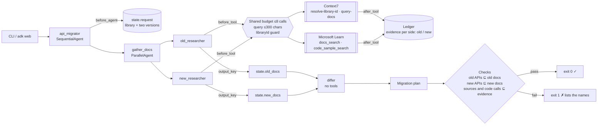
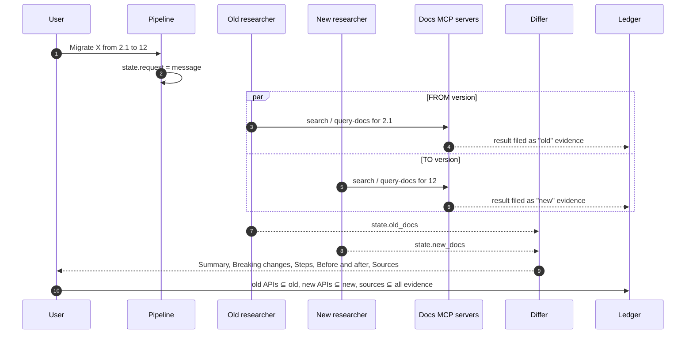

# Day 019 · API Migrator

> Name a library and two versions; it retrieves each version's docs **in parallel**, then a tool-less differ writes a migration plan from the two. Afterwards every "removed" API is checked against the old docs and every replacement against the new docs, so a plausible API remembered from training fails the run.

| | |
|---|---|
| **Pattern** | Diff reasoning over docs (ParallelAgent fan-out → SequentialAgent diff) |
| **Framework** | Google ADK 2.12 · Gemini 3.5 Flash-Lite |
| **MCP servers** | [`@upstash/context7-mcp`](https://github.com/upstash/context7) 4.4.4 (stdio via `npx`) · [Microsoft Learn MCP](https://learn.microsoft.com/en-us/training/support/mcp) (remote, no auth) |
| **Needs** | Gemini API key · `uv` · Node 18+ (`npx`) · optional free Context7 key (see below) |
| **Typical run** | ≈ 15 s · 5–8 tool calls (capped at 8) · ≈ 50k tokens |

## Architecture



Context7 runs as a **stdio subprocess started by `npx`**; Microsoft Learn is a **remote streamable-HTTP** server. Each researcher owns its own connections so the two can run concurrently.

## How a run works



## Engineering decisions

| Decision | Why |
|---|---|
| **ParallelAgent for the two retrievals** | The FROM and TO lookups are independent, so wall-clock time is one lookup, not two. Each researcher has its own MCP connections and writes to its own `output_key`, so they never race on state. |
| **Differ has no tools** | A migration plan is a comparison. With no tools the differ can only use the two digests, so any API it names has to come from them, and that is what the checks verify. |
| **Evidence kept per side** | `after_tool_callback` files each result under `old` or `new` by the calling agent's name. This is what makes the diff checkable: "removed" must be in the old docs and the replacement in the new docs. A single evidence pool would pass an API that only exists in the wrong version. |
| **Shared tool budget of 8** | One ledger counts calls from both researchers, so parallelism cannot double the spend. Over-budget calls get an error dict instead of running. |
| **Argument guards before the budget** | Queries are capped at 300 chars and `query-docs` rejects a `libraryId` that is not a Context7 id, so a malformed call costs nothing. |
| **Tool filter: 4 tools** | Context7 needs both of its tools. From Microsoft Learn we take search and code samples, not the page fetcher, whose pages are large and unbounded. |
| **Pin Context7 to 4.4.4** | Servers change tool names and schemas. Learn is remote and can't be pinned, so a smoke test asserts its exact filtered tool list. |
| **Truncate each result to 6k chars** | Two digests feed the differ, so each must stay small. Evidence is what the model saw, so checks can't pass on text it never read. |
| **Request comes from the message** | A `before_agent_callback` stores the message in `state.request` and asks a clarifying question (no model call) unless it names two versions. `root_agent` hard-codes no library. |
| **Flash-Lite** | Retrieval plus structured comparison over short digests. `GEMINI_MODEL` overrides it for harder migrations. |

## Cost and performance

A real run ([full output](examples/sample-output.md)):

```
  → [new_researcher] microsoft_docs_search(query='Azure Storage Blob Python SDK v12 migration BlockBlobService BlobServi...)
  → [old_researcher] resolve-library-id(libraryName='azure-storage-blob', query='BlockBlobService version 2.1 Python SDK')
  → [old_researcher] microsoft_docs_search(query='BlockBlobService Azure Storage Blob Python SDK 2.1')
  → [old_researcher] microsoft_code_sample_search(language='python', query='BlockBlobService')
  → [new_researcher] microsoft_docs_search(query='migrate from 2.1 blockblobservice to v12 python azure storage blob')
  → [new_researcher] microsoft_code_sample_search(language='python', query='BlobServiceClient container_client blob_client')
— 14.6s · 8 model calls · 6/8 tool calls {'microsoft_docs_search': 3, 'resolve-library-id': 1, 'microsoft_code_sample_search': 2} · 46,203 in / 2,753 out tokens
✓ Sections present, sources returned by a tool, every old API in the old docs, every new API in the new docs.
```

- **Input tokens dominate (94%).** Each researcher re-reads its tool results on every turn, and the differ reads both digests. Truncation and the shared budget bound this.
- **Two researchers cost roughly double one**, but run concurrently, so latency is about that of one.
- **No USD figure** appears because Flash-Lite's price isn't in the built-in table. Set `GEMINI_PRICE_IN` / `GEMINI_PRICE_OUT` (USD per 1M tokens) to get one. It's an estimate for budgeting, not billing.
- `--metrics m.json` writes the same numbers as JSON for the [eval dashboard](../README.md#agent-health).

## Context7 free quota

Context7 works without a key but applies a shared monthly quota to keyless use. When it is used up, the server returns `Monthly quota exceeded`. Get a **free** key at <https://context7.com/dashboard> and put `CONTEXT7_API_KEY=...` in `.env`; the agent passes it to the server process. Without a key, Microsoft and Azure migrations still work through Microsoft Learn (the default eval request is one); for other libraries the run reports the Context7 error and exits 1 instead of guessing. **During development the keyless quota was already exhausted, so the sample run exercises Microsoft Learn only. Context7 was verified only as far as starting it and listing its tools; none of its docs calls succeeded, so no end-to-end run through it is included.**

## Failure modes and mitigations

| Failure | Mitigation |
|---|---|
| Plan lists a "removed" or "new" API the matching docs don't contain | `diff_grounded` fails the run (exit 1) and lists `old:name` / `new:name` |
| Plan cites a URL or library id no tool returned | `sources_verified` fails the run. This happened in development: a plausible Learn URL that was never retrieved |
| Code uses a function in neither doc set | `code_grounded` fails the run |
| One version's docs missing, or a server errors | Differ writes "The retrieved docs do not cover this"; `covered_by_docs` fails the run |
| Retrieved docs describe a different version than requested | Researchers must state the version the docs describe; the differ reports it in the Summary |
| Context7 quota used up | Error text surfaces in the digest; use `CONTEXT7_API_KEY` or a Microsoft/Azure migration |
| Parallel researchers overspend | One shared ledger and budget |
| Vague input ("hi", no versions) | Clarifying question, no model or tool call |

The checks are deterministic string matches against retrieved text. They catch invented names, not wrong reasoning about real ones, so a human still reviews the plan.

## Tests

```bash
uv run pytest -q
```

| Test | What it proves | Needs |
|---|---|---|
| `test_ledger.py` | Budget, cost maths, request parsing, table parsing, per-side symbol grounding, source and code checks | nothing |
| `test_before_tool_*`, `test_after_tool_*` | Shared budget across both researchers, query caps, `libraryId` guard, truncation, evidence filed per side | nothing |
| `test_request_comes_from_the_message_not_import_time` | Two migrations in one session rebind the pipeline | nothing |
| `test_each_request_gets_a_fresh_budget_and_evidence` | Reused ledger (`adk web`) resets between messages | nothing |
| `test_pipeline_is_parallel_gather_then_toolless_differ` | Stage order, `output_key` hand-offs, differ has no tools | nothing |
| `test_context7_exposes_exactly_the_filtered_tools` | Starts the **real** Context7 server and checks least-privilege filtering | `npx` |
| `test_microsoft_learn_exposes_exactly_the_filtered_tools` | Same for the remote Microsoft Learn server | network |
| `test_live_plan_is_grounded_in_both_doc_sets` | Full end-to-end run with Gemini | `GOOGLE_API_KEY` |

## Run it

```bash
cp .env.example .env            # add GOOGLE_API_KEY
uv sync
uv run python -m api_migrator "Migrate the Azure Storage Blob Python SDK from the legacy 2.1 BlockBlobService to the current v12 BlobServiceClient" -o plan.md
uv run adk web                  # interactive dev UI: send "Migrate X from A to B"
```

| Env var | Default | Purpose |
|---|---|---|
| `GOOGLE_API_KEY` | none (required) | Gemini API key, read from `.env` and never committed |
| `GEMINI_MODEL` | `gemini-3.5-flash-lite` | Model used by every stage |
| `GEMINI_PRICE_IN` / `GEMINI_PRICE_OUT` | unset | USD per 1M tokens for the cost meter |
| `MAX_TOOL_CALLS` | `8` | Tool-call budget per run, shared by both researchers |
| `CONTEXT7_API_KEY` | unset | Optional free Context7 key, avoids the keyless monthly quota |

## What I'd do next

- Add a verify-and-repair loop: when `diff_grounded` fails, send the offending names back to the differ for one retry.
- Scan the user's own code (a filesystem MCP, read-only) and turn the breaking-change table into a per-file checklist.
- Pull the project's changelog or release notes as a third evidence side and cross-check the docs diff against it.
