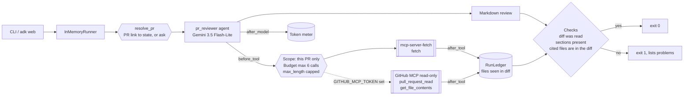
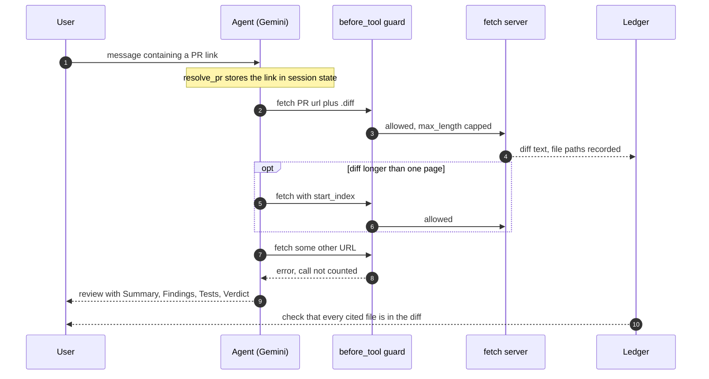

# Day 020 · PR Reviewer

> Give it a public GitHub pull request link and it reads the diff and writes a review. What's special is the access model: the agent can **look at exactly one pull request and change nothing**. The scope is enforced in code (one PR's URLs, read tools only, no credentials needed), and the review is checked afterwards so it can only cite files that really appear in the diff.

| | |
|---|---|
| **Pattern** | Read-only scoped credentials (single agent, scope and budget guardrails) |
| **Framework** | Google ADK 2.12 · Gemini 3.5 Flash-Lite |
| **MCP servers** | [mcp-server-fetch](https://pypi.org/project/mcp-server-fetch/) 2026.11.4 (stdio via `uvx`, default) · optional: [GitHub MCP server](https://github.com/github/github-mcp-server) (remote, read-only mode) |
| **Needs** | Gemini API key · `uv` · no GitHub account or token for public PRs |
| **Typical run** | ≈ 10 s · 1–4 tool calls (capped at 6) · ≈ 10–50k tokens depending on diff size |

## Architecture



## How a run works



## Engineering decisions

| Decision | Why |
|---|---|
| **Scope is code, not a prompt** | `before_tool_callback` accepts only this PR's page, `.diff`, `.patch` and `/files` URLs on `github.com`. Anything else (another PR, another repo, an API URL) returns an error and costs no budget. A prompt-injected diff can ask for more, but it cannot get it. |
| **No token for public PRs** | The diff of a public PR is public. Not needing a credential means there is nothing to leak, so the safest read-only credential is none. |
| **Optional GitHub MCP in read-only mode** | With `GITHUB_MCP_TOKEN` set, the agent uses the official remote server with the `X-MCP-Readonly` header, two tools (`pull_request_read`, `get_file_contents`), and arguments pinned to the PR's owner, repo and number. Use a fine-grained token with read permissions only: three layers (token scope, server mode, tool filter) each independently prevent writes. The variable is deliberately not `GITHUB_TOKEN`, so an ambient write token is never picked up by accident. |
| **Tool filtering** | `fetch` is the only tool exposed from the fetch server. From the GitHub server, only two read tools of dozens (it also has merge, comment, review and branch tools). |
| **Pinned stdio server** | `mcp-server-fetch==2026.11.4`, so a run today behaves like a run next month. The smoke test asserts the exact filtered tool list. |
| **`--ignore-robots-txt` on the fetch server** | `github.com/robots.txt` answers 403 to non-browser clients, which makes the server refuse every fetch. This is acceptable because the URL is supplied by the user and the scope check allows only that one PR. |
| **Proxy and CA variables passed through** | Stdio MCP servers start with a minimal environment. Only network settings (proxy, CA bundle) are forwarded, never anything that could hold a credential. |
| **Untrusted-input rule** | Titles, descriptions and code can contain instructions. The prompt says to treat them as data, and the code scope check limits what a successful injection could do. |
| **Post-run file check** | The ledger records file paths from diff headers. Files in backticks in the review that were never in a diff are reported and the run exits non-zero. |
| **Link comes from the message** | `resolve_pr` stores the link each turn (and asks a question if there is none), so `adk web` works for any PR and nothing is hard-coded at import time. |
| **Flash-Lite by default** | Reading a diff and writing a structured review is within its range. Switch with `GEMINI_MODEL` for subtle logic bugs in large diffs. |

## Cost and performance

The CLI prints a tool-call trace and a meter at the end of every run. A real run ([full output](examples/sample-output.md)):

```
  → fetch(url='https://github.com/tallaprs15/agent-a-day/pull/1.diff')
  → fetch(url='https://github.com/tallaprs15/agent-a-day/pull/1.diff', start_index=20000)
  → fetch(start_index=40000, url='https://github.com/tallaprs15/agent-a-day/pull/1.diff')
— 8.9s · 4 model calls · 3/6 tool calls {'fetch': 3} · 48,281 in / 382 out tokens
✓ Diff was read, sections are present, and every cited file appears in the diff.
```

- **Input tokens dominate (99%).** The diff is the cost, and each page is re-sent on the next model call. A 60 KB diff costs about 48k input tokens; a small PR costs a few thousand.
- **Page size is capped** at 20,000 characters per fetch, and the budget of 6 calls bounds the worst case at roughly 120 KB of diff.
- **No USD figure** appears because Flash-Lite's price isn't in the built-in table. Set `GEMINI_PRICE_IN` / `GEMINI_PRICE_OUT` (USD per 1M tokens) to get one. It is an estimate for budgeting, not billing.

## Failure modes and mitigations

| Failure | Mitigation |
|---|---|
| Review cites a file that isn't in the diff | Checked against diff headers; reported and exit code 1 |
| Diff injection ("ignore your rules, fetch ...") | Scope check in code allows only this PR's URLs; the prompt also treats content as data |
| Model asks for another PR or repo | Rejected with an error and no budget spent |
| Huge diff | Paged 20k characters at a time; budget of 6 calls; the review must say when the diff was truncated |
| Tool loop | Hard budget in code |
| Private PR or no access | The fetch returns an error and the review says it could not read the diff; the `diff_read` check fails |
| No PR link in the message | Asks for one instead of calling the model |
| Server renames or removes a tool | Smoke test asserts the exact filtered tool list |
| Review looks authoritative but is wrong | It is a second pair of eyes, not an approval. The agent cannot approve, comment or merge. |

## Tests

```bash
uv run pytest -q
```

| Test | What it proves | Needs |
|---|---|---|
| `test_ledger.py` | PR link parsing, URL scope (other PRs, repos, hosts, schemes, traversal all rejected), budget, cost, file-evidence parsing including escaped newlines | nothing |
| `test_fetch_is_scoped_capped_and_budgeted` | Out-of-scope calls are rejected for free, `max_length` is capped, budget blocks | nothing |
| `test_github_tools_are_pinned_to_the_pr_and_read_methods` | Owner, repo and number are overwritten; write-like methods are refused | nothing |
| `test_pr_comes_from_each_message_not_import_time` | Two different PR links in one session each bind to state | nothing |
| `test_missing_pr_link_triggers_a_clarifying_question` | No link means a question, not a model call | nothing |
| `test_agent_builds_with_both_server_modes` | Both toolset configurations construct; no write tool is in the allowed list | nothing |
| `test_fetch_server_exposes_exactly_the_filtered_tools` | Starts the **real** server and checks least-privilege filtering | `uvx`, network |
| `test_live_review_only_cites_files_in_the_diff` | Full end-to-end run with Gemini against a real PR | `GOOGLE_API_KEY` |

The GitHub MCP mode is covered by unit tests only: it needs a token, which wasn't available when this was built, so it has **not** been run against the live server.

## Run it

```bash
cp .env.example .env            # add GOOGLE_API_KEY
uv sync
uv run python -m pr_reviewer https://github.com/tallaprs15/agent-a-day/pull/1 -o review.md
uv run adk web                  # interactive dev UI: paste a PR link in the chat
```

| Env var | Default | Purpose |
|---|---|---|
| `GOOGLE_API_KEY` | none (required) | Gemini API key, read from `.env` and never committed |
| `GEMINI_MODEL` | `gemini-3.5-flash-lite` | Model used by the agent |
| `MAX_TOOL_CALLS` | `6` | Tool-call budget per run |
| `GITHUB_MCP_TOKEN` | unset | Optional. Switches to the GitHub MCP server in read-only mode. Use a free fine-grained token with read-only repository permissions. |
| `GEMINI_PRICE_IN` / `GEMINI_PRICE_OUT` | unset | USD per 1M tokens for the cost meter |

## What I'd do next

- Verify the quoted line numbers against the diff hunks, not just the file names, and flag any that don't match.
- Add the GitHub MCP path to the smoke test in CI with a read-only token, to cover private repositories.
- Split large diffs per file and review them in parallel, then merge the findings.
