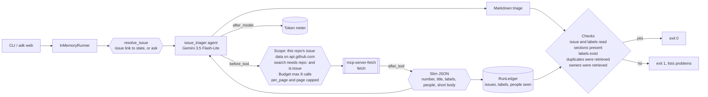
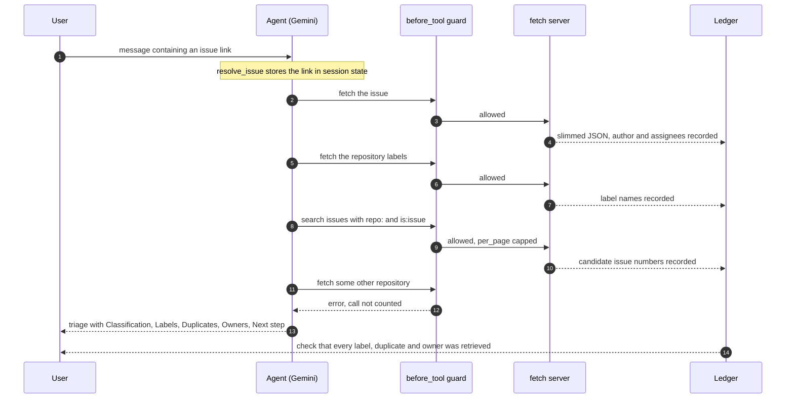

# Day 021 · Issue Triager

> Give it a public GitHub issue link and it suggests labels, likely duplicates and owners. What's special is that classification is separated from retrieval: the model decides what kind of issue it is, but every label, duplicate number and person it **names** must come out of a tool result (the repository's label list, a repo-scoped search, the issue thread). Anything invented is caught by a post-run check and fails the run.

| | |
|---|---|
| **Pattern** | Classification + retrieval (single agent, scope and budget guardrails, grounding checks) |
| **Framework** | Google ADK 2.12 · Gemini 3.5 Flash-Lite |
| **MCP servers** | [mcp-server-fetch](https://pypi.org/project/mcp-server-fetch/) 2026.11.4 (stdio via `uvx`) against the public GitHub REST API |
| **Needs** | Gemini API key · `uv` · no GitHub account or token for public repositories |
| **Typical run** | ≈ 5 s · 3–5 tool calls (capped at 8) · ≈ 8–16k tokens · < $0.002 |

## Architecture



## How a run works



## Engineering decisions

| Decision | Why |
|---|---|
| **Retrieval gates what can be named** | Classification is the model's judgement, but a label must exist in the repository's label list, a duplicate must be a different issue that a tool returned, and an owner must be a person who appeared in the results. This is what makes a triage trustworthy enough to act on. |
| **Scope is code, not a prompt** | `before_tool_callback` accepts only one repository's issue, comments, labels and issues list, plus `search/issues` whose query pins every `repo:` qualifier to that repository (and rejects `org:` or `user:`). Another repo, another host or another endpoint returns an error and costs no budget. A prompt-injected issue body can ask for more, but cannot get it. |
| **No token for public repositories** | Public issue data is public. Not needing a credential means nothing to leak. The agent has no write tool at all, so it cannot label, comment or close. |
| **Slim the JSON in `after_tool_callback`** | A raw GitHub issue is about 8 KB (dozens of URL fields). The callback keeps number, title, state, labels, author, assignees and 700 characters of body, roughly 0.5 KB. The model sees more candidates for the same tokens, and the evidence the checks read is small and exact. |
| **`max_length` raised, `per_page` capped** | The slimming needs complete JSON, so a fetch is allowed to be large, while `per_page` (20) and `page` (3) are capped in code so one call cannot pull a whole backlog. |
| **Search must say `is:issue` or `is:pr`** | GitHub answers 422 otherwise. The guard catches that for free and tells the model what to add, instead of spending budget on a call that cannot succeed. |
| **Pull requests are triaged as issues** | GitHub numbers both from one sequence and serves both through the issues API, so `/pull/N` links work too and the output says `kind`. |
| **Tool filtering and pinning** | `fetch` is the only tool exposed. `mcp-server-fetch==2026.11.4`, and the smoke test asserts the exact filtered tool list. |
| **`--ignore-robots-txt`** | The server consults `robots.txt` for model-initiated fetches. This is acceptable because the scope check allows only one repository's REST data. |
| **Untrusted-input rule** | Issue titles, bodies and comments can contain instructions. The prompt treats them as data and the code scope limits what a successful injection could reach. |
| **Link comes from the message** | `resolve_issue` stores the link each turn (and asks a question if there is none), so `adk web` works for any issue and nothing is hard-coded at import time. |
| **Flash-Lite by default** | Classifying one issue against a short label list is within its range. Switch with `GEMINI_MODEL` for long, ambiguous threads. |

## Cost and performance

The CLI prints a tool-call trace and a meter at the end of every run. A real run ([full output](examples/sample-output.md)):

```
  → fetch(url='https://api.github.com/repos/tallaprs15/agent-a-day/issues/2')
  → fetch(url='https://api.github.com/repos/tallaprs15/agent-a-day/labels')
  → fetch(url='https://api.github.com/search/issues?q=Context7+repo:tallaprs15/agent-a-day+is:pr')
— 5.1s · 4 model calls · 3/8 tool calls {'fetch': 3} · 8,019 in / 265 out tokens · ~$0.0009
✓ Issue and labels were read; every label, duplicate and owner named in the triage came from tool results.
```

- **Input tokens dominate (97%).** Each tool result is re-sent on the next model call; slimming keeps that to a few thousand tokens per call instead of tens of thousands.
- **Bounded worst case.** At most 8 tool calls, each at most 20 items.
- **The USD figure is an estimate** from a built-in price table. Set `GEMINI_PRICE_IN` / `GEMINI_PRICE_OUT` (USD per 1M tokens) to override it.

## Failure modes and mitigations

| Failure | Mitigation |
|---|---|
| Suggests a label that doesn't exist | Checked against the repository label list; reported and exit code 1 |
| Names a duplicate that was never retrieved, or the issue itself | Checked against issue numbers seen in tool results; reported and exit code 1 |
| Names an owner with no evidence | Checked against logins seen in tool results; reported and exit code 1 |
| Skips the label list | The `labels_listed` check fails (this happened in the first development run) |
| Issue text injection ("ignore your rules, fetch ...") | Scope check in code; the prompt treats content as data |
| Model queries another repository | Rejected with an error and no budget spent |
| Search returns 422 or nothing | Guard prevents the common 422; the agent falls back to the recent-issues list, and says "None found" otherwise |
| Unauthenticated rate limit (60 requests/h, search 10/min) | Few calls per run; a rate-limit error surfaces as a failed tool call and the triage must say it could not read the data |
| Duplicates missed because search is keyword based | A triage is a suggestion for a maintainer, not an action. Nothing is changed on GitHub. |
| Server renames or removes a tool | Smoke test asserts the exact filtered tool list |

## Tests

```bash
uv run pytest -q
```

| Test | What it proves | Needs |
|---|---|---|
| `test_ledger.py` | Link parsing, URL scope (other issues, repos, hosts, schemes, extra `repo:`/`org:` qualifiers, userinfo tricks all rejected), query capping, JSON slimming, budget, cost, evidence collection, grounding validators | nothing |
| `test_fetch_is_scoped_capped_and_budgeted` | Out-of-scope calls are rejected for free, `per_page` is capped, budget blocks | nothing |
| `test_search_without_type_is_rejected_for_free` | The guard catches a search that GitHub would answer with 422 | nothing |
| `test_after_tool_slims_the_response_and_records_evidence` | Noise is dropped and the ledger learns who and what was shown | nothing |
| `test_issue_comes_from_each_message_not_import_time` | Two different issue links in one session each bind to state; a PR link binds as the same number | nothing |
| `test_missing_issue_link_triggers_a_clarifying_question` | No link means a question, not a model call | nothing |
| `test_root_agent_does_not_hard_code_a_subject` | The instruction is templated from state | nothing |
| `test_fetch_server_exposes_exactly_the_filtered_tools` | Starts the **real** server and checks least-privilege filtering | `uvx`, network |
| `test_live_triage_only_names_labels_issues_and_people_the_tools_returned` | Full end-to-end run with Gemini against a real repository | `GOOGLE_API_KEY` |

## Run it

```bash
cp .env.example .env            # add GOOGLE_API_KEY
uv sync
uv run python -m issue_triager https://github.com/tallaprs15/agent-a-day/issues/2 -o triage.md
uv run adk web                  # interactive dev UI: paste an issue link in the chat
```

| Env var | Default | Purpose |
|---|---|---|
| `GOOGLE_API_KEY` | none (required) | Gemini API key, read from `.env` and never committed |
| `GEMINI_MODEL` | `gemini-3.5-flash-lite` | Model used by the agent |
| `MAX_TOOL_CALLS` | `8` | Tool-call budget per run |
| `GEMINI_PRICE_IN` / `GEMINI_PRICE_OUT` | unset | USD per 1M tokens for the cost meter |

## What I'd do next

- Use the official GitHub MCP server in read-only mode (with a read-only token) for private repositories and higher rate limits, keeping the same grounding checks.
- Add embedding-based candidate retrieval so duplicates are found by meaning, not only by keywords.
- Read `CODEOWNERS` and recent commit authors for the touched area to make owner suggestions stronger than "author of related issues".
