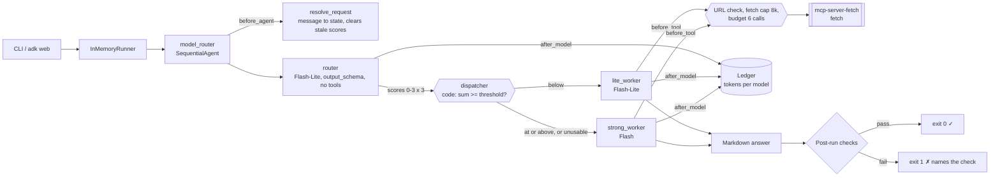
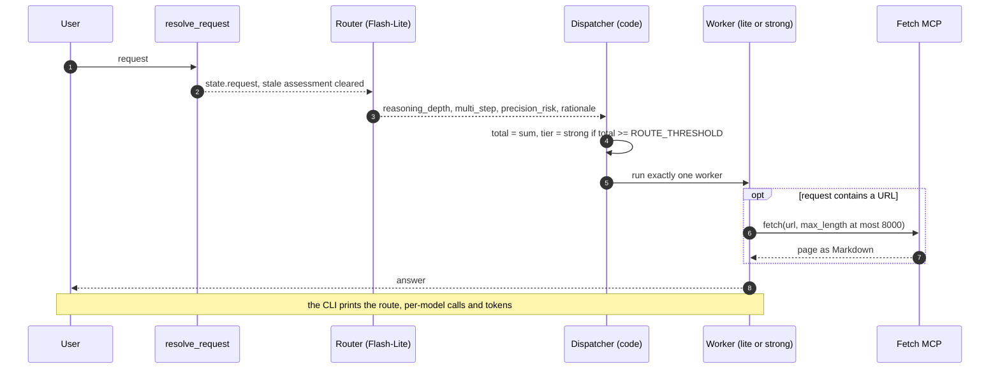

# Day 022 · Model Router

> Every request first meets a cheap router that only **scores difficulty**. Plain code adds up the scores and picks the model: easy requests are answered on Flash-Lite, hard ones on Flash. If the router's output is unusable, the decision fails safe to the strong model.

| | |
|---|---|
| **Pattern** | Cost-aware routing (router + two workers behind a custom dispatcher agent) |
| **Framework** | Google ADK 2.12 · Gemini 3.5 Flash-Lite (router, cheap worker) · Gemini 3.8 Flash (strong worker) |
| **MCP servers** | [`mcp-server-fetch`](https://github.com/modelcontextprotocol/servers/tree/main/src/fetch) 2026.11.4 (official reference server) |
| **Needs** | Gemini API key · `uv` · Node (the fetch server installs a readability helper with npm on first use) |
| **Typical run** | ≈ 5 s on the cheap path · 3 model calls · 0–2 tool calls (capped at 6) · ≈ 2k tokens |

## Architecture



The fetch server runs as a **stdio subprocess launched by `uvx`**. Only the chosen worker ever starts it, and the router has no tools at all.

## How a run works



## Engineering decisions

| Decision | Why |
|---|---|
| **The model scores, code routes** | An LLM asked "which model should answer?" is unreliable and unaudited. Three 0-3 scores summed in code and compared with `ROUTE_THRESHOLD` give a decision you can unit test and tune without touching a prompt. |
| **Fail safe to the strong model** | Wrong routes are asymmetric: a hard request on the cheap model costs quality, an easy one on the strong model costs a little money. Missing, malformed or out-of-range router output therefore routes to strong. |
| **Router is always Flash-Lite and has no tools** | Scoring is classification, which the cheapest tier handles, and a tool-less router cannot be steered into side effects by the request text. |
| **Two workers behind a custom `BaseAgent` dispatcher** | An ADK agent's model is fixed at construction, and a `SequentialAgent` would run both. The dispatcher reads the scores from session state and runs exactly one worker. |
| **One shared instruction and toolset definition for both workers** | The tier changes the model only, so any quality difference is attributable to the model, not the prompt. |
| **Clear the previous assessment on every message** | In `adk web` one session handles many requests. A stale score must never route the next request. |
| **Pin `mcp-server-fetch==2026.11.4` and filter to `fetch`** | Keeps runs reproducible and the prompt small; the server exposes one tool anyway, and the filter makes that a tested guarantee. |
| **Fetch guardrails in `before_tool_callback`** | Only public http(s) URLs (no localhost, private ranges, link-local metadata addresses, `file:`), `max_length` capped at 8k, budget of 6 calls. Refused URLs do not spend budget. |
| **Per-model token ledger** | A blended token count hides the point of routing. Usage is recorded per model so cost is the sum of each model's own price. |
| **Forward only proxy and CA variables to the stdio server** | Stdio servers start with a minimal environment; without these the fetch server cannot get through a proxy. The API key is never forwarded. |

## Cost and performance

A real run on the cheap path ([full output](examples/sample-output.md)):

```
  → [lite_worker] fetch(url='https://example.com')
route: lite (gemini-3.5-flash-lite) · difficulty 2/9 {'reasoning_depth': 1, 'multi_step': 1, 'precision_risk': 0}
— 5.4s · 3 model calls {'gemini-3.5-flash-lite': 3} · 1/6 tool calls {'fetch': 1} (0 failed) · 2,220 in / 117 out tokens
✓ Routed to the lite model; the worker that ran matches the routing policy and the answer is non-empty.
```

- **The router costs one small call**, with no tool results in its context. For an easy request that is the whole overhead; routing only pays off when it avoids Flash on enough requests.
- **Input tokens dominate (95%)** because each tool result is fed back to the worker on its next turn. The fetch cap matters more than output length.
- **No USD figure** appears because prices are not built in. Set `GEMINI_PRICE_LITE_IN/OUT` and `GEMINI_PRICE_STRONG_IN/OUT` (USD per 1M tokens) to get an estimate; it is for budgeting, not billing.
- The strong path was exercised only by the live test, which checks the route (not tokens or latency). No strong-path meter line is published.
- Metrics are also written as JSON with `--metrics m.json`, which is what the [eval dashboard](../README.md#agent-health) consumes.

## Failure modes and mitigations

| Failure | Mitigation |
|---|---|
| Router returns malformed or out-of-range scores | Routes to the strong model; the `router_output_usable` check fails the run so it is noticed |
| Router under-scores a hard request | Tune `ROUTE_THRESHOLD`; the rationale is printed with the scores. The cheap model is still given an explicit "say so if you are unsure" instruction |
| Stale score reused in a long chat | Assessment is cleared in `before_agent_callback`; a live test sends an easy then a hard request in one session |
| Worker claims to have read a page it did not | Instruction forbids it; `fetched_when_url_given` and `no_tool_errors` fail the run |
| Prompt-injected URL such as `http://169.254.169.254/` | Rejected in `before_tool_callback` without spending budget |
| Tool loop | Hard budget of 6 calls |
| Fetch server cannot reach the web (proxy, first-run npm install) | Proxy/CA variables are forwarded; `no_tool_errors` makes a silent failure a failed run |

## Tests

```bash
uv run pytest -q
```

| Test | What it proves | Needs |
|---|---|---|
| `test_ledger.py` | Threshold arithmetic and inclusivity, fail-safe on bad router output, URL guard, budget, per-model cost maths | nothing |
| `test_before_tool_*`, `test_after_tool_*` | Fetch cap, budget, private URLs refused for free, failed tool calls counted | nothing |
| `test_resolve_request_*` | Message goes to state, stale scores cleared, short input gets a question | nothing |
| `test_pipeline_shape_*`, `test_root_agent_*` | Router is Flash-Lite with a schema and no tools; workers use the right models; instructions never hard-code a task | nothing |
| `test_mcp_server_exposes_exactly_the_filtered_tools` | Starts the **real** fetch server and checks least-privilege filtering | `uvx` |
| `test_live_two_requests_in_one_session_route_independently` | An easy then a hard request in one session route to lite then strong | `GOOGLE_API_KEY` |

## Run it

```bash
cp .env.example .env            # add GOOGLE_API_KEY
uv sync
uv run python -m model_router "Fetch https://example.com and tell me in two sentences what the page says." -o answer.md
uv run adk web                  # interactive dev UI; the request comes from each chat message
```

| Env var | Default | Purpose |
|---|---|---|
| `GOOGLE_API_KEY` | none (required) | Gemini API key, read from `.env` and never committed |
| `GEMINI_MODEL` | `gemini-3.5-flash-lite` | Router and cheap worker |
| `GEMINI_STRONG_MODEL` | `gemini-3.8-flash` | Worker for hard requests |
| `ROUTE_THRESHOLD` | `5` | Difficulty total (0-9) at or above which the strong model is used |
| `MAX_TOOL_CALLS` | `6` | Tool-call budget per run |
| `GEMINI_PRICE_LITE_IN/OUT`, `GEMINI_PRICE_STRONG_IN/OUT` | unset | USD per 1M tokens for the cost meter |

## What I'd do next

- Escalate on failure: if the cheap worker's answer fails a check, retry once on the strong model and report the retry in the meter.
- Calibrate the threshold on a small labelled set of easy and hard requests, using `adk eval` to measure quality loss against savings.
- Add a request cache so repeated questions skip both the router and the worker.
