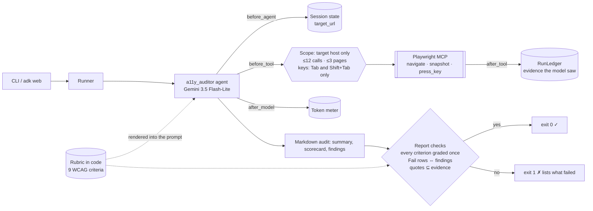
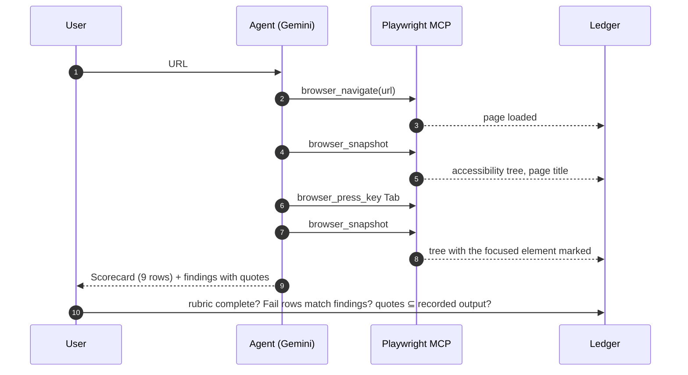

# Day 023 · A11y Auditor

> Give it a URL; it loads the page in a real browser through Playwright MCP, reads the accessibility tree and grades the page against a **fixed WCAG rubric kept in code**. Every criterion must be graded, every failure needs a finding with a **quote copied from a tool result**, and a post-run check fails the run if the scorecard skips a criterion, contradicts its own findings or cites evidence the browser never returned.

| | |
|---|---|
| **Pattern** | Browser + rubric |
| **Framework** | Google ADK 2.12 · Gemini 3.5 Flash-Lite |
| **MCP servers** | [`@playwright/mcp`](https://github.com/microsoft/playwright-mcp) 0.0.85 (stdio via `npx`) |
| **Needs** | Gemini API key · `uv` · Node 18+ (`npx`) · a Chromium/Chrome browser (Playwright downloads one on first use, or set `PLAYWRIGHT_MCP_EXECUTABLE_PATH`) |
| **Typical run** | ≈ 7 s · ≈ 4 tool calls (capped at 12) · ≈ 10k tokens |

## Architecture



Playwright MCP runs as a **stdio subprocess launched by `npx`**. It describes pages as accessibility snapshots (roles, accessible names, heading levels, link targets), which is exactly the data an accessibility audit needs, with no vision model.

## How a run works



## Engineering decisions

| Decision | Why |
|---|---|
| Rubric as data (`rubric.py`) | One list drives the prompt and the checks, so the model cannot drop, rename or invent criteria. Adding a criterion is a one-line change. |
| Only criteria visible in an accessibility tree | Colour contrast, page language and zoom need pixels or the DOM, so they are left out rather than guessed. "Not assessed" is a valid grade. |
| Three tools out of ~25 (`tool_filter`) | The server also offers `browser_evaluate`, clicking, typing, uploads and downloads. An audit is read-only, so none of that is exposed. |
| `browser_press_key` limited to Tab and Shift+Tab | Keyboard focus is the only interactive evidence the tree can give (WCAG 2.1.1). Enter or Space could activate controls. |
| Explicit `browser_snapshot` after navigate | In 0.0.85 `browser_navigate` returns a link to a snapshot file, not the tree. The instruction says so, and `filename` arguments are stripped so nothing is written to disk. |
| Server pinned to `0.0.85` | A run today behaves like a run next month. |
| Scope guard in `before_tool` | Only the target's host (and subdomains), http(s) only, ≤3 pages. A rejected call costs no budget. |
| Scorecard cross-checks | `Fail` rows must list findings, each finding must name the same criterion, and no finding may sit outside a `Fail` row. This catches a summary that disagrees with its details. |
| Evidence is what the model saw | Results are truncated at 8,000 chars per part and the truncated text is what is recorded, so a quote from unseen text fails. |
| Flash-Lite | Grading nine criteria against a short tree is classification, not deep reasoning. |

## Cost and performance

Real run against `https://demo.playwright.dev/todomvc/` (see `examples/sample-output.md`):

```
— 7.1s · 5 model calls · 4/12 tool calls {browser_navigate: 1, browser_snapshot: 2, browser_press_key: 1} · 9,853 in / 449 out tokens
```

No USD figure is printed because no price is configured for this model; set `GEMINI_PRICE_IN` and `GEMINI_PRICE_OUT` (USD per 1M tokens) to get one. Cost is driven by snapshot size, which is re-sent on every model call, so large pages cost more. The per-part cap and the page budget bound it.

## Failure modes and mitigations

| Failure | Mitigation |
|---|---|
| Model skips or renames a criterion | Rubric check: each criterion graded exactly once → exit 1 |
| Model claims a failure with no proof | Each finding needs a backticked quote that appears verbatim in tool output |
| Scorecard and findings disagree | Cross-check in `rubric_problems` |
| Agent wanders to another site or a `file://` URL | Scope guard blocks it before the call |
| Agent presses Enter on a control | Key allow-list blocks it |
| Huge page floods the context | Per-part truncation, and only the truncated text counts as evidence |
| The tree cannot show an issue (contrast, language, images without alt are dropped as decorative) | Out of the rubric or graded "Not assessed"; this tool is a first pass, not a conformance audit |

## Tests

| Test | What it proves | Needs |
|---|---|---|
| `test_ledger.py` | Scorecard rules, evidence and page verification, budgets, scope | nothing |
| `test_agent.py` guardrails | Scope block, budgets, key allow-list, no file writes, truncation, target taken from the message | nothing |
| `test_playwright_exposes_exactly_the_filtered_tools` | The real server starts and exposes exactly the three allowed tools | Node |
| `test_real_browser_snapshot_shows_the_fixture_defects` | A real browser on a local defective page yields the snapshot lines the agent quotes, and Tab moves focus | Node + Chromium |
| `test_live_audit_grades_the_whole_rubric_with_verified_evidence` | End to end with Gemini on a public page; all checks pass | `GOOGLE_API_KEY` |

## Run it

```bash
cd day-023-a11y-auditor
cp .env.example .env        # add your GOOGLE_API_KEY
uv sync
uv run pytest -q
uv run python -m a11y_auditor https://demo.playwright.dev/todomvc/ -o report.md --metrics metrics.json
uv run adk web .            # chat UI: send a URL in each message
```

| Variable | Default | Purpose |
|---|---|---|
| `GOOGLE_API_KEY` | none | Gemini API key |
| `GEMINI_MODEL` | `gemini-3.5-flash-lite` | Model |
| `MAX_TOOL_CALLS` | `12` | Tool-call budget |
| `MAX_PAGES` | `3` | Distinct pages per run |
| `PLAYWRIGHT_MCP_EXECUTABLE_PATH` | unset | Use an existing Chromium/Chrome |
| `GEMINI_PRICE_IN`, `GEMINI_PRICE_OUT` | unset | USD per 1M tokens, enables the cost estimate |

## What I'd do next

- Add a deterministic pre-pass that parses the snapshot for unnamed links, buttons and textboxes, so the model only explains what code has already found.
- Add a contrast check by exposing a narrowly scoped computed-style tool, behind the same scope guard.
- Run the audit on every page of a sitemap and diff scorecards over time.
