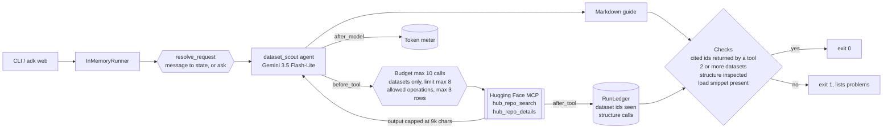
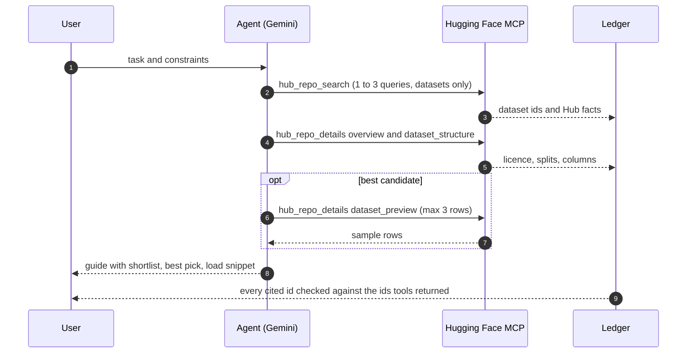

# Day 024 · Dataset Scout

> Describe what you want to train or evaluate; it searches the Hugging Face Hub, inspects the structure of the best candidates, peeks at a few rows, and writes a guide. Retrieval and summarisation are kept honest by an **evidence trail**: the guide may only cite datasets a tool actually returned, and the CLI exits non-zero when it does not.

| | |
|---|---|
| **Pattern** | Retrieval + summarisation (search, inspect, then write) with an evidence check |
| **Framework** | Google ADK 2.12 · Gemini 3.5 Flash-Lite |
| **MCP servers** | [Hugging Face MCP](https://huggingface.co/mcp) (remote, streamable HTTP, server version 0.4.34 when verified; [docs](https://huggingface.co/docs/hub/en/hf-mcp-server)) |
| **Needs** | Gemini API key · `uv` · no Hugging Face account (an optional free `HF_TOKEN` only raises rate limits) |
| **Typical run** | ≈ 10 s · 4–6 tool calls (capped at 10) · ≈ 25k tokens |

## Architecture



The Hugging Face server is **remote**: nothing to install or deploy. ADK's `McpToolset` connects over streamable HTTP and turns the two allowed tool schemas into Gemini function declarations.

## How a run works



## Engineering decisions

| Decision | Why |
|---|---|
| **Evidence trail for citations** | The ledger remembers every dataset id a tool returned (headings and Hub links). Ids in the guide, including `load_dataset("...")` snippets, must be in that set. A made-up dataset id looks plausible, and a code snippet that loads it fails only when someone runs it. |
| **Retrieve, then summarise, in one agent** | The steps are sequential but share one conversation, so the model can use what search returned to decide which datasets to inspect. A separate summariser would only re-read the same text. The instruction pins the order and the output format. |
| **Inspect structure before recommending** | A card and a download count do not say whether a dataset has the columns and splits you need. `dataset_structure` is required before the run can pass (`structure_inspected`). |
| **Filter tools to 2 of 4** | The server also exposes `hf_whoami` and a filesystem-style `hf_fs`. Search plus read-only details is all a guide needs. |
| **Argument guards in `before_tool_callback`** | `repo_types` is forced to `dataset`, search `limit` is capped at 8, details at 3 repos and an allow-list of operations, previews at 3 rows. Fixed before the budget is spent. |
| **Cap what tools hand back** | Sample rows and long cards can be huge. `after_tool_callback` records evidence from the full text, then truncates what the model reads to 9,000 characters, keeping the response shape. |
| **Budget of 10 tool calls in code** | A prompt is a suggestion; the callback returns an error dict that tells the model to write the guide now. |
| **Request comes from the message** | `resolve_request` stores the user's text in session state each turn (and asks a question if it is too short), so `adk web` works for any task and nothing is hard-coded at import time. |
| **Flash-Lite by default** | The work is search, extraction and short summaries over tool output. Switch with `GEMINI_MODEL` for deeper trade-off reasoning. |
| **Unpinned remote server** | A hosted server has no package version to pin. The smoke test asserts the exact filtered tool list, which catches renamed tools. |

## Cost and performance

The CLI prints a tool-call trace and a meter at the end of every run. A real run ([full output](examples/sample-output.md)):

```
  → hub_repo_search(filters=['language:en', 'text-classification'], query='customer support ticket intent c...)
  → hub_repo_search(sort='downloads', query='support tickets intent classification', repo_types=['dataset'])
  → hub_repo_search(query='customer support tickets', repo_types=['dataset'], sort='downloads')
  → hub_repo_details(operations=['overview', 'dataset_structure'], repo_ids=['enzo-joseph/customer-support-t...)
  → hub_repo_details(split='train', config='en', limit=3, repo_ids=['enzo-joseph/customer-support-tickets'],...)
— 10.7s · 6 model calls · 5/10 tool calls {'hub_repo_search': 3, 'hub_repo_details': 2} · 23,674 in / 970 out tokens
✓ Every cited dataset was returned by a tool; structure was inspected.
```

- **Input tokens dominate (96%).** Every tool result is fed back on each later model call. The search `limit` cap, the details cap and the 9k-character output cap are what hold this near 25k.
- **No USD figure** appears because Flash-Lite's price isn't in the built-in table. Set `GEMINI_PRICE_IN` / `GEMINI_PRICE_OUT` (USD per 1M tokens) to get one. It is an estimate for budgeting, not billing.
- The run above is one sample; the number of searches varies from run to run.

## Failure modes and mitigations

| Failure | Mitigation |
|---|---|
| Guide cites a dataset no tool returned | `citations_verified` fails, ids are listed, exit 1 |
| Licence missing from the card | The instruction says "not stated" instead of guessing, and the guide must tell the reader to check before commercial use |
| Recommends without seeing the columns | `structure_inspected` fails the run if `dataset_structure` was never requested |
| Huge sample rows | Previews capped at 3 rows and tool output at 9,000 characters |
| Tool loop | Hard budget of 10 calls |
| Search returns nothing useful | The instruction asks for a short honest guide and a better query rather than padding |
| Hub rate limits for anonymous callers | Optional free `HF_TOKEN` is sent as a bearer header |
| Server renames or removes a tool | Smoke test asserts the exact filtered tool list |
| Vague request | Asks what the task and constraints are instead of searching |

The check proves each cited id exists in tool output. It does not prove the prose about it is right: facts such as sizes and licences are still model-written, so read the table against the linked cards.

## Tests

```bash
uv run pytest -q
```

| Test | What it proves | Needs |
|---|---|---|
| `test_ledger.py` | Budget and structure-call counting, cost meter, evidence from headings and links, unverified citations in links and `load_dataset`, truncation keeps the response shape | nothing |
| `test_before_tool_*` | Budget, datasets-only, argument caps, operation allow-list | nothing |
| `test_after_tool_records_evidence_and_truncates_big_results` | Evidence comes from the full result, the model sees a capped one | nothing |
| `test_request_comes_from_each_message_not_import_time` | Two different requests in one session each bind to state | nothing |
| `test_checks_fail_on_invented_dataset_and_missing_structure` | The post-run checks catch an invented id and a skipped inspection | nothing |
| `test_mcp_server_exposes_exactly_the_filtered_tools` | Connects to the **real remote server** and checks least-privilege filtering | network |
| `test_live_guide_cites_only_datasets_from_tool_results` | Full end-to-end run with Gemini | `GOOGLE_API_KEY` |

## Run it

```bash
cp .env.example .env            # add GOOGLE_API_KEY
uv sync
uv run python -m dataset_scout "Fine-tune a small model to classify customer support tickets by intent, English, permissive licence" -o guide.md
uv run adk web                  # interactive dev UI
```

| Env var | Default | Purpose |
|---|---|---|
| `GOOGLE_API_KEY` | none (required) | Gemini API key, read from `.env` and never committed |
| `GEMINI_MODEL` | `gemini-3.5-flash-lite` | Model used by the agent |
| `MAX_TOOL_CALLS` | `10` | Tool-call budget per run |
| `HF_TOKEN` | unset | Optional free Hugging Face token to raise rate limits |
| `GEMINI_PRICE_IN` / `GEMINI_PRICE_OUT` | unset | USD per 1M tokens for the cost meter |

## What I'd do next

- Verify numbers too: compare sizes, licences and download counts in the guide against the parsed Hub facts, not just the ids.
- Check the best pick's licence field in code and refuse a "permissive" claim when the Hub says otherwise.
- Add a second, independent query pass so a niche task does not depend on one keyword choice.
