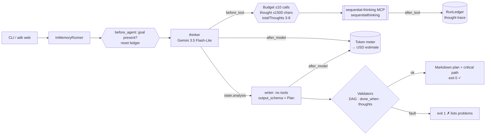
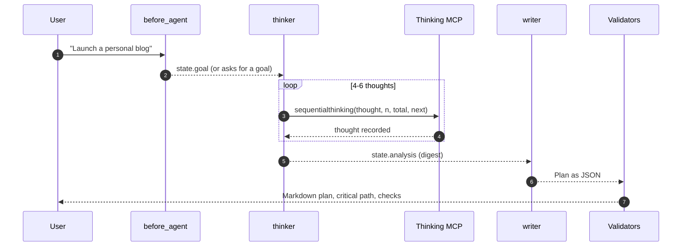

# Day 025 · Deep Planner

> Give it a vague goal; it reasons through it step by step with the **Sequential Thinking** MCP tool, then writes a typed plan. The plan is then **checked as a real dependency graph**: unknown ids, cycles, steps with no acceptance check, or too little reasoning fail the run.

| | |
|---|---|
| **Pattern** | Explicit reasoning tool (thinker, then a typed writer) |
| **Framework** | Google ADK 2.12 · Gemini 3.5 Flash-Lite |
| **MCP servers** | [`@modelcontextprotocol/server-sequential-thinking`](https://github.com/modelcontextprotocol/servers/tree/main/src/sequentialthinking) 1.0.0 |
| **Needs** | Gemini API key · Node.js (`npx`) · `uv` · no other accounts |
| **Typical run** | Not measured yet, see [Cost and performance](#cost-and-performance) |

## Architecture



The MCP server runs as a **stdio subprocess launched by `npx`**: nothing to deploy and no ports to open.

## How a run works



## Engineering decisions

| Decision | Why |
|---|---|
| **A reasoning tool, not just a prompt** | The tool does no work itself: it makes the model commit to numbered, revisable thoughts (restate, define done, decompose, stress-test, revise). The ledger can then count them, which a hidden chain of thought can't offer. |
| **Two stages: thinker, then writer** | Gemini can't combine tools with a structured output schema reliably in one agent. The thinker has the tool and writes a digest; the writer has no tools and must emit the `Plan` schema. |
| **`output_schema=Plan` for the final plan** | Steps, dependencies, effort and acceptance checks are typed fields, so they can be validated by code instead of read by eye. |
| **Deterministic plan validators** | Unique ids, known dependencies, no cycles (topological sort), 3-15 steps, a real `done_when` on every step. A plan that fails is not rendered. |
| **Critical path from effort estimates** | Computed from the validated graph (S=0.5, M=1.5, L=4 days), so it can't contradict the dependencies. |
| **Argument caps in `before_tool`** | `thought` ≤ 1500 chars, `totalThoughts` clamped to 3-8, the 8th thought forced to be final, and a 10-call budget. Caps run before the budget is spent. |
| **Goal from the message, not import time** | `root_agent` reads the goal in a `before_agent_callback`, resets the ledger and asks a question if the message has fewer than 3 words, so `adk web` can plan two different goals in one session. |
| **Pinned to server 1.0.0** | Pinned so runs are reproducible. 2.x of this package requires Node 24; 1.0.0 runs on Node 18+. The smoke test asserts the exact tool list. |
| **Flash-Lite by default** | The tool does the structuring and the writer reformats; no deep reasoning is needed. Set `GEMINI_MODEL` to try a stronger model. |

## Cost and performance

**No live run has been recorded for this agent yet**: the Gemini API key available when this was built had hit its monthly spending cap (HTTP 429 `RESOURCE_EXHAUSTED`), so `examples/sample-output.md` is deliberately absent rather than invented. Once a key works, `uv run python -m deep_planner "Launch a personal blog about cycling" -o examples/sample-output.md` prints the meter line (time · model calls · tool calls · tokens · ~USD).

What should drive cost: input tokens. Every thought is a tool round trip and the growing history is resent each time, so the thought cap (8) and the 1500-character limit per thought are the main levers. The writer adds one model call.

## Failure modes and mitigations

| Failure | Mitigation |
|---|---|
| Plan has a dependency cycle or a missing step id | Graph validator fails the run (exit 1) and lists the faults |
| Steps with no way to tell when they are done | `done_when` check rejects empty or placeholder values |
| Model skips the reasoning tool and just writes a plan | Run fails unless at least 3 thoughts were recorded and the last one set `nextThoughtNeeded=false` |
| Endless thinking loop | 8-thought ceiling (forced final thought) and a 10-call budget |
| Vague or empty request | `before_agent_callback` asks for the goal without spending a model call |
| Server tool name changes upstream | Pinned version and a smoke test of the exact filtered tool list |

## Tests

```bash
uv run pytest -q
```

| Test | What it proves | Needs |
|---|---|---|
| `test_ledger.py` | Budget, cost maths, graph validation, cycle detection, critical path, rendering | nothing |
| `test_before_tool_*`, `test_after_tool_*` | Argument caps, thought ceiling, thought trace | nothing |
| `test_goal_comes_from_the_message_not_import_time` | Two goals in one session rebind the pipeline and reset the ledger | nothing |
| `test_pipeline_is_thinker_with_tool_then_toolless_typed_writer` | Writer has no tools and a typed schema | nothing |
| `test_sequential_thinking_server_exposes_exactly_the_filtered_tools` | Starts the **real MCP server** and checks least-privilege filtering | `npx` |
| `test_live_plan_is_a_valid_graph_from_stepwise_reasoning` | Full end-to-end run with Gemini | `GOOGLE_API_KEY` |

## Run it

```bash
cp .env.example .env            # add GOOGLE_API_KEY
uv sync
uv run python -m deep_planner "Launch a personal blog about cycling" -o plan.md --metrics m.json
uv run adk web                  # interactive dev UI
```

| Env var | Default | Purpose |
|---|---|---|
| `GOOGLE_API_KEY` | none (required) | Gemini API key, read from `.env` and never committed |
| `GEMINI_MODEL` | `gemini-3.5-flash-lite` | Model used by both stages |
| `GEMINI_PRICE_IN` / `GEMINI_PRICE_OUT` | unset | USD per 1M tokens for the cost meter; without them the meter reports tokens only |
| `MAX_TOOL_CALLS` | `10` | Tool-call budget per run |

## What I'd do next

- Add a critic pass that proposes a missing step and re-runs the writer when the validators fail, instead of exiting.
- Export the validated graph as a Mermaid Gantt or an import file for a ticket system.
- Let the user answer the open questions and re-plan with those answers as constraints.
