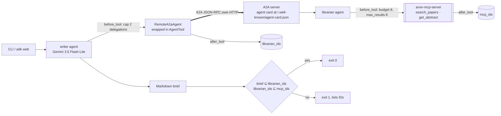
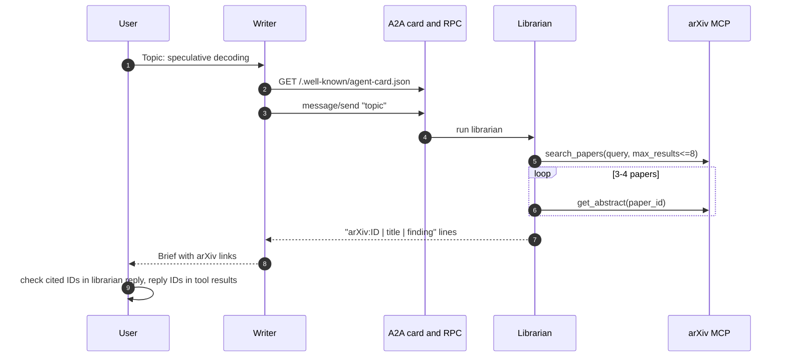

# Day 026 · A2A Duo

> Two ADK agents, one protocol. A **librarian** owns the arXiv tools and is published as an A2A server; a **writer** has no search tools at all and reaches the librarian through its agent card. Every ID in the final brief must trace back, hop by hop, to a real arXiv tool result.

| | |
|---|---|
| **Pattern** | Agent-to-agent (ADK A2A): `to_a2a` server + `RemoteA2aAgent` client |
| **Framework** | Google ADK 2.14 · a2a-sdk 0.3 · Gemini 3.5 Flash-Lite |
| **MCP servers** | [`arxiv-mcp-server`](https://github.com/blazickjp/arxiv-mcp-server) 0.8.2 (librarian side only) |
| **Needs** | Gemini API key · `uv` · no other accounts |
| **Typical run** | not yet measured live (see Cost and performance) |

## Architecture



The arXiv server runs as a stdio subprocess of the **librarian only**. The writer's only capability is "ask the librarian", so the two agents can be deployed, scaled and permissioned separately. For the CLI, the A2A server runs inside the same process on a free localhost port; `python -m a2a_duo serve` runs it on its own.

## How a run works



## Engineering decisions

| Decision | Why |
|---|---|
| **A2A between the agents, MCP only inside the librarian** | MCP is agent-to-tool, A2A is agent-to-agent. The writer depends on a published contract (the agent card), not on the librarian's tools or prompts. |
| **`RemoteA2aAgent` wrapped in `AgentTool`** | The writer stays in control: it calls the librarian like a function and keeps writing. A sub-agent transfer would hand the conversation over and the librarian's raw list would become the answer. |
| **Filter arXiv tools to 2 of ~21** | Only `search_papers` and `get_abstract`; no downloads, local indexes or watches. Smaller prompt, no disk writes. |
| **Pin `arxiv-mcp-server==0.8.2`** | Tool names and schemas change between versions; upgrades should be deliberate. |
| **Two budgets, enforced in `before_tool_callback`** | Librarian: 8 MCP calls, `max_results` capped at 8. Writer: 2 A2A delegations, request text capped at 300 chars. Callbacks are code; prompts are suggestions. |
| **Two-hop evidence check** | Hop 1: every ID the librarian reports must appear in an arXiv tool result (catches a hallucinating librarian). Hop 2: every ID in the brief must appear in the librarian's reply (catches a hallucinating writer). |
| **Writer reads the topic from the chat message** | Nothing about the task is hard-coded in `root_agent`; it asks if no topic is given. |
| **Flash-Lite for both agents** | Retrieval and formatting, not deep reasoning. Override with `GEMINI_MODEL`. |

## Cost and performance

No live Gemini run is included. The API key available when this was built returned `429 RESOURCE_EXHAUSTED` (project spending cap reached), so `examples/sample-output.md` is deliberately absent rather than invented. The A2A transport, agent card resolution, delegation and ledger checks were verified with scripted stand-in models (see Tests); the live test and the CLI still need a run with a working key.

What should drive cost: each delegation costs one extra librarian model session, and the librarian's tool results are fed back to it on every turn, so input tokens will dominate, as in day 001. The delegation cap bounds the worst case at two librarian sessions.

The CLI prints a meter line at the end of every run and `--metrics m.json` writes the same numbers as JSON.

## Failure modes and mitigations

| Failure | Mitigation |
|---|---|
| Librarian invents a paper | Hop-1 check: ID not in any tool result, run exits 1 |
| Writer cites a paper the librarian never sent | Hop-2 check, run exits 1 |
| Writer answers without delegating | `delegated_over_a2a` check fails the run |
| Delegation loop | Cap of 2 A2A calls; callback returns an error telling the writer to finish |
| Tool loop inside the librarian | Budget of 8 MCP calls |
| A2A server down or card unreachable | The call fails fast with a card resolution error rather than hanging the writer |
| Upstream tool rename | Pinned version plus a smoke test of the exact filtered tool list |

## Tests

```bash
uv run pytest -q
```

| Test | What it proves | Needs |
|---|---|---|
| `test_ledger.py` | Budgets, ID extraction, both evidence checks, cost maths | nothing |
| `test_librarian_before_tool_enforces_budget_and_caps_search` | Librarian guardrails | nothing |
| `test_writer_reaches_librarian_over_a2a_and_ledger_traces_ids` | Real A2A over localhost (agent card, JSON-RPC, `RemoteA2aAgent`); only the two LLMs are scripted | nothing |
| `test_arxiv_server_exposes_exactly_the_filtered_tools` | Starts the **real arXiv MCP server** and checks least-privilege filtering | `uvx` |
| `test_live_duo_delegates_over_a2a_with_verified_citations` | End-to-end with Gemini | `GOOGLE_API_KEY` |

## Run it

```bash
cp .env.example .env            # add GOOGLE_API_KEY
uv sync
uv run python -m a2a_duo "speculative decoding for LLM inference" -o brief.md

# or run the two sides separately and chat with the writer
uv run python -m a2a_duo serve --port 8001 &
uv run adk web
```

| Env var | Default | Purpose |
|---|---|---|
| `GOOGLE_API_KEY` | none (required) | Gemini API key, read from `.env`, never committed |
| `GEMINI_MODEL` | `gemini-3.5-flash-lite` | Model for both agents |
| `MAX_TOOL_CALLS` | `8` | Librarian MCP-call budget |
| `LIBRARIAN_URL` | `http://127.0.0.1:8001/.well-known/agent-card.json` | Agent card the `adk web` writer connects to |
| `GEMINI_PRICE_IN` / `GEMINI_PRICE_OUT` | unset | USD per 1M tokens for the cost meter |

## What I'd do next

- Put the librarian behind auth (an A2A security scheme on the agent card) and run it as a separate service.
- Stream the librarian's partial results to the writer instead of waiting for one reply.
- Add a second remote specialist (a fact-checker) and let the writer choose by agent card skills.
