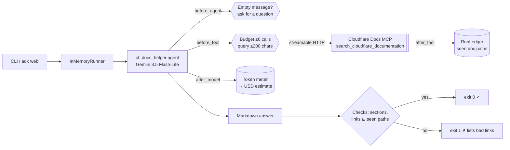
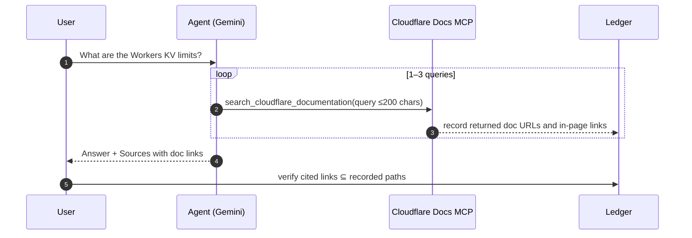

# Day 027 · CF Docs Helper

> Ask a Cloudflare question; it searches the official docs over a **remote MCP server (streamable HTTP, nothing to install)** and answers with links. Then it **verifies every cited doc link against what the server actually returned**, so invented pages fail the run.

| | |
|---|---|
| **Pattern** | Remote MCP over streamable HTTP |
| **Framework** | Google ADK 2.x · Gemini 3.5 Flash-Lite |
| **MCP servers** | [Cloudflare Docs MCP](https://github.com/cloudflare/mcp-server-cloudflare) at `https://docs.mcp.cloudflare.com/mcp` (remote, server `docs-ai-search` 0.5.0 at time of writing) |
| **Needs** | Gemini API key · `uv` · no Cloudflare account |
| **Typical run** | Not yet measured, see [Cost and performance](#cost-and-performance) |

## Architecture



The server is **remote**: `McpToolset` opens an HTTP session to it with `StreamableHTTPConnectionParams`. There is no subprocess to launch, no version to install, and no port to open.

## How a run works



## Engineering decisions

| Decision | Why |
|---|---|
| **Filter tools to 1 of 2** | The server also exposes a Pages-to-Workers migration guide. This agent answers questions, so it only gets `search_cloudflare_documentation`: a smaller prompt and fewer wrong tool choices. |
| **Remote server, so no pin** | There is no package version to pin. The smoke test asserts the exact filtered tool list against the live server, so upstream renames fail loudly in CI. |
| **Budget and argument cap in `before_tool_callback`** | Prompts are suggestions, callbacks are code. Empty queries are rejected for free; over-long ones are truncated to 200 chars; when the budget is gone the model is told to answer with what it has. |
| **Question comes from the conversation** | The agent never hard-codes a product or topic. A `before_agent_callback` answers an empty message with a clarifying question without spending a model call. |
| **Evidence ledger + link check** | Models invent plausible doc paths. A cited `developers.cloudflare.com` link passes only if the server returned that page or a page linked from a result (paths are normalised: no fragment, query or trailing slash). |
| **Flash-Lite by default** | Search-and-summarise needs function calling, not deep reasoning. Override with `GEMINI_MODEL`. |

## Cost and performance

**The live run has not been recorded yet.** The Gemini API key available when this agent was written was rejected with `429 RESOURCE_EXHAUSTED: project has exceeded its monthly spending cap`, so no model call succeeded and `examples/sample-output.md` is deliberately absent rather than invented. Everything that does not need the model (guardrails, ledger, the real MCP server's tool list and a real search call) is tested and passes.

The meter line printed at the end of each run has the form:

```
— <seconds>s · <n> model calls · <used>/<budget> tool calls {<per tool>} · <in> in / <out> out tokens [· ~$<usd>]
```

Expect input tokens to dominate: each search result (a few pages of Markdown) is fed back to the model on the next turn, which is why the query cap and call budget matter. A USD figure appears only when `GEMINI_PRICE_IN` / `GEMINI_PRICE_OUT` are set.

## Failure modes and mitigations

| Failure | Mitigation |
|---|---|
| Model cites a page it never retrieved | Link check fails the run (exit 1) and lists the links |
| Answer has no sources | Run fails: sections and at least one doc link are required |
| Search loop | Hard budget of 6 calls plus a prompt rule against repeat queries |
| Remote server down or slow | MCP timeout 60 s; the run surfaces the error instead of guessing |
| Tool renamed upstream | Smoke test asserts the exact filtered tool list |
| Off-topic question | Prompt tells the agent to say it only covers Cloudflare and not call tools |
| Docs don't cover the question | Prompt requires saying so rather than padding |

## Tests

```bash
uv run pytest -q
```

| Test | What it proves | Needs |
|---|---|---|
| `test_ledger.py` | Budget, cost maths, link normalisation, verification of cited links | nothing |
| `test_before_tool_*`, `test_after_*`, `test_empty_message_*` | Guardrail and meter callbacks, clarifying question | nothing |
| `test_agent_has_one_filtered_remote_tool_...` | One filtered toolset, no hard-coded subject | nothing |
| `test_cloudflare_docs_server_exposes_exactly_the_filtered_tools` | Connects to the **real remote server** and checks least-privilege filtering | network |
| `test_search_returns_doc_urls_the_ledger_can_verify` | A real search returns URLs the ledger recognises | network |
| `test_live_answer_has_sections_and_verified_links` | Full end-to-end run with Gemini | `GOOGLE_API_KEY` with quota |

## Run it

```bash
cp .env.example .env            # add GOOGLE_API_KEY
uv sync
uv run python -m cf_docs_helper "What are the Workers KV limits?" -o answer.md
uv run adk web                  # interactive dev UI: ask any Cloudflare question
```

| Env var | Default | Purpose |
|---|---|---|
| `GOOGLE_API_KEY` | none (required) | Gemini API key, read from `.env` and never committed |
| `GEMINI_MODEL` | `gemini-3.5-flash-lite` | Model used by the agent |
| `GEMINI_PRICE_IN` / `GEMINI_PRICE_OUT` | unset | USD per 1M tokens for the cost meter |
| `MAX_TOOL_CALLS` | `6` | Tool-call budget per run |

## What I'd do next

- Add the server's own page Markdown (every docs page has an `index.md`) via a fetch tool restricted to `developers.cloudflare.com` for fuller answers.
- Check that quoted numbers (limits, prices) appear verbatim in a returned result, not just that links do.
- Add a second MCP session pinned to a docs section (e.g. only `/workers/`) to compare answer quality per tool budget.
